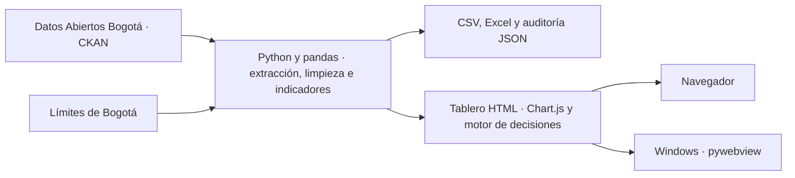

# VacunaBI

**Proyecto final de Inteligencia de Negocios · Universidad Manuela Beltrán**

VacunaBI analiza la cobertura de vacunación en Bogotá D.C. a partir de datos abiertos. El proyecto reúne la extracción de las fuentes, la validación de los datos y la visualización de indicadores en un tablero que puede abrirse en el navegador o como aplicación de Windows.

El análisis responde tres preguntas: qué tan lejos está la cobertura de la meta, en qué localidades y sectores se concentra la brecha y cuántas dosis adicionales harían falta bajo un denominador fijo. En V2.2.3 puedes recorrer los módulos desde la barra lateral y consultar el corte y la procedencia de los datos en cada vista.

## Descargar VacunaBI para Windows

**Última versión estable: V2.2.3** · [⬇ Descargar directamente VacunaBI-Windows.zip](https://github.com/Codeforgeettttt/VacunaBI/releases/download/v2.2.3/VacunaBI-Windows.zip) · [Ver todas las versiones](https://github.com/Codeforgeettttt/VacunaBI/releases/latest)

Descarga el ZIP, extráelo y ejecuta `VacunaBI.exe` desde una carpeta con permisos de escritura. El archivo contiene la versión publicada; no es necesario buscar artefactos en GitHub Actions.

**[Índice de documentación de VacunaBI](docs/INDICE_DOCUMENTACION.md)** — Acceso organizado a los manuales del proyecto.

| Documento | Contenido |
| --- | --- |
| [Manual integral](docs/DOCUMENTACION_INTEGRAL.md) | Problema, objetivos, funcionalidades, metodología y guía de uso |
| [Manual técnico](docs/DOCUMENTACION_TECNICA.md) | Arquitectura, componentes, interfaces, despliegue y pruebas |
| [Casos de uso y diagramas](docs/CASOS_DE_USO_Y_DIAGRAMAS.md) | Catálogo funcional y diagramas Mermaid del sistema |
| [Diccionario y gestión de datos](docs/DICCIONARIO_Y_GESTION_DATOS.md) | Modelo analítico, campos, KPI, linaje y calidad |
| [Proceso ETL](docs/PROCESO_ETL.md) | Extracción CKAN, transformación, publicación y recuperación |
| [Requisitos y plan de pruebas](docs/REQUISITOS_Y_PLAN_PRUEBAS.md) | Requisitos funcionales/no funcionales, aceptación y trazabilidad |

[Descarga directa de V2.2.3](https://github.com/Codeforgeettttt/VacunaBI/releases/download/v2.2.3/VacunaBI-Windows.zip) · [Compilaciones de Windows](https://github.com/Codeforgeettttt/VacunaBI/actions/workflows/windows.yml) · [Metodología de decisiones](docs/DECISIONES.md) · [Historial de cambios](CHANGELOG.md)

## Cómo probar el proyecto

### Aplicación para Windows

1. Descarga [**VacunaBI-Windows.zip — versión estable V2.2.3**](https://github.com/Codeforgeettttt/VacunaBI/releases/download/v2.2.3/VacunaBI-Windows.zip) directamente desde GitHub Releases.
2. Extrae el archivo ZIP en una carpeta con permisos de escritura.
3. Ejecuta `VacunaBI.exe`. La primera carga sin un tablero compatible consulta las fuentes y necesita Internet; para mostrar la interfaz se utiliza Microsoft Edge WebView2.

La **primera ejecución** necesita Internet para descargar ambas fuentes y preparar el tablero. En aperturas posteriores de la **misma versión**, VacunaBI abre de inmediato el tablero guardado **sin repetir la descarga**. El botón **Actualizar datos** es la acción explícita para volver a consultar las dos fuentes y generar cifras nuevas. Desde V2.2.3 ambas fuentes se descargan en paralelo y las páginas CKAN adicionales se solicitan con un límite de dos peticiones simultáneas por fuente. Se preservan los controles de integridad de los registros. La mejora de tiempo depende del servidor y la red; no se afirma una aceleración medida sin una prueba real. Si cambias de versión, el programa necesita generar una copia compatible una vez. Si falla la consulta y existe un tablero válido, conserva esa copia. Desde V2.2.1, la recarga utiliza pywebview sin parámetros en la ruta local.

### Generar el tablero desde el código fuente

Requisitos para esta ruta: Git, Python 3.12 recomendado e Internet para consultar las fuentes.

```bash
git clone https://github.com/Codeforgeettttt/VacunaBI.git
cd VacunaBI
python -m venv .venv
```

Activa el entorno virtual en PowerShell con `.\.venv\Scripts\Activate.ps1` o en Linux y macOS con `source .venv/bin/activate`. Luego instala las dependencias y genera el tablero.

```bash
python -m pip install -r requirements.txt
python etl.py
```

Abre `salidas/dashboard.html` en el navegador. El archivo incluye los gráficos y los datos de esa ejecución. Para consultar datos nuevos desde esta modalidad, vuelve a ejecutar el ETL.

## Recorrido del tablero

| Vista | Qué puedes revisar |
| --- | --- |
| **Resumen general** | Cobertura de primera infancia, brecha frente a la meta, evolución anual por biológico y avance mensual acumulado. |
| **Localidades** | Mapa de las 20 localidades de Bogotá, ranking, matriz localidad–sector, comparación entre dos localidades y ficha territorial en CSV. |
| **Sectores y biológicos** | Cobertura por sector institucional y por grupo de biológicos en la población de seguimiento. |
| **Calidad de datos** | Corte de cada fuente, registros aceptados, descartados y observados e historial de actualizaciones. |
| **Decisiones** | Ranking con pesos ajustables, comparación de dos escenarios de dosis, alertas y reporte ejecutivo en CSV. |
| **Metodología** | Definiciones de los indicadores, procedencia de los datos y criterios de interpretación. |

Para una demostración, abre **Localidades**, selecciona una zona en el mapa y compárala con otra bajo el mismo corte. La ficha indica las dosis, el denominador y si hay observaciones de calidad. Luego pasa a **Decisiones**, cambia el peso de la brecha y compara un escenario de cero dosis adicionales con uno que represente una meta operativa. Puedes regresar a un paso anterior sin perder los valores. El CSV ejecutivo conserva el contexto de esa selección.

Selecciona **Fuente**, año y localidad en la barra principal. El año indica si hay registros distritales, sectoriales o de ambos orígenes. **Más filtros** reúne biológico y sector. Si una combinación no está publicada, VacunaBI lo explica y propone ajustar la consulta: **sin registros no significa cobertura del 0 %**. [Guía de compatibilidad de fuentes y filtros](docs/FILTROS_FUENTES.md). Las opciones Histórico, Actual y Comparativo están en **Evolución de cobertura**, dentro de Resumen. **Consultar datos de la selección** permite buscar, ordenar y exportar filas en CSV o Excel. **Consultar tabla del gráfico** permite leer los valores con teclado.

## Fuentes, indicadores y alcance

| Fuente | Uso en el proyecto | Identificador |
| --- | --- | --- |
| Seguimiento de cobertura por sectores | Cobertura por localidad, sector y biológico para el corte sectorial. | `e519cce2-9951-41de-afbc-005d1e1d24dd` |
| Cobertura mensual de vacunación de Bogotá D.C. | Serie distrital, avance mensual y comparación de años cerrados. | `1910589c-2836-41d3-aba4-00488bb5e5f3` |
| Límites oficiales de localidades | Geometría del mapa territorial. | [Procedencia y preparación](docs/DATOS_TERRITORIALES.md) |

Los dos recursos de vacunación se consultan mediante la API CKAN del [Portal de Datos Abiertos Bogotá](https://datosabiertos.bogota.gov.co/). El tablero trabaja con datos agregados. Cada fuente tiene su propio corte y población de seguimiento, por lo que una comparación territorial y una tendencia distrital pueden corresponder a fechas distintas.

- **Cobertura.** Dosis aplicadas divididas por la población objetivo, multiplicadas por 100. Para agregar grupos se suman las dosis y los denominadores antes de calcular el porcentaje.
- **Brecha.** Diferencia en puntos porcentuales frente a la meta de referencia del 95 %. Para priorizar se toma la parte de la brecha que queda por debajo de la meta.
- **Dosis adicionales.** Cantidad entera necesaria para alcanzar la meta con el denominador observado. El ranking pondera la brecha relativa y las dosis faltantes normalizadas respecto al mayor valor de la selección.

Las coberturas superiores al 100 % quedan señaladas para revisión. La diferencia de cobertura entre etapas del esquema no mide por sí sola el abandono individual. Los escenarios A y B estiman qué cobertura resultaría al sumar una cantidad de dosis al mismo indicador con un denominador fijo. El reporte identifica estos resultados como simulaciones aritméticas.

**Cargar registros manuales** permite ensayar ajustes mediante una plantilla CSV del último corte sectorial. La vista previa es temporal, las filas manuales se identifican en las exportaciones de exploración y el análisis de **Decisiones** utiliza los registros oficiales.

## Arquitectura y resultados



| Archivo | Responsabilidad |
| --- | --- |
| [`etl.py`](etl.py) | Consulta las fuentes, aplica reglas de calidad, calcula indicadores y publica las salidas. |
| [`dashboard_template.html`](dashboard_template.html) | Estructura HTML y puntos de integración del dashboard autónomo. |
| [`frontend/charts.js`](frontend/charts.js) | Gráficos iniciales e indicadores de visualización. |
| [`frontend/dashboard.js`](frontend/dashboard.js) | Interacciones, filtros, mapa y exportaciones del tablero. |
| [`frontend/`](frontend/) | CSS, navegación y componentes reutilizables; se integran en el HTML generado. |
| [`decisiones.js`](decisiones.js) | Cálculos de brecha, prioridades, alertas y escenarios. |
| [`app.py`](app.py) | Ventana de escritorio y actualización de los datos desde Windows. |
| [`localidades.json`](localidades.json) | Límites simplificados de las 20 localidades para visualización. |

El ETL guarda las consultas originales (`crudo_sectores.csv` y `crudo_mensual.csv`), los datos tratados (`hechos_sectores.csv`, `cobertura_anual.csv` y `base_consolidada.xlsx`), los indicadores (`kpis.json`), la auditoría (`auditoria.json`) y el tablero (`dashboard.html`). Las salidas se generan en `salidas/` y se excluyen del control de versiones. El proceso valida ambas fuentes antes de publicar y conserva la última publicación válida si falla la actualización. [Diccionario de calidad y trazabilidad](docs/CALIDAD_DATOS.md)

## Pruebas y mantenimiento

Con las dependencias de Python instaladas, ejecuta los siguientes comandos. Las pruebas de decisiones requieren Node.js y las suites se ejecutan sin consultar la API.

```bash
python test_etl.py
python -m unittest -v test_etl_regression test_dashboard_template test_app_export
node --test test_decisiones.cjs test_frontend.cjs
```

Para compilar la aplicación desde Windows con las mismas versiones de empaquetado de GitHub Actions, usa PowerShell.

```powershell
python -m pip install pyinstaller==6.22.3 pywebview==5.3.2
python -m PyInstaller --onefile --windowed --name VacunaBI `
  --add-data "dashboard_template.html:." --add-data "chart.umd.min.js:." `
  --add-data "frontend:frontend" `
  --add-data "localidades.json:." --add-data "decisiones.js:." app.py
```

El ejecutable queda en `dist/VacunaBI.exe`. Para abrir la aplicación sin compilar, instala `pywebview==5.3.2` y ejecuta `python app.py`.

Al exportar desde Windows, VacunaBI abre un selector de guardado y anuncia si el archivo se guardó, se canceló o no pudo escribirse. En el navegador se usa la descarga habitual. [Verificación de V2.2](docs/V2.2_VALIDACION.md) · [Validación manual y accesibilidad de Windows](docs/VALIDACION_WINDOWS.md)

GitHub Actions ejecuta las pruebas en cada push a `main`. La actualización del tablero está programada a las 06:00, hora de Colombia, y también se puede lanzar manualmente. Cuando termina correctamente deja el artefacto `VacunaBI-Dashboard`. La publicación en GitHub Pages es opcional y se controla mediante `ENABLE_PAGES`. [Flujo de actualización](.github/workflows/actualizar.yml) · [Compilación de Windows](.github/workflows/windows.yml) · [Roadmap](docs/ROADMAP.md)

## Equipo

- [Valery Michell Herrera Roca](https://github.com/Codeforgeettttt)
- [Daniel Felipe Rojas González](https://github.com/Dani2026403)
- [Julián Andrés Peñuela Alfonso](https://github.com/julianpenuelaalfonso-fullstack)
