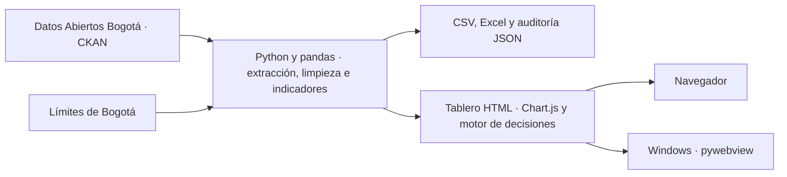

# VacunaBI

**Proyecto final de Inteligencia de Negocios · Universidad Manuela Beltrán**

VacunaBI analiza la cobertura de vacunación en Bogotá D.C. a partir de datos abiertos. El proyecto reúne la extracción de las fuentes, la validación de los datos y la visualización de indicadores en un tablero que puede abrirse en el navegador o como aplicación de Windows.

El análisis responde tres preguntas: qué tan lejos está la cobertura de la meta, en qué localidades y sectores se concentra la brecha y cuántas dosis adicionales harían falta bajo un denominador fijo. La versión 2.1 reúne estas preguntas en un resumen y guía el análisis en la vista **Decisiones**.

[Compilaciones de VacunaBI para Windows](https://github.com/Codeforgeettttt/VacunaBI/actions/workflows/windows.yml) · [Metodología de decisiones](docs/DECISIONES.md) · [Historial de cambios](CHANGELOG.md)

## Cómo probar el proyecto

### Aplicación para Windows

1. Abre la última ejecución exitosa del [flujo de compilación de Windows](https://github.com/Codeforgeettttt/VacunaBI/actions/workflows/windows.yml) en GitHub Actions e inicia sesión si GitHub lo pide.
2. En **Artifacts**, descarga **VacunaBI-Windows** y extrae el ZIP.
3. Ejecuta `VacunaBI.exe` desde una carpeta donde puedas escribir. La aplicación consulta las fuentes al abrir y utiliza Microsoft Edge WebView2 para mostrar el tablero.

La primera ejecución requiere conexión a Internet. **Actualizar datos** vuelve a consultar la API. Si falla la actualización y existe un tablero válido guardado, la aplicación muestra esa copia.

### Generar el tablero desde el código fuente

Requisitos para esta ruta: Git, Python 3.12 recomendado e Internet para consultar las fuentes.

```bash
git clone https://github.com/Codeforgeettttt/VacunaBI.git
cd VacunaBI
python -m venv .venv
```

Activa el entorno virtual en PowerShell con `.\.venv\Scripts\Activate.ps1` o en Linux y macOS con `source .venv/bin/activate`. Luego instala las dependencias y genera el tablero.

```bash
python -m pip install -r requirements.txt
python etl.py
```

Abre `salidas/dashboard.html` en el navegador. El archivo incluye los gráficos y los datos de esa ejecución. Para consultar datos nuevos desde esta modalidad, vuelve a ejecutar el ETL.

## Recorrido del tablero

| Vista | Qué puedes revisar |
| --- | --- |
| **Resumen general** | Cobertura de primera infancia, brecha frente a la meta, evolución anual por biológico y avance mensual acumulado. |
| **Localidades** | Mapa de las 20 localidades de Bogotá, ranking, matriz localidad–sector, comparación entre dos localidades y ficha territorial en CSV. |
| **Sectores y biológicos** | Cobertura por sector institucional y por grupo de biológicos en la población de seguimiento. |
| **Calidad de datos** | Corte de cada fuente, registros aceptados, descartados y observados e historial de actualizaciones. |
| **Decisiones** | Ranking con pesos ajustables, comparación de dos escenarios de dosis, alertas y reporte ejecutivo en CSV. |
| **Metodología** | Definiciones de los indicadores, procedencia de los datos y criterios de interpretación. |

Para una demostración, abre **Localidades**, selecciona una zona en el mapa y compárala con otra bajo el mismo corte. Luego pasa a **Decisiones**, cambia el peso de la brecha y compara un escenario de cero dosis adicionales con uno que represente una meta operativa. El CSV ejecutivo conserva el contexto de esa selección.

Selecciona año y localidad en la barra principal. **Más filtros** reúne biológico y sector. Las opciones Histórico, Actual y Comparativo están en **Evolución de cobertura**, dentro de Resumen. **Consultar datos de la selección** permite buscar, ordenar y exportar filas en CSV o Excel. **Consultar tabla del gráfico** permite leer los valores con teclado.

## Fuentes, indicadores y alcance

| Fuente | Uso en el proyecto | Identificador |
| --- | --- | --- |
| Seguimiento de cobertura por sectores | Cobertura por localidad, sector y biológico para el corte sectorial. | `e519cce2-9951-41de-afbc-005d1e1d24dd` |
| Cobertura mensual de vacunación de Bogotá D.C. | Serie distrital, avance mensual y comparación de años cerrados. | `1910589c-2836-41d3-aba4-00488bb5e5f3` |
| Límites oficiales de localidades | Geometría del mapa territorial. | [Procedencia y preparación](docs/DATOS_TERRITORIALES.md) |

Los dos recursos de vacunación se consultan mediante la API CKAN del [Portal de Datos Abiertos Bogotá](https://datosabiertos.bogota.gov.co/). El tablero trabaja con datos agregados. Cada fuente tiene su propio corte y población de seguimiento, por lo que una comparación territorial y una tendencia distrital pueden corresponder a fechas distintas.

- **Cobertura.** Dosis aplicadas divididas por la población objetivo, multiplicadas por 100. Para agregar grupos se suman las dosis y los denominadores antes de calcular el porcentaje.
- **Brecha.** Diferencia en puntos porcentuales frente a la meta de referencia del 95 %. Para priorizar se toma la parte de la brecha que queda por debajo de la meta.
- **Dosis adicionales.** Cantidad entera necesaria para alcanzar la meta con el denominador observado. El ranking pondera la brecha relativa y las dosis faltantes normalizadas respecto al mayor valor de la selección.

Las coberturas superiores al 100 % quedan señaladas para revisión. La diferencia de cobertura entre etapas del esquema no mide por sí sola el abandono individual. Los escenarios A y B estiman qué cobertura resultaría al sumar una cantidad de dosis al mismo indicador con un denominador fijo. El reporte identifica estos resultados como simulaciones aritméticas.

**Cargar registros manuales** permite ensayar ajustes mediante una plantilla CSV del último corte sectorial. La vista previa es temporal, las filas manuales se identifican en las exportaciones de exploración y el análisis de **Decisiones** utiliza los registros oficiales.

## Arquitectura y resultados



| Archivo | Responsabilidad |
| --- | --- |
| [`etl.py`](etl.py) | Consulta las fuentes, aplica reglas de calidad, calcula indicadores y publica las salidas. |
| [`dashboard_template.html`](dashboard_template.html) | Interfaz, filtros, mapa, gráficos y exportaciones de la selección. |
| [`decisiones.js`](decisiones.js) | Cálculos de brecha, prioridades, alertas y escenarios. |
| [`app.py`](app.py) | Ventana de escritorio y actualización de los datos desde Windows. |
| [`localidades.json`](localidades.json) | Límites simplificados de las 20 localidades para visualización. |

El ETL guarda las consultas originales (`crudo_sectores.csv` y `crudo_mensual.csv`), los datos tratados (`hechos_sectores.csv`, `cobertura_anual.csv` y `base_consolidada.xlsx`), los indicadores (`kpis.json`), la auditoría (`auditoria.json`) y el tablero (`dashboard.html`). Las salidas se generan en `salidas/` y se excluyen del control de versiones. El proceso valida ambas fuentes antes de publicar y conserva la última publicación válida si falla la actualización. [Diccionario de calidad y trazabilidad](docs/CALIDAD_DATOS.md)

## Pruebas y mantenimiento

Con las dependencias de Python instaladas, ejecuta los siguientes comandos. Las pruebas de decisiones requieren Node.js y las suites se ejecutan sin consultar la API.

```bash
python test_etl.py
python -m unittest -v test_etl_regression test_dashboard_template
node --test test_decisiones.cjs
```

Para compilar la aplicación desde Windows con las mismas versiones de empaquetado de GitHub Actions, usa PowerShell.

```powershell
python -m pip install pyinstaller==6.22.3 pywebview==5.3.2
python -m PyInstaller --onefile --windowed --name VacunaBI `
  --add-data "dashboard_template.html:." --add-data "chart.umd.min.js:." `
  --add-data "frontend:frontend" `
  --add-data "localidades.json:." --add-data "decisiones.js:." app.py
```

El ejecutable queda en `dist/VacunaBI.exe`. Para abrir la aplicación sin compilar, instala `pywebview==5.3.2` y ejecuta `python app.py`.

GitHub Actions ejecuta las pruebas en cada push a `main`. La actualización del tablero está programada a las 06:00, hora de Colombia, y también se puede lanzar manualmente. Cuando termina correctamente deja el artefacto `VacunaBI-Dashboard`. La publicación en GitHub Pages es opcional y se controla mediante `ENABLE_PAGES`. [Flujo de actualización](.github/workflows/actualizar.yml) · [Compilación de Windows](.github/workflows/windows.yml) · [Roadmap](docs/ROADMAP.md)

## Equipo

- [Valery Michell Herrera Roca](https://github.com/Codeforgeettttt)
- [Daniel Felipe Rojas González](https://github.com/Dani2026403)
- [Julián Andrés Peñuela Alfonso](https://github.com/julianpenuelaalfonso-fullstack)

VacunaBI continúa el [proyecto original de cobertura de vacunación](https://github.com/julianpenuelaalfonso-fullstack/Proyecto_vacunacion). En esa primera entrega, Julián desarrolló el ETL, el tablero y la aplicación de escritorio. Valery y Daniel participaron en las pruebas.
