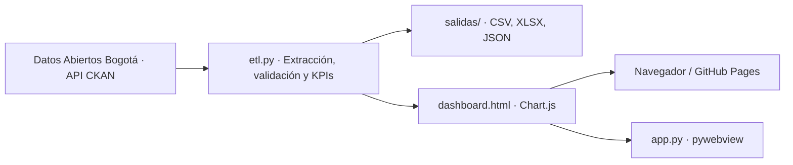

# VacunaBI 💉

**Dashboard de cobertura de vacunación en Bogotá D.C.**, con procesos de extracción y transformación de datos, indicadores de cobertura y visualizaciones de apoyo al análisis territorial.


## ¿Qué hace?

VacunaBI consulta dos recursos públicos de la **API CKAN de Datos Abiertos Bogotá**, procesa la información con Python, calcula indicadores y genera un dashboard de consulta. Puede utilizarse desde un navegador o dentro de una ventana de escritorio mediante pywebview.

Su enfoque actual es **Bogotá D.C.**; la compatibilidad con otras regiones aún no está implementada. El proyecto trabaja con datos agregados y está orientado a la exploración y el análisis de información de vacunación.

## Funcionalidades disponibles

| Módulo | Funciones |
| --- | --- |
| Resumen | Indicadores de cobertura de primera infancia, brecha frente a la meta del 95 %, comparación de triple viral y dosis adicionales estimadas |
| Histórico | Evolución anual de cobertura por biológico y avance acumulado del año disponible |
| Localidades | Ranking de primera infancia y matriz de calor localidad × sector |
| Sectores y biológicos | Comparaciones por sector institucional y grupo de biológico |
| Calidad de datos | Registro de validaciones y transformaciones del ETL |
| Metodología | Definiciones y contexto de interpretación de indicadores |
| Datos | Exportación generada por el ETL en CSV, Excel, JSON y HTML |
| Escritorio | Ventana de aplicación mediante pywebview y opción de compilación para Windows |

La **V1.1** introduce navegación modular y un sistema visual renovado; todavía está en validación visual. Los filtros globales, mapas geográficos, escenarios y alertas avanzadas son funcionalidades futuras.

## Arquitectura



### Tecnologías

- **Python + pandas:** consultas, limpieza, normalización, cálculos y generación del dashboard.
- **openpyxl:** generación de archivos Excel.
- **HTML, CSS, JavaScript y Chart.js:** presentación de indicadores y gráficos.
- **pywebview:** aplicación de escritorio.
- **PyInstaller:** empaquetado opcional para Windows.
- **GitHub Actions:** pruebas y actualización automatizada del dashboard.

### Archivos del proyecto

```text
VacunaBI/
├── .github/workflows/actualizar.yml  # Pruebas, ETL y publicación opcional
├── app.py                             # Ventana de aplicación
├── etl.py                             # Fuentes, procesamiento y KPIs
├── dashboard_template.html            # Interfaz y gráficos
├── chart.umd.min.js                   # Chart.js local
├── requirements.txt                   # Dependencias de procesamiento
├── test_etl.py                        # Pruebas del ETL
├── test_etl_regression.py             # Pruebas de regresión
├── test_dashboard_template.py         # Comprobaciones de interfaz
├── docs/                              # Especificaciones técnicas por versión
├── CHANGELOG.md                       # Cambios publicados
└── salidas/                            # Archivos generados; ignorados por Git
```

## Instalación y ejecución

**Requisitos:** Python 3.12 recomendado, Git y conexión a Internet para consultar las fuentes.

### 1. Descargar y preparar el entorno

```bash
git clone https://github.com/Codeforgeettttt/VacunaBI.git
cd VacunaBI
python -m venv .venv
```

Activar el entorno virtual:

**Windows (PowerShell):**

```powershell
.\.venv\Scripts\Activate.ps1
```

**Linux / macOS:**

```bash
source .venv/bin/activate
```

Instalar dependencias:

```bash
python -m pip install -r requirements.txt
```

### 2. Ejecutar las pruebas

```bash
python test_etl.py
python -m unittest -v test_etl_regression test_dashboard_template
```

Las pruebas de limpieza e interfaz estructural no requieren conexión a Internet.

### 3. Generar y abrir el dashboard

```bash
python etl.py
```

Al terminar, abre **`salidas/dashboard.html`** en un navegador moderno. El archivo incorpora los datos procesados y la librería Chart.js necesaria para presentar los gráficos.

### 4. Ejecutar como aplicación de escritorio

```bash
python -m pip install pywebview==5.3.2
python app.py
```

`app.py` ejecuta el ETL antes de cargar el dashboard. En Windows utiliza el motor web disponible en el sistema (habitualmente WebView2).

### 5. Compilar un ejecutable para Windows (opcional)

```powershell
python -m pip install pyinstaller pywebview==5.3.2
pyinstaller --onefile --windowed --name VacunaBI --add-data "dashboard_template.html;." --add-data "chart.umd.min.js;." app.py
```

El ejecutable se genera dentro de `dist/`.

GitHub Actions también compila el ejecutable cuando cambian los archivos de la aplicación en `main`. Para obtenerlo, abre [VacunaBI · ejecutable de Windows](https://github.com/Codeforgeettttt/VacunaBI/actions/workflows/windows.yml), selecciona una ejecución exitosa y descarga el artefacto `VacunaBI-Windows`. Extrae el ZIP y ejecuta `VacunaBI.exe` desde una carpeta donde puedas escribir.

## Fuentes y datos generados

**Endpoint CKAN:** `https://datosabiertos.bogota.gov.co/api/3/action/datastore_search`

| Fuente | ID de recurso |
| --- | --- |
| Seguimiento de cobertura por sectores | `e519cce2-9951-41de-afbc-005d1e1d24dd` |
| Cobertura mensual de vacunación de Bogotá D.C. | `1910589c-2836-41d3-aba4-00488bb5e5f3` |

`python etl.py` crea dentro de `salidas/`: `crudo_sectores.csv`, `crudo_mensual.csv`, `hechos_sectores.csv`, `cobertura_anual.csv`, `base_consolidada.xlsx`, `kpis.json` y `dashboard.html`.

La carpeta `salidas/` no se versiona. Los datos generados dependen de la vigencia y disponibilidad de las fuentes.

### Indicadores

```text
Cobertura (%)       = dosis aplicadas / población objetivo × 100
Brecha (pp)         = 95 − cobertura
Variación anual (pp)= cobertura actual − cobertura del año anterior
```

Las comparaciones deben utilizar periodos, biológicos y denominadores compatibles. Las coberturas superiores al 100 % se identifican para revisión y las diferencias entre etapas del esquema no deben interpretarse automáticamente como abandono individual.

## Automatización

El workflow [`actualizar.yml`](.github/workflows/actualizar.yml) separa dos actividades:

- **En cada push a `main`:** ejecuta las pruebas de la aplicación y del ETL, sin consultar la API externa.
- **Diariamente a las 11:00 UTC** (06:00 hora de Colombia): ejecuta las pruebas y, si pasan, descarga los datos y regenera el dashboard.
- **Manualmente desde Actions:** permite solicitar una actualización completa del dashboard.

Así, una caída o demora de la API pública no marca como fallido un commit cuyo código y pruebas son correctos.

**Publicación opcional en GitHub Pages:** selecciona *Settings → Pages → Source: GitHub Actions* y configura la variable de repositorio `ENABLE_PAGES=true` en *Settings → Secrets and variables → Actions → Variables*. Si no está habilitada, las pruebas y la actualización pueden seguir ejecutándose sin desplegar el sitio.

## Roadmap

| Versión | Objetivo | Estado |
| --- | --- | --- |
| **V1.0** | ETL, KPIs, dashboard y aplicación de escritorio | Base integrada |
| **V1.1** | Rediseño UI/UX y navegación modular | Primera iteración; validación pendiente |
| **V1.2** | Filtros globales, comparaciones y exportaciones desde la interfaz | Planificada |
| **V1.3** | Mapa geográfico y fichas territoriales | Planificada |
| **V1.4** | Trazabilidad y calidad de datos ampliada | Planificada |
| **V1.5** | Rendimiento, accesibilidad y pruebas | Planificada |
| **V2.0** | Priorización, simulaciones y alertas explicables | Planificada |

Detalles de desarrollo: [V1.0](docs/V1.0_BASELINE.md) · [V1.1](docs/V1.1_UI_UX.md) · [Roadmap técnico](docs/ROADMAP.md) · [Cambios](CHANGELOG.md).

## Equipo

VacunaBI continúa el trabajo de la [versión original del proyecto](https://github.com/julianpenuelaalfonso-fullstack/Proyecto_vacunacion). En esa primera entrega, Julián desarrolló el ETL, el dashboard y la aplicación de escritorio. Valery y Daniel participaron en las pruebas de la aplicación.

- [Valery Michell Herrera Roca · @Codeforgeettttt](https://github.com/Codeforgeettttt)
- [Daniel Felipe Rojas González · @Dani2026403](https://github.com/Dani2026403)
- [Julián Andrés Peñuela Alfonso · @julianpenuelaalfonso-fullstack](https://github.com/julianpenuelaalfonso-fullstack)

---

**VacunaBI** · Proyecto de análisis y visualización de coberturas de vacunación con datos abiertos de Bogotá.
