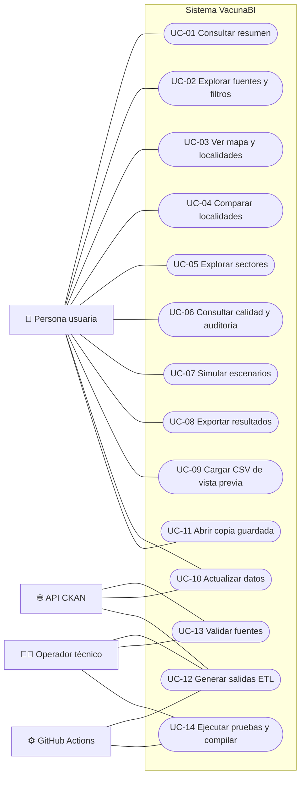
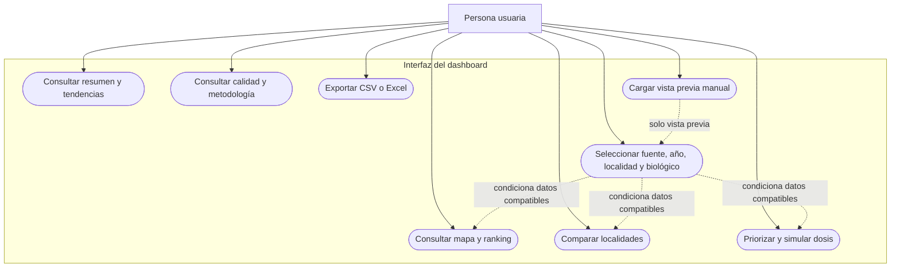
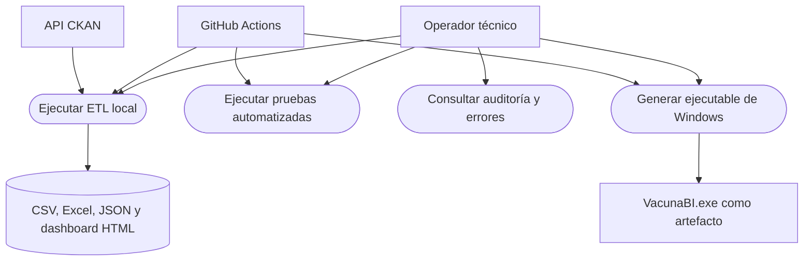
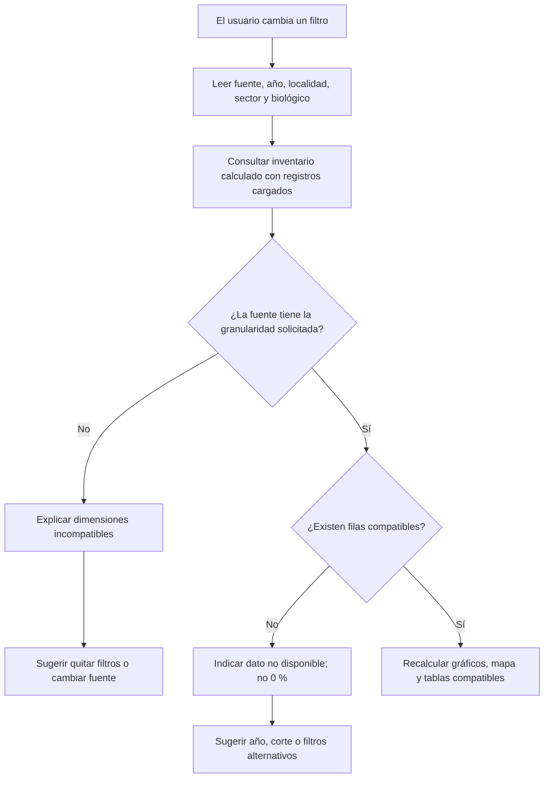
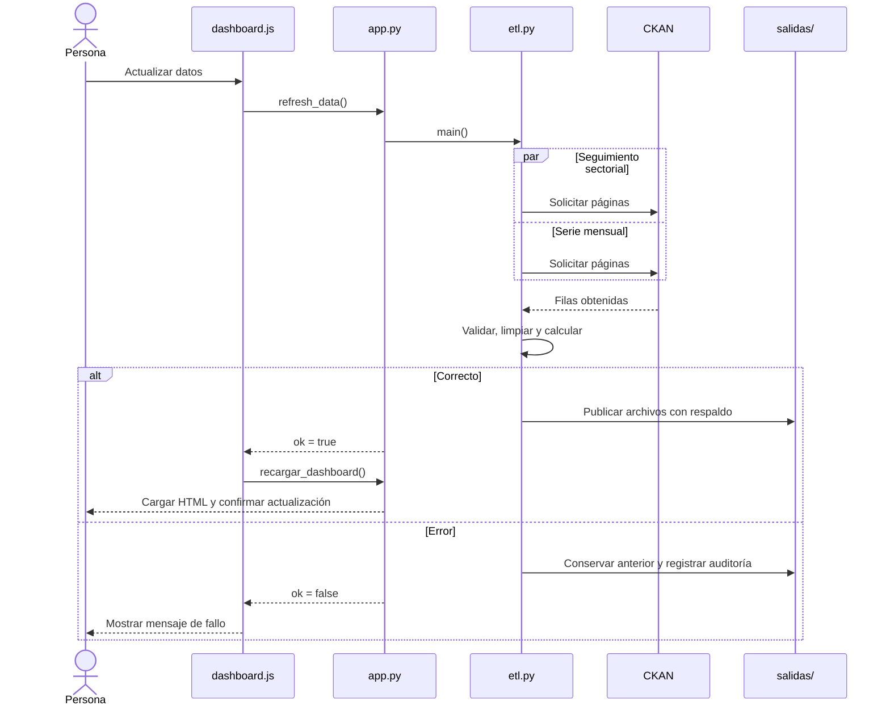
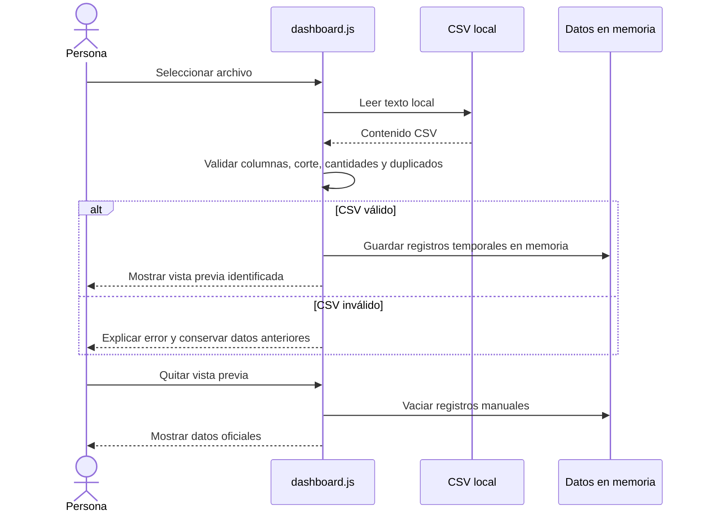
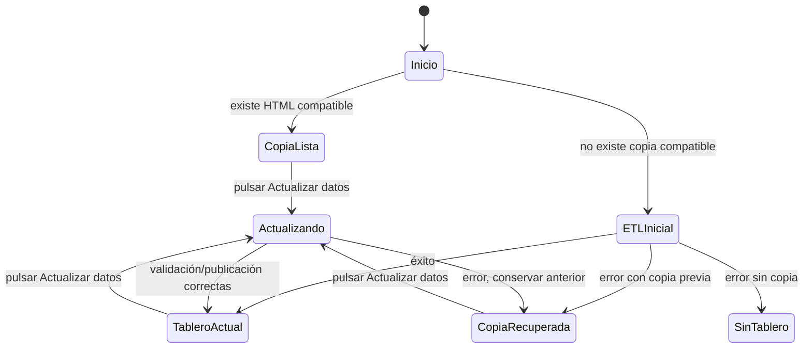

# Casos de uso y diagramas de VacunaBI

**Versión:** 2.2.3 · **Tipo:** especificación funcional y modelos de comportamiento  
**Base:** `dashboard_template.html`, `frontend/dashboard.js`, `frontend/availability.js`, `frontend/navigation.js`, `frontend/stages.js`, `decisiones.js`, `app.py` y `etl.py`.

> Los diagramas están escritos en **Mermaid**, para que GitHub los muestre directamente en este Markdown. Los diagramas de casos de uso usan nodos ovalados con notación de flujo, una representación visual equivalente para la lectura; **no son un diagrama UML de casos de uso formal generado por una herramienta UML**. Las especificaciones textuales de casos de uso son el contrato funcional de referencia.

## 1. Alcance, actores y convenciones

El sistema se utiliza principalmente desde un dashboard HTML y, opcionalmente, desde el ejecutable para Windows. Los actores que aparecen a continuación son **personas y sistemas que interactúan con la solución**, no roles autenticados.

| Actor | Descripción | Actividades que realiza |
| --- | --- | --- |
| **Persona usuaria / analista** | Consulta indicadores desde HTML o Windows | Navegar, filtrar, comparar, simular, exportar |
| **Operador técnico** | Mantiene y ejecuta el proyecto | Generar salidas, revisar auditoría, ejecutar pruebas |
| **API CKAN** | Sistema externo de Datos Abiertos Bogotá | Entregar los dos recursos paginados |
| **GitHub Actions** | Servicio externo de automatización | Ejecutar pruebas, ETL programado y compilación |

**Límite:** ni «analista» ni «operador» deben interpretarse como cuentas del sistema. VacunaBI no implementa login, perfil administrador ni permisos por usuario.

## 2. Diagrama general de casos de uso

**Interpretación de la relación entre casos:** para consultar mapa, comparar o simular, primero debe existir un tablero generado con información compatible. Las funciones de consulta usan un mismo conjunto de filtros, pero no se trata de operaciones de escritura sobre la fuente pública.

### 2.1. Diagrama funcional para el usuario

### 2.2. Diagrama de operación técnica

La programación de GitHub Actions no convierte al operador en usuario de un panel de administración. Es una operación de integración continua del repositorio.

## 3. Catálogo de casos de uso del sistema

| ID | Caso de uso | Actor principal | Evidencia de implementación |
| --- | --- | --- | --- |
| UC-01 | Consultar resumen e indicadores | Persona usuaria | Vista `resumen`, `charts.js` |
| UC-02 | Aplicar filtros compatibles | Persona usuaria | `availability.js` y `dashboard.js` |
| UC-03 | Revisar mapa y ranking de localidades | Persona usuaria | Vista `localidades` |
| UC-04 | Comparar localidades del mismo corte | Persona usuaria | Ficha territorial y selector de comparación |
| UC-05 | Explorar sectores, biológicos y matriz | Persona usuaria | Vista `sectores` y mapa de calor |
| UC-06 | Consultar calidad, fuente y auditoría | Persona usuaria | Vista `calidad` |
| UC-07 | Priorizar y simular dosis adicionales | Persona usuaria | `decisiones.js` y cuatro etapas |
| UC-08 | Exportar CSV, XLSX y reporte | Persona usuaria | `dashboard.js`, `tables.js`, `app.py` |
| UC-09 | Cargar y retirar CSV de vista previa | Persona usuaria | `parsePreview()` y eventos de `manual-file` |
| UC-10 | Actualizar datos en Windows | Persona usuaria | `Actualizacion.refresh_data()` |
| UC-11 | Abrir copia compatible / recuperada | Persona usuaria | `cargar()` y `hay_tablero_compatible()` |
| UC-12 | Generar salidas desde Python | Operador técnico / workflow | `etl.main()` y `guardar_salidas()` |
| UC-13 | Comprobar integridad de fuentes | ETL frente a CKAN | `consultar_api()` y limpieza |
| UC-14 | Ejecutar pruebas y construir ZIP | Operador / workflow | Workflows y tests |
| UC-15 | Consultar metodología | Persona usuaria | Vista `metodologia` |
| UC-16 | Consultar tabla y búsqueda de resultados | Persona usuaria | Tabla con paginación, orden y búsqueda |
| UC-17 | Cambiar tema y abrir gráfico ampliado | Persona usuaria | Controles de UI y diálogo de gráfico |
| UC-18 | Descargar ficha territorial | Persona usuaria | `territory-export` |
| UC-19 | Revisar alerta y reporte ejecutivo | Persona usuaria | Vista `decisiones`, reporte CSV |

No se incluyen casos como «registrar pacientes», «autorizar vacunas», «administrar usuarios» o «modificar la API CKAN» porque **no existen en el producto**.

## 4. Casos de uso extendidos

### UC-01. Consultar resumen e indicadores

| Campo | Especificación |
| --- | --- |
| Objetivo | Interpretar la cobertura y la brecha frente a la meta en una vista general |
| Actor | Persona usuaria |
| Disparador | Abrir VacunaBI o entrar en **Resumen** |
| Precondición | Existe un `dashboard.html` generado |
| Resultado | Se muestran indicadores y gráficas del contexto disponible |
| Implementación | `dashboard_template.html`, `charts.js`, `navigation.js` |

**Flujo principal:** (1) el usuario abre Resumen; (2) el sistema muestra fecha de generación y las fuentes; (3) se ven indicadores y evolución; (4) el usuario elige modo histórico, actual o comparativo; (5) la vista presenta registros compatibles.

**Alternativas:** si el año no tiene filas de una fuente, se muestra un aviso; si se intenta una comparación sin dos años cerrados comparables, no se debe fabricar una tendencia.

**Regla:** una cobertura agrupada procede de numeradores y denominadores, no del promedio simple de porcentajes.

### UC-02. Filtrar por fuente, año y granularidad

| Campo | Especificación |
| --- | --- |
| Objetivo | Mostrar información solo de combinaciones existentes |
| Actor | Persona usuaria |
| Disparador | Cambiar Fuente, Año, Localidad, Biológico o Sector |
| Precondición | El dashboard tiene el inventario de registros incrustado |
| Resultado | Gráficos/tablas compatibles y estado explicativo |
| Implementación | `VacunaDisponibilidad.inspect()` y `render()` |

**Flujo principal:** (1) el usuario cambia un selector; (2) el sistema identifica fuente y año; (3) comprueba dimensiones soportadas; (4) recalcula las vistas; (5) actualiza el texto de disponibilidad.

**Alternativa A — fuente incompatible:** aparece un mensaje de granularidad y una acción para quitar filtros o consultar la fuente apropiada.

**Alternativa B — periodo sin registros:** se indica que no hay filas sectoriales o distritales para ese año y se ofrece otra selección.

**Postcondición:** la ausencia de datos **no se interpreta como un 0 %**. Un filtro no realiza una petición nueva a CKAN.

### UC-03. Consultar el mapa y ranking territorial

**Actor:** persona usuaria. **Precondición:** datos del seguimiento sectorial compatibles con el corte y los filtros.

1. Entrar en **Localidades**.
2. Examinar mapa de las 20 localidades y ranking.
3. Seleccionar una localidad en el mapa o selector.
4. Revisar cobertura, dosis, denominador y fecha de corte.
5. Opcionalmente consultar la ficha territorial.

**Alternativa:** territorios sin filas compatibles se presentan sin dato; la geometría del mapa no aporta cobertura por sí sola.

**Resultado:** el mapa, la ficha y el ranking se mantienen dentro del mismo contexto sectorial.

### UC-04. Comparar dos localidades

**Actor:** persona usuaria. **Precondición:** dos localidades con datos compatibles.

1. Seleccionar la primera localidad.
2. Elegir otra localidad mediante **Comparar con otra localidad**.
3. El sistema agrupa datos de ambas bajo las mismas dimensiones.
4. Presenta valores y diferencia en puntos porcentuales.
5. Opcionalmente se descarga la ficha territorial.

**Alternativa:** si la segunda localidad no tiene filas, la comparación debe indicarse como no disponible.

**Resultado:** una comparación contextualizada; no constituye una equivalencia entre cortes diferentes.

### UC-05. Explorar instituciones, grupos y matriz

**Actor:** persona usuaria. **Disparador:** abrir la vista **Sectores y biológicos**.

Se consultan agregaciones del seguimiento sectorial por institución y grupo de biológicos. La matriz localidad–institución utiliza las dimensiones presentes en el mismo recurso. La interfaz representa porcentajes de cobertura; cuando se requieren cantidades se consultan las tablas y exportaciones.

**Alternativa:** combinaciones sin registros se señalan como ausentes, no como cobertura cero.

### UC-06. Consultar calidad y auditoría

| Campo | Especificación |
| --- | --- |
| Objetivo | Comprobar procedencia y resultado de la preparación |
| Actor | Persona usuaria u operador técnico |
| Precondición | Existe una ejecución registrada |
| Flujo | Abrir Calidad → leer cortes, originales/aceptados/descartados/observados → revisar actualizaciones |
| Resultado | Identificación de la fuente y estado de extracción |
| Alternativa | Si el escritorio recupera una copia, el historial puede reflejar el fallo posterior |

El historial local no es una consola de administración de usuarios ni almacena registros de pacientes.

### UC-07. Priorizar y simular dosis

| Campo | Especificación |
| --- | --- |
| Objetivo | Comparar escenarios y ordenar territorios con reglas explícitas |
| Actor | Persona usuaria |
| Precondición | Seguimiento sectorial oficial compatible |
| Implementación | `decisiones.js` y `stages.js` |
| Resultado | Ranking, escenarios A/B, alertas y reporte |

**Flujo:**
1. Elegir **Decisiones** y revisar la selección.
2. Consultar la cobertura, brecha y dosis faltantes.
3. Ajustar el peso de la brecha para el ranking.
4. Ingresar cantidades de dosis adicionales A y B.
5. Comparar las coberturas recalculadas con denominador fijo.
6. Revisar alertas y, si corresponde, exportar el reporte.

**Alternativa:** valores de escenario negativos o no enteros se rechazan; sin datos compatibles no se presenta una recomendación inventada.

**Regla:** los registros manuales de vista previa se excluyen del módulo oficial de decisiones.

### UC-08. Exportar resultados

**Actor:** persona usuaria. **Disparador:** Descargar CSV, Excel, ficha territorial o reporte ejecutivo.

- La aplicación prepara las filas y los metadatos de la selección.
- En navegador se inicia una descarga compatible.
- En Windows se llama al puente Python para abrir el diálogo de guardado.
- Se informa guardado, cancelación o error según la respuesta.

**Postcondición:** un archivo se conserva solo si la operación de guardado concluye correctamente. Los botones de exportación de tabla pueden estar deshabilitados si no existen filas.

### UC-09. Cargar vista previa manual

**Actor:** persona usuaria. **Precondición:** dashboard con un último corte sectorial disponible.

1. Descargar la plantilla de seis columnas.
2. Completar registros usando fecha del último corte, localidad, institución y biológico existentes en el conjunto cargado.
3. Importar CSV separado por punto y coma, de máximo **1 MB**.
4. El sistema valida orden de columnas, cantidades enteras no negativas, denominador positivo y combinaciones sin duplicados.
5. La interfaz activa una vista previa temporal.
6. El usuario puede retirarla y volver a los datos oficiales.

**Excepciones:** columnas no coincidentes, archivo vacío, corte diferente, institución inexistente, duplicados, cantidades inválidas o archivo superior a 1 MB producen un mensaje de error. Si ya había una vista previa anterior válida, el error no la sustituye.

**Límite:** la carga no escribe en CKAN, no añade registros permanentes al ETL y no modifica las decisiones oficiales.

### UC-10. Actualizar datos en Windows

**Actor:** persona usuaria. **Disparador:** pulsar **Actualizar datos**.

1. La interfaz deshabilita temporalmente el botón y muestra una consulta en curso.
2. Invoca `Actualizacion.refresh_data()`.
3. El backend ejecuta `etl.main()` y consulta ambos recursos CKAN.
4. El ETL valida y publica las salidas si están completas.
5. La interfaz solicita `recargar_dashboard()` y se vuelve a abrir el HTML local sin parámetros de URL.
6. El sistema muestra un aviso de éxito.

**Excepción:** falla la extracción, limpieza o publicación; se informa el error y no se afirma una actualización correcta. La implementación utiliza un bloqueo para impedir dos actualizaciones simultáneas.

### UC-11. Abrir una copia local compatible

**Actor:** persona usuaria. **Disparador:** abrir el ejecutable.

- Si el archivo del tablero contiene el marcador de la versión actual, se abre sin ejecutar el ETL de nuevo.
- Si no existe copia compatible, el sistema intenta generar una nueva.
- Si la consulta falla y hay una copia anterior válida, intenta mostrar esa copia e informa su condición.
- Si no existe ninguna copia usable, se presenta el error de inicio.

**Postcondición:** la interfaz distingue una copia guardada de una extracción recién completada.

### UC-12. Generar el dashboard desde Python

**Actor:** operador técnico o workflow. **Disparador:** ejecutar `python etl.py`.

1. Preparar carpeta de salida e historial de auditoría.
2. Consultar ambos recursos en paralelo.
3. Comprobar esquema, integridad y totales.
4. Limpiar fuentes y calcular indicadores.
5. Generar CSV, XLSX, JSON y HTML en directorio temporal.
6. Respaldar y reemplazar archivos; registrar auditoría.

**Alternativa:** cualquier fallo interrumpe el proceso y conserva o restaura la publicación anterior cuando está disponible.

### UC-13. Validar registros y paginación

**Actor externo participante:** API CKAN; **responsable interno:** ETL.

Incluye la revisión de `success`, totales declarados, longitud de cada página, identificadores `_id`, duplicados y columnas mínimas. Rechaza páginas vacías antes de completar el total, errores del servidor, cambios de total y registros incompletos.

El propósito no es demostrar que cada dato publicado por la autoridad sea correcto clínicamente, sino **proteger la integridad de los registros descargados y detectar observaciones**.

### UC-14. Ejecutar pruebas y construir Windows

**Actor:** operador técnico / GitHub Actions.

El flujo instala dependencias, ejecuta pruebas Python/JavaScript, ensambla `VacunaBI.exe` con PyInstaller y sube el artefacto. La publicación de una release y la promoción de su estado son trabajos separados con condiciones de commit; no ocurren automáticamente por cambiar documentación.

**Postcondición:** artefacto compilado y resultados de CI. La aceptación manual de Windows sigue siendo una actividad distinta.

### UC-15 a UC-19. Casos complementarios

| ID | Flujo resumido | Alternativa |
| --- | --- | --- |
| UC-15 | Abrir Metodología → consultar fórmulas, procedencia y límites | Información del documento no cambia las fuentes |
| UC-16 | Abrir tabla → seleccionar fuente → buscar, ordenar y paginar | Sin resultados se deshabilita exportación de tabla |
| UC-17 | Cambiar tema o ampliar un gráfico → consultar sus valores tabulares | Si la serie está oculta se pide habilitarla |
| UC-18 | Seleccionar localidad → solicitar ficha CSV → exportar con corte y fuente | Sin datos compatibles no se genera una cifra ficticia |
| UC-19 | Completar Decisiones → revisar alertas → descargar reporte ejecutivo | Escenarios inválidos no se exportan como resultados válidos |

## 5. Diagramas de actividades y decisiones

### 5.1. Validación de filtros

### 5.2. Secuencia de actualización

### 5.3. Secuencia de vista previa manual

### 5.4. Estados de actualización y recuperación

## 6. Relaciones entre casos de uso y requisitos

| Requisito | Casos | Prueba/archivo de referencia |
| --- | --- | --- |
| Datos y KPIs verificables | UC-01, UC-12, UC-13 | `test_etl.py`, `test_etl_regression.py` |
| Filtros compatibles | UC-02, UC-05 | `test_frontend.cjs` |
| Consulta territorial | UC-03, UC-04, UC-18 | `dashboard.js` y pruebas estructurales |
| Decisiones reproducibles | UC-07, UC-19 | `test_decisiones.cjs` |
| Exportaciones controladas | UC-08, UC-16, UC-18 | `test_app_export.py`, `test_frontend.cjs` |
| Inicio y actualización Windows | UC-10, UC-11 | `test_app_export.py` |
| Calidad y trazabilidad | UC-06, UC-13 | `auditoria.json`, regresiones |
| CI y ejecutable | UC-14 | `test_release_integrity.py` y workflow Windows |

**Importante:** la presencia de una prueba automatizada o de un elemento en el HTML no demuestra por sí sola una prueba manual aprobada con usuarios. El plan de aceptación específico continúa en [VALIDACION_WINDOWS.md](VALIDACION_WINDOWS.md).

## 7. Cómo mantener los casos de uso al modificar el sistema

Cuando se agregue una función, conviene registrar primero su actor y objetivo, luego su precondición, flujo principal, alternativas y resultado esperado. Después se actualiza el diagrama general y la tabla de trazabilidad.

Cuando únicamente se reorganiza la interfaz, no es necesario inventar actores o nuevos casos de uso: puede actualizarse un caso existente y mencionar qué componentes cambiaron.

Para fundamentar las cifras y el origen de cada vista, consultar [DICCIONARIO_Y_GESTION_DATOS.md](DICCIONARIO_Y_GESTION_DATOS.md). Para comprender la actualización y sus fallos, consultar [PROCESO_ETL.md](PROCESO_ETL.md). Para dependencias, despliegue y mantenimiento, consultar [DOCUMENTACION_TECNICA.md](DOCUMENTACION_TECNICA.md).
