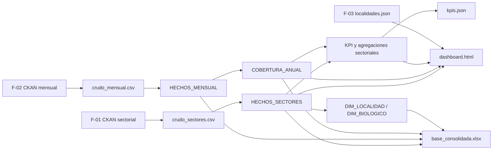
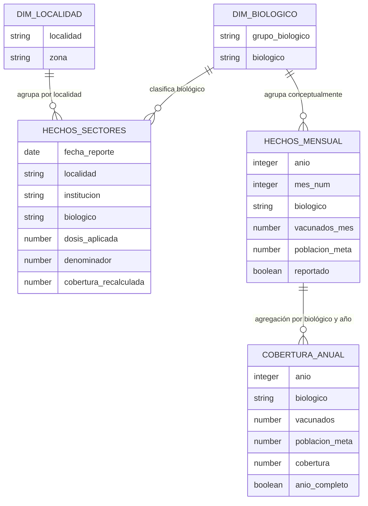
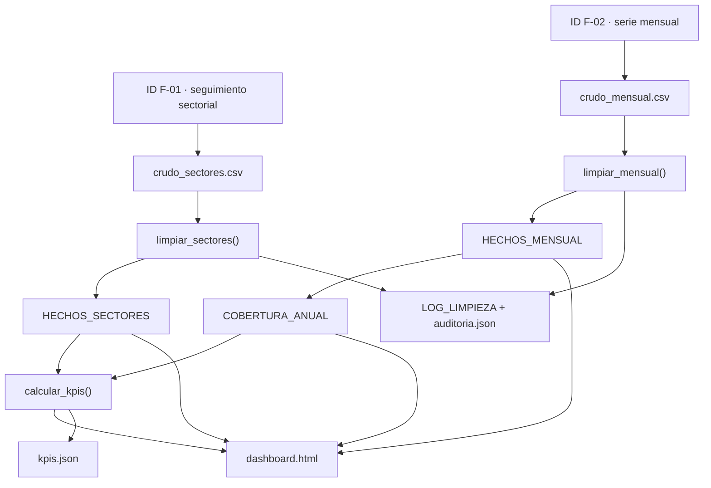

# Diccionario de datos, modelo analítico y gestión de información — VacunaBI

**Sistema:** VacunaBI V2.2.3 · **Ámbito:** datos, estructura, procedencia, calidad, trazabilidad y uso responsable  
**Revisión del código:** `etl.py`, `localidades.json`, `frontend/availability.js`, `frontend/data.js`, `decisiones.js`.

Este documento describe **qué datos maneja VacunaBI, de dónde salen, qué significan y qué transformaciones se aplican**. Complementa la explicación del procesamiento en [PROCESO_ETL.md](PROCESO_ETL.md) y la estructura general en [DOCUMENTACION_TECNICA.md](DOCUMENTACION_TECNICA.md).

> Importante: el libro Excel de salida organiza tablas de hechos y dimensiones, pero **VacunaBI no despliega una base de datos SQL ni implementa tablas físicas con claves foráneas**. Los diagramas dimensionales de este documento son representaciones conceptuales de los archivos analíticos que genera el ETL.

## 1. Objetivo de la gestión de datos

VacunaBI transforma registros abiertos de vacunación de Bogotá D. C. en un conjunto consultable para indicadores, gráficos y decisiones exploratorias. El manejo de datos tiene cuatro compromisos:

1. Mantener identificable el **recurso y el corte** al que pertenece cada cifra.
2. Conservar los registros originales antes de aplicar limpieza, para poder contrastar resultados.
3. Distinguir **registro inválido, dato ausente, valor cero, observación y simulación**.
4. No mezclar la serie mensual distrital y la fuente sectorial como si sus poblaciones y dimensiones fueran equivalentes.

No se incorporan historias clínicas individuales, datos personales de pacientes o un registro de inmunizaciones por persona. Los datos son **agregados por periodo, territorio, sector y/o biológico**, según el recurso.

## 2. Inventario de fuentes

| Código | Recurso | Identificador | Granularidad | Uso |
| --- | --- | --- | --- | --- |
| F-01 | Seguimiento de cobertura de vacunación por sectores | `e519cce2-9951-41de-afbc-005d1e1d24dd` | Fecha de reporte, localidad, institución, biológico | KPIs de primera infancia, mapa, sectores, prioridades |
| F-02 | Cobertura mensual de vacunación de Bogotá D. C. | `1910589c-2836-41d3-aba4-00488bb5e5f3` | Año, mes, biológico, distrito | Evolución histórica y mensual, comparativos y alertas |
| F-03 | Localidades de Bogotá | `localidades.json`, derivado de recurso oficial | Código/localidad y geometría | Mapa de las 20 localidades |

**Consulta oficial:** [Portal de Datos Abiertos Bogotá](https://datosabiertos.bogota.gov.co/) y su endpoint CKAN `/api/3/action/datastore_search`.

**Geometría:** según [DATOS_TERRITORIALES.md](DATOS_TERRITORIALES.md), procede de la fuente pública de la Secretaría Distrital de Planeación y se simplificó para visualización; la documentación de origen identifica licencia CC BY 4.0.

**Advertencia:** no se asignan aquí fechas de corte fijas a F-01 y F-02, porque cambian con cada extracción y el recurso sectorial puede actualizarse con una periodicidad distinta a la serie distrital.

## 3. Modelo de información real y conceptual

### 3.1. Flujo de datos y sus productos

Los nombres `HECHOS_*` y `DIM_*` son **hojas dentro de `base_consolidada.xlsx`**. No existe un motor de base de datos detrás de estas hojas.

### 3.2. Esquema conceptual dimensional

**Convención de lectura:** el diagrama relaciona los conceptos mediante nombres y agregaciones. **No afirma la existencia de claves foráneas, índices SQL, restricciones DDL ni identidad exacta entre denominaciones de biológicos de ambas fuentes.** La relación entre la serie mensual y la tabla anual es un proceso de agregación, no una relación fila a fila persistida.

## 4. Diccionario de entrada: fuente sectorial F-01

La validación de esquema busca estas columnas, normalizadas para comparación a minúsculas:

| Campo original requerido | Tipo esperado al recibir | Significado | Transformación |
| --- | --- | --- | --- |
| `fecha_reporte` | Texto de fecha | Fecha del reporte sectorial | Parseo `%d/%m/%Y` |
| `nombre_localidad` | Texto | Código y nombre de localidad | Extraer número y localidad; validar conjunto Bogotá |
| `biologico_edad` | Texto | Biológico / edad del seguimiento | Renombrar a `biologico`, clasificar grupo |
| `institucion` | Texto | Institución o sector | Normalizar espacios y nombres observados |
| `dosis_aplicada` | Numérico/texto | Dosis contadas por el recurso | Convertir a número no negativo |
| `denominador` | Numérico/texto | Población objetivo | Convertir a número positivo |
| `cobertura` | Numérico/texto | Cobertura presentada por la fuente | Dividir por diez según regla del recurso |

En la respuesta CKAN también se espera el identificador de registro `_id` para comprobar integridad durante la descarga. **No se guarda como identificador de negocio en la hoja final**.

### 4.1. Esquema de salida transformada: HECHOS_SECTORES

| Campo final | Tipo lógico | ¿Puede faltar en un registro aceptado? | Regla o significado |
| --- | --- | --- | --- |
| `fecha_reporte` | Fecha | No | Fecha válida del corte |
| `cod_localidad` | Numérico | Debe proceder del patrón de localidad aceptado | Código extraído del campo fuente |
| `localidad` | Texto | No | Debe pertenecer a las 20 localidades |
| `zona` | Texto | No para localidad válida | Agrupación propia: Norte, Centro, Sur, Occidente o Rural |
| `institucion` | Texto | No | Texto normalizado, `str.title()` |
| `grupo_biologico` | Texto | Derivado | Grupo asignado por `grupo_biologico()` |
| `biologico` | Texto | No | Nombre de la fuente, con tratamiento de espacios |
| `dosis_aplicada` | Número | No | Numerador ≥ 0 |
| `denominador` | Número | No | Denominador > 0 |
| `cobertura_reportada` | Número | Puede señalar inconsistencias | Dato original dividido por 10 |
| `cobertura_recalculada` | Número | No si dosis/denominador válidos | 100 × dosis / denominador, 1 decimal |
| `brecha_meta` | Número | Derivado | max(0, 95 − cobertura recalculada) |
| `cumple_meta` | Booleano | Derivado | Cobertura recalculada ≥ 95 |
| `flag_inconsistencia` | Booleano | Derivado | Diferencia absoluta reportada-recalculada > 0,1 pp |
| `flag_sobre_100` | Booleano | Derivado | Cobertura recalculada > 100 |

**Clave lógica para detectar duplicados sectoriales en el ETL:** `fecha_reporte + localidad + biologico + institucion`. En la vista previa CSV del frontend se utiliza también una combinación equivalente de esas dimensiones para detectar duplicados de la carga.

La eliminación de duplicados usa esta combinación; **no significa que exista una clave primaria física declarada en una base de datos**.

### 4.2. Reglas específicas de aceptación

- Fecha parseable.
- Localidad incluida en el conjunto de Bogotá reconocido por `ZONAS`.
- Dosis numéricas no negativas.
- Denominador mayor que cero.
- Biológico e institución con texto útil.
- Eliminación de claves lógicas duplicadas.

Los registros con cobertura mayor a 100 % **no se reemplazan por 100 %**. Los registros con diferencias entre cobertura publicada y recalculada pueden quedar observados. La revisión de calidad debe distinguir «observado» de «descartado».

## 5. Diccionario de entrada: serie distrital mensual F-02

Los nombres de origen utilizados en el ETL son:

| Columna del origen | Nombre interno | Descripción |
| --- | --- | --- |
| `Biologico` | `biologico` | Identificación de la serie |
| `Ano` | `anio` | Año |
| `Orden mes` | `mes_num` | Orden del mes, 1–12 |
| `Mes` | `mes` | Nombre del mes |
| `Meta` | `poblacion_meta` | Denominador publicado |
| `Vacunados` | `vacunados_mes` | Cantidad mensual reportada |
| `Cobertura` | Se elimina para recalcular | Campo de la fuente, no usado como porcentaje final |
| `Column7` | Se elimina | Columna auxiliar del recurso |

### 5.1. Registros válidos

Se exige año entero entre 1900 y 2200, mes de 1 a 12, biológico informado y población meta positiva. Se acepta que el campo mensual de vacunados no tenga reporte; si sí está informado, se espera un número no negativo.

Las filas cuyo número de mes es **13** se consideran totales de la fuente y se excluyen antes de volver a calcular agregaciones.

**Clave lógica para eliminar duplicados mensuales:** `biologico + anio + mes_num`.

### 5.2. Campos derivados de HECHOS_MENSUAL

| Campo | Tipo | Regla |
| --- | --- | --- |
| `reportado` | Booleano | `vacunados_mes` no es nulo |
| `vacunados_acum` | Número | Suma acumulada por biológico y año |
| `cobertura_acum` | Número | 100 × acumulado / meta poblacional, 1 decimal |

Un mes sin vacunados reportados **no se convierte en cero para completar la serie**. El frontend puede omitir periodos sin datos al construir una gráfica.

## 6. Diccionario de COBERTURA_ANUAL

La tabla anual se obtiene de las filas mensuales marcadas como `reportado`.

| Campo | Tipo lógico | Cálculo/criterio |
| --- | --- | --- |
| `biologico` | Texto | Agrupación de la fuente mensual |
| `anio` | Entero | Agrupación por año |
| `poblacion_meta` | Número | Máximo de meta entre los meses reportados de esa serie |
| `vacunados` | Número | Suma de `vacunados_mes` reportados |
| `meses_reportados` | Entero | Cantidad de meses con dato |
| `cobertura` | Número | 100 × vacunados / población meta |
| `anio_completo` | Booleano | `meses_reportados == 12` |
| `cobertura_proyectada` | Número | `cobertura × 12 / meses_reportados`, extrapolación simple |
| `brecha_meta` | Número | max(0, 95 − cobertura) |

**Advertencia metodológica:** `cobertura_proyectada` no es una estimación predictiva validada. Solo extrapola aritméticamente el ritmo observado; no sustituye una proyección con hipótesis epidemiológicas.

## 7. Diccionario de dimensiones y geografía

### 7.1. DIM_LOCALIDAD

| Campo | Descripción |
| --- | --- |
| `localidad` | Nombre de una de las 20 localidades |
| `zona` | Agrupación definida en `ZONAS` |

En el conjunto sectorial también se conserva `cod_localidad`, extraído del nombre de localidad publicado. La dimensión Excel usa nombre y zona; no se genera una tabla SQL de códigos.

### 7.2. DIM_BIOLOGICO

| Campo | Descripción |
| --- | --- |
| `grupo_biologico` | Clasificación mediante las reglas del proyecto |
| `biologico` | Descripción del biológico obtenida de la fuente sectorial |

La clasificación sirve para agregación analítica. No es un catálogo clínico normativo mantenido por VacunaBI.

### 7.3. Límites cartográficos

`localidades.json` aporta polígonos simplificados vinculados a códigos y nombres. Se usa para dibujar el mapa, no para calcular dosis ni completar registros faltantes. El script `scripts/preparar_localidades.py` permite regenerar la versión simplificada desde la fuente geográfica indicada en [DATOS_TERRITORIALES.md](DATOS_TERRITORIALES.md).

## 8. Indicadores KPI: diccionario de `kpis.json`

| Clave | Procedencia/cálculo | Interpretación |
| --- | --- | --- |
| `fecha_corte_sectores` | Mayor fecha sectorial válida | Corte del KPI sectorial |
| `ultimo_anio_cerrado` | Mayor año completo de la serie | Periodo anual de referencia |
| `cobertura_global_sectores` | Suma dosis / suma denominadores del último corte | Cobertura agregada sectorial |
| `cobertura_primera_infancia_sectores` | Agregado de primera infancia en el último corte | Cobertura del grupo elegido |
| `pct_registros_cumplen_meta` | Porcentaje de filas válidas que cumplen meta | No es porcentaje de personas |
| `localidades_bajo_meta_infancia` | Conteo de localidades con cobertura inferior a 95 % | Brecha territorial |
| `localidad_menor_cobertura` | Localidad de menor cobertura compatible | Nombre, no recomendación clínica |
| `localidad_menor_cobertura_valor` | Cobertura de la localidad anterior | Porcentaje |
| `tv_1anio_ult` | Triple viral 1 año, último año completo | Porcentaje distrital |
| `tv_5anios_ult` | Serie buscada por prefijo triple viral R1 o DPT | Porcentaje distrital |
| `caida_esquema_1a5` | Diferencia entre las dos referencias anteriores | Puntos porcentuales; no abandono individual |
| `biologicos_cumplen_meta_ult` | Conteo de biológicos sobre la meta, último año cerrado | Número de series |
| `biologicos_total_ult` | Conteo de biológicos del último año cerrado | Denominador para el conteo anterior |
| `dosis_faltantes_meta_infancia` | `ceil(0,95 × población objetivo) − dosis`, mínimo cero | Cantidad hipotética con denominador fijo |

El archivo `kpis.json` contiene un objeto con dos claves principales: `kpis` (valores anteriores) y `limpieza` (contadores por fuente). No representa una respuesta de la API CKAN.

## 9. Catálogo de archivos de salida

| Archivo | Tipo | Granularidad / contenido | Para qué se utiliza |
| --- | --- | --- | --- |
| `crudo_sectores.csv` | CSV | Filas originales F-01 | Contrastar limpieza |
| `crudo_mensual.csv` | CSV | Filas originales F-02 | Contrastar la serie |
| `hechos_sectores.csv` | CSV | Filas sectoriales aceptadas | Revisión y análisis externo |
| `cobertura_anual.csv` | CSV | Biológico × año | Comparación anual |
| `base_consolidada.xlsx` | Excel | Hechos, dimensiones, KPIs, limpieza | Explorar estructura BI |
| `kpis.json` | JSON | Indicadores y contadores | Consumo y verificación |
| `auditoria.json` | JSON | Historial de ejecuciones | Trazabilidad de actualización |
| `dashboard.html` | HTML autónomo | Datos preparados incrustados | Interfaz usuario |

### 9.1. Hojas de `base_consolidada.xlsx`

- `HECHOS_SECTORES`
- `HECHOS_MENSUAL`
- `COBERTURA_ANUAL`
- `DIM_LOCALIDAD`
- `DIM_BIOLOGICO`
- `KPI`
- `LOG_LIMPIEZA`

La hoja de hechos sectoriales tiene fechas y medidas a nivel de corte/localidad/institución/biológico. No se debe promediar la columna de cobertura para agregar instituciones: la agregación correcta suma numeradores y denominadores.

## 10. Reglas de calidad y sus evidencias

| Dimensión | Regla implementada | Dónde se comprueba |
| --- | --- | --- |
| Completitud de descarga | Total positivo, páginas completas y recuento final | `consultar_api()` |
| Unicidad de extracción | Sin IDs `_id` repetidos | `consultar_api()` |
| Contrato de origen | Columnas mínimas presentes | `ESCHEMAS` |
| Validez territorial | Solo localidades reconocidas de Bogotá | `limpiar_sectores()` |
| Validez temporal | Fechas parseables y meses de 1 a 12 | Funciones de limpieza |
| Validez aritmética | Dosis ≥ 0, denominador > 0 | Funciones de limpieza |
| Consistencia porcentual | Comparar reportada vs recalculada (tolerancia > 0,1 pp) | `flag_inconsistencia` |
| Detección de anomalías | Cobertura recalculada > 100 % | `flag_sobre_100` |
| Periodo completo | 12 meses reportados | `anio_completo` |
| Seguridad de publicación | Carpeta temporal, respaldo y restauración | `publicar_salidas()` |
| Estado de consulta | Auditoría con fases y resultado | `auditoria.json` |

**Importante:** que un registro pase estas reglas no demuestra por sí solo que su valor sea correcto en términos epidemiológicos. Son comprobaciones de estructura, consistencia y uso analítico.

## 11. Trazabilidad, linaje y procedencia

Para revisar una cifra del dashboard:
1. Anotar el recurso indicado en la vista.
2. Registrar año, corte, localidad, institución y biológico si corresponden.
3. Localizar el indicador o agregado del HTML/JSON.
4. Comparar con la tabla transformada.
5. Si hay dudas sobre un registro, consultar el CSV crudo.
6. Revisar el historial de limpieza y el estado de la extracción.

No se dispone de un catálogo automático de gobierno de datos ni de control de versiones por fila. La trazabilidad se basa en archivos, recursos CKAN y registros de auditoría.

## 12. Política de actualización, copias y retención

`etl.main()` consulta ambas fuentes cuando se ejecuta. La ventana Windows puede abrir una copia local de **la misma versión** sin descargar otra vez. La actualización manual reemplaza los archivos solo tras validar los resultados.

El historial de auditoría conserva como máximo **30 ejecuciones recientes**: `historial_auditoria()` recupera las últimas 29 antes de agregar la nueva. Si falla una actualización, se registra el error en `auditoria.json` y se preserva el tablero anterior.

Los archivos de salida se generan en `salidas/`, excluida de Git. **No existe una política automática de archivado histórico indefinido** de todas las extracciones ni una base temporal permanente de snapshots. Si se requiere esa funcionalidad, debe diseñarse explícitamente en una versión posterior.

## 13. Uso responsable, clasificación y límites

| Tema | Situación actual |
| --- | --- |
| Clasificación práctica | Datos públicos agregados de salud y geometría pública |
| Datos personales de pacientes | No forman parte del esquema implementado |
| Identidad de usuarios | No hay gestión de cuentas en la aplicación |
| Escritura hacia fuentes públicas | No existe: CKAN se utiliza para consulta |
| Cargas manuales | Vista previa temporal en la memoria del dashboard |
| Fuente de decisiones oficiales | Registros sectoriales oficiales compatibles, no vista previa manual |
| Geometría | Simplificada para representación visual, no mensura |
| Cobertura superior al 100 % | Observación visible; no se recorta al 100 |
| Valores faltantes | No se sustituyen por ceros |
| Comparación distrito-localidad | No se fuerza sin granularidad compatible |

Si una futura versión incorpora datos individuales, se deberá definir una evaluación nueva de privacidad, permisos, seguridad y ciclo de vida; la documentación actual **no cubre ese escenario**.

## 14. Ejemplo de interpretación de datos (ficticio)

**Ejemplo ilustrativo, no resultado de Bogotá:**

| Fuente | Corte | Localidad | Dosis | Denominador | Cobertura |
| --- | --- | --- | ---: | ---: | ---: |
| F-01 | 2025-08-26 | Localidad A | 80 | 100 | 80 % |
| F-01 | 2025-08-26 | Localidad B | 20 | 25 | 80 % |

La cobertura de las dos localidades en conjunto es `(80 + 20)/(100 + 25) × 100 = 80 %`. Si la localidad B no tuviera registros para el corte, no se debería rellenar con 0 % para construir la tabla.

No tendría sentido comparar ese total agregado con una serie mensual distrital de otro periodo sin reconocer que se trata de fuentes con criterios distintos.

## 15. Validación del diccionario y próximos ajustes

Las pruebas Python cubren transformaciones y agregaciones; `test_frontend.cjs` protege filtros y agregación en el navegador. Se recomienda revisar este diccionario cuando CKAN cambie un nombre o tipo de campo, se añada otra fuente o se modifiquen reglas de agrupación.

Los cambios de esquema deben reflejarse en **ESCHEMAS, limpieza, pruebas y documentación al mismo tiempo**. No se debe «corregir» una incompatibilidad haciendo pasar campos inexistentes por valores válidos.

**Referencias:** [Proceso ETL](PROCESO_ETL.md) · [Calidad](CALIDAD_DATOS.md) · [Documentación técnica](DOCUMENTACION_TECNICA.md) · [Disponibilidad de fuentes](FILTROS_FUENTES.md) · [Procedencia cartográfica](DATOS_TERRITORIALES.md).
