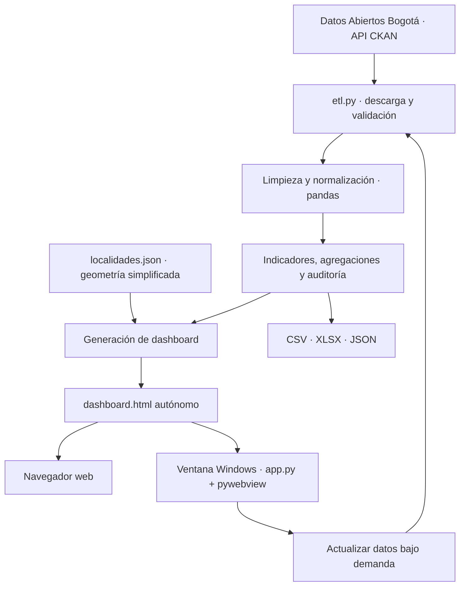
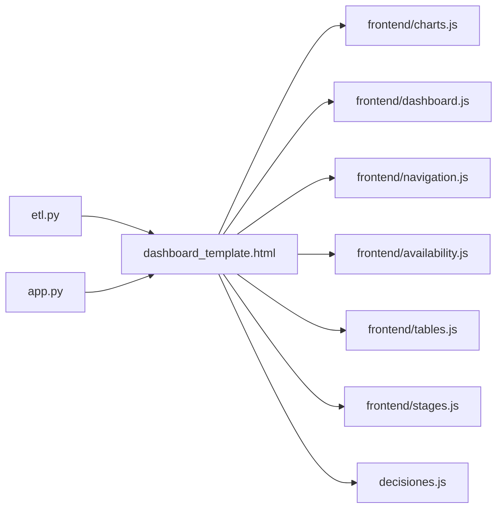
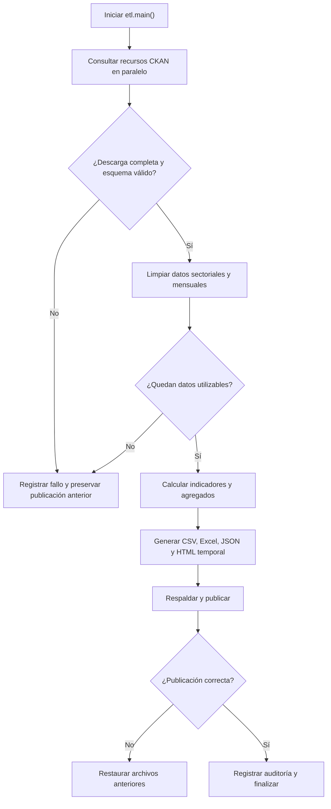

# VacunaBI — Documentación integral del proyecto

**Sistema de análisis de cobertura de vacunación en Bogotá D. C.**  
**Proyecto final de Inteligencia de Negocios — Universidad Manuela Beltrán**  
**Versión documentada:** 2.2.3 · **Fecha de corte documental:** 16 de noviembre de 2026  
**Repositorio:** https://github.com/Codeforgeettttt/VacunaBI  
**Última versión publicada:** https://github.com/Codeforgeettttt/VacunaBI/releases/tag/v2.2.3

**Equipo del proyecto**

- Valery Michell Herrera Roca — [@Codeforgeettttt](https://github.com/Codeforgeettttt).
- Daniel Felipe Rojas González — [@Dani2026403](https://github.com/Dani2026403).
- Julián Andrés Peñuela Alfonso — [@julianpenuelaalfonso-fullstack](https://github.com/julianpenuelaalfonso-fullstack).

> **Sobre este documento.** Este manual reúne el funcionamiento del producto, las decisiones técnicas que pueden verificarse en el repositorio, la metodología de análisis y el procedimiento para operarlo y mantenerlo. Explica el estado real de la versión 2.2.3. Las verificaciones manuales que no tienen evidencia registrada se presentan como pendientes; no se declaran aprobadas por el simple hecho de que el ejecutable se haya compilado.

### Documentación técnica complementaria

El manual integral presenta una visión completa del proyecto; los modelos detallados se mantienen en documentos independientes para que sea más fácil consultarlos y actualizarlos:

- [Índice general de documentos](INDICE_DOCUMENTACION.md).
- [Manual técnico, arquitectura y componentes](DOCUMENTACION_TECNICA.md).
- [Casos de uso extendidos y diagramas](CASOS_DE_USO_Y_DIAGRAMAS.md).
- [Diccionario, modelo BI, linaje y gestión de datos](DICCIONARIO_Y_GESTION_DATOS.md).
- [Especificación completa del proceso ETL](PROCESO_ETL.md).
- [Requisitos, criterios de aceptación y plan de pruebas](REQUISITOS_Y_PLAN_PRUEBAS.md).

Los diagramas se ofrecen en Mermaid, con visualización directa en GitHub. Los modelos conceptuales no deben interpretarse como una base SQL implementada ni como autenticación por perfiles.

---

## Contenido

1. [Presentación del proyecto](#1-presentación-del-proyecto)
2. [Problema, objetivos y alcance](#2-problema-objetivos-y-alcance)
3. [Usuarios, necesidades y requisitos](#3-usuarios-necesidades-y-requisitos)
4. [Solución y arquitectura general](#4-solución-y-arquitectura-general)
5. [Tecnologías y estructura del repositorio](#5-tecnologías-y-estructura-del-repositorio)
6. [Fuentes de datos y procedencia](#6-fuentes-de-datos-y-procedencia)
7. [Proceso ETL completo](#7-proceso-etl-completo)
8. [Diccionario y organización de los datos](#8-diccionario-y-organización-de-los-datos)
9. [Indicadores y reglas de cálculo](#9-indicadores-y-reglas-de-cálculo)
10. [Módulos del dashboard](#10-módulos-del-dashboard)
11. [Filtros inteligentes y estados sin datos](#11-filtros-inteligentes-y-estados-sin-datos)
12. [Mapa, comparaciones y análisis territorial](#12-mapa-comparaciones-y-análisis-territorial)
13. [Apoyo a decisiones y simulación](#13-apoyo-a-decisiones-y-simulación)
14. [Registros manuales y exportaciones](#14-registros-manuales-y-exportaciones)
15. [Aplicación de escritorio y actualizaciones](#15-aplicación-de-escritorio-y-actualizaciones)
16. [Instalación, ejecución y compilación](#16-instalación-ejecución-y-compilación)
17. [Archivos que produce la aplicación](#17-archivos-que-produce-la-aplicación)
18. [Calidad, seguridad y accesibilidad](#18-calidad-seguridad-y-accesibilidad)
19. [Pruebas y validación](#19-pruebas-y-validación)
20. [Integración continua y publicaciones](#20-integración-continua-y-publicaciones)
21. [Evolución de versiones](#21-evolución-de-versiones)
22. [Guía de uso paso a paso](#22-guía-de-uso-paso-a-paso)
23. [Problemas frecuentes y soluciones](#23-problemas-frecuentes-y-soluciones)
24. [Mantenimiento y posibles mejoras](#24-mantenimiento-y-posibles-mejoras)
25. [Glosario, conclusiones y referencias](#25-glosario-conclusiones-y-referencias)

---

## 1. Presentación del proyecto

VacunaBI es una aplicación de inteligencia de negocios orientada a explorar información pública sobre cobertura de vacunación en Bogotá D. C. Su propósito es convertir registros distribuidos en recursos de datos abiertos en un conjunto de indicadores, gráficos, tablas y herramientas de análisis que resulten comprensibles para personas que necesitan revisar el comportamiento de la vacunación.

El proyecto tiene dos formas de utilización. La primera es un **dashboard HTML autónomo**, que se abre con un navegador y contiene los datos correspondientes a la última ejecución del proceso de extracción, transformación y carga. La segunda es una **aplicación de escritorio para Windows**, presentada en su propia ventana por medio de Python y pywebview, que permite actualizar los datos y guardar archivos mediante el selector nativo del sistema operativo.

No se trata de un sistema de registro clínico ni de una plataforma para administrar jornadas de vacunación. VacunaBI no registra pacientes, no programa citas y no modifica los datos oficiales. Su función es **consultar, preparar, explicar y comparar datos agregados** procedentes de fuentes públicas.

El resultado busca responder preguntas concretas:

- ¿Cuál es la cobertura observada frente a una meta de referencia?
- ¿Qué localidades o sectores muestran brechas en el corte disponible?
- ¿Cómo varía la serie distrital a lo largo de los años y meses publicados?
- ¿Cuántas dosis adicionales se requerirían matemáticamente para alcanzar una meta, manteniendo fijo el denominador?
- ¿Qué restricciones de calidad y disponibilidad deben considerarse antes de interpretar los resultados?

La aplicación utiliza una meta de referencia del **95 %**, definida en el código para los cálculos del proyecto. Esta referencia permite calcular diferencias y ordenar prioridades, pero no reemplaza una evaluación epidemiológica completa.

### 1.1. Antecedentes del desarrollo

El punto de partida fue una base funcional de ETL, dashboard y escritorio proveniente del proyecto original de cobertura de vacunación. La documentación de línea base identifica el trabajo inicial de Julián en el ETL, el tablero y el escritorio, y la participación de Valery y Daniel en pruebas. Las mejoras posteriores se registraron mediante commits y versiones incrementales.

Desde la versión 1.1 se trabajó en la organización de la interfaz; después llegaron filtros, análisis territorial, trazabilidad, accesibilidad, decisiones y mejoras específicas de Windows. La versión **2.2.3** incorpora también una descarga CKAN concurrente. Esta secuencia se puede consultar en [CHANGELOG.md](../CHANGELOG.md).

La versión publicada como estable en GitHub Releases es la **v2.2.3**, asociada al commit de publicación `42f15838a6bc1988aebbbe6851b3170559f54936`. Que una release esté marcada como estable en GitHub indica su estado de distribución; no significa que hayan concluido todas las pruebas manuales de usabilidad o accesibilidad.

---

## 2. Problema, objetivos y alcance

### 2.1. Problema que se aborda

La información abierta sobre vacunación resulta útil, pero no siempre es sencilla de analizar directamente. Las fuentes pueden utilizar nombres de columnas distintos, publicar fechas diferentes, incluir totales junto a registros mensuales y tener niveles de desagregación que no son equivalentes.

Al revisar archivos por separado aparecen dificultades prácticas: interpretar números con formatos diferentes, distinguir meses sin reporte de valores cero, encontrar localidades con brechas, comparar periodos completos y reconocer si una cobertura mayor al 100 % es una observación que requiere revisión.

También existe un riesgo frecuente en los tableros: mostrar un gráfico vacío sin explicar su motivo. Un gráfico sin registros para una selección no demuestra que la cobertura de vacunación sea cero. Puede significar simplemente que la fuente no incluye ese año, localidad, institución o biológico.

VacunaBI organiza estas situaciones en una experiencia de consulta más clara, sin ocultar las limitaciones de origen.

### 2.2. Objetivo general

Desarrollar una aplicación de inteligencia de negocios que integre datos abiertos de vacunación de Bogotá D. C., aplique reglas de calidad, calcule indicadores de cobertura y ofrezca herramientas visuales y analíticas para interpretar brechas, tendencias y escenarios de dosis adicionales.

### 2.3. Objetivos específicos

1. Extraer los recursos oficiales mediante la API CKAN y verificar que la descarga sea completa.
2. Limpiar y transformar los datos conservando su procedencia, periodos e información de calidad.
3. Calcular coberturas, brechas y dosis adicionales con reglas explícitas y reproducibles.
4. Presentar resultados por localidad, sector institucional, grupo de biológico y periodo cuando la fuente permita ese desglose.
5. Ofrecer filtros que expliquen las combinaciones incompatibles o sin registros.
6. Permitir la consulta mediante navegador y ejecutable de Windows.
7. Incorporar exportaciones, trazabilidad de actualizaciones y pruebas automatizadas.
8. Mantener documentación de instalación, arquitectura, uso y limitaciones.

### 2.4. Alcance funcional

**Incluido:** extracción de dos recursos CKAN de vacunación, preparación de datos, KPIs, gráficos, mapa de localidades, comparaciones territoriales, matrices, filtros, tablas, simulaciones aritméticas, alertas, descargas, auditoría local, generación de HTML y ejecución en Windows.

**Fuera del alcance actual:** identificación de personas vacunadas, historias clínicas, autenticación de usuarios, base transaccional de pacientes, campañas de mensajería, predicción estadística validada, asignación automática de recursos reales, gestión de inventarios de vacunas y análisis validado de municipios de Cundinamarca.

El proyecto trabaja sobre **Bogotá D. C.** y los registros efectivamente disponibles en las fuentes utilizadas. No debe interpretarse como un sistema de vigilancia clínica en tiempo real.

---

## 3. Usuarios, necesidades y requisitos

### 3.1. Usuarios previstos

El principal usuario es una persona interesada en consultar resultados de cobertura, por ejemplo un estudiante, docente, analista de datos o integrante de un equipo que estudia indicadores de salud pública. No se exige experiencia programando para utilizar el dashboard.

También se considera al **equipo técnico**, responsable de ejecutar el ETL, revisar anomalías, actualizar la aplicación y verificar que una publicación no cambie de manera incorrecta los cálculos.

No existe en el código un sistema de cuentas, roles ni inicio de sesión. Las expresiones «usuario» y «equipo técnico» describen tipos de uso, no perfiles implementados de autenticación.

### 3.2. Requisitos funcionales

| Código | Requisito | Implementación |
| --- | --- | --- |
| RF-01 | Obtener registros de los recursos de vacunación | `consultar_api()` en `etl.py` |
| RF-02 | Comprobar paginación, total, identificadores y esquema | Validaciones antes de construir DataFrames |
| RF-03 | Normalizar campos y descartar filas inválidas | `limpiar_sectores()` y `limpiar_mensual()` |
| RF-04 | Calcular agregados e indicadores | `anual()`, `cobertura()` y `calcular_kpis()` |
| RF-05 | Generar salidas de consulta | CSV, Excel, JSON y HTML |
| RF-06 | Mostrar un resumen ejecutivo | KPIs y gráficos de evolución |
| RF-07 | Consultar localidades | Mapa, ranking y ficha |
| RF-08 | Comparar territorios compatibles | Misma fuente, corte y filtros |
| RF-09 | Explorar instituciones y grupos de biológicos | Vista sectorial y matriz |
| RF-10 | Filtrar por fuente, año y otras dimensiones disponibles | Selectores y motor de disponibilidad |
| RF-11 | Explicar consultas sin registros o incompatibles | Mensajes y acciones de recuperación |
| RF-12 | Consultar tablas y exportaciones | Búsqueda, orden, paginación, CSV y XLSX |
| RF-13 | Simular dosis adicionales | Escenarios A y B, denominador fijo |
| RF-14 | Mostrar prioridades y alertas | Motor `decisiones.js` |
| RF-15 | Registrar estado de las actualizaciones | `auditoria.json` y vista Calidad |
| RF-16 | Abrir la aplicación desde Windows | `app.py`, pywebview y WebView2 |
| RF-17 | Actualizar los datos por acción explícita | Botón **Actualizar datos** |
| RF-18 | Reutilizar un tablero compatible | Inicio rápido desde copia guardada |
| RF-19 | Conservar la última publicación ante un fallo | Publicación temporal, respaldo y recuperación |
| RF-20 | Permitir registros manuales para vista previa | Importación CSV temporal, separada de Decisiones |

### 3.3. Requisitos no funcionales y criterios observables

| Aspecto | Criterio de diseño |
| --- | --- |
| Integridad | No publicar resultados de una descarga incompleta o inconsistente |
| Trazabilidad | Identificar origen, corte, procesamiento y observaciones |
| Interpretabilidad | Diferenciar ausencia de datos, cero observado y escenario simulado |
| Portabilidad | HTML autónomo y ejecutable para Windows |
| Mantenibilidad | Separación de ETL, lógica de decisiones, interfaz y pruebas |
| Usabilidad | Seis vistas, filtros compartidos y avisos explicativos |
| Accesibilidad | Navegación por teclado, foco visible y tablas alternativas para gráficos |
| Resiliencia | Mantener una copia válida si la consulta falla |
| Rendimiento | Paralelizar recursos y páginas CKAN con concurrencia limitada |
| Comprobación | Pruebas Python/JavaScript y compilación automatizada |

No se declara un tiempo máximo garantizado de respuesta de la API. Tampoco se declara conformidad completa con WCAG 2.2 AA: las comprobaciones automatizadas y la aceptación manual son actividades diferentes.

---

## 4. Solución y arquitectura general

VacunaBI combina un proceso de datos escrito en Python, un dashboard HTML/JavaScript y una capa ligera de escritorio. **No necesita un servidor web propio, una base de datos SQL ni un servicio de autenticación para su funcionamiento actual**. Su fuente de verdad analítica proviene de los recursos públicos que descarga el ETL.

### 4.1. Vista de alto nivel



El diagrama expresa las responsabilidades principales, no procesos permanentemente activos. El ETL se ejecuta cuando se invoca desde Python, cuando se requiere preparar una primera copia compatible o cuando el usuario solicita una actualización desde Windows.

### 4.2. Capas de la aplicación

**Capa de adquisición.** `etl.py` se comunica con la API CKAN y obtiene los registros originales de cada recurso.

**Capa de transformación.** Python y pandas convierten los campos, eliminan duplicados, aplican validaciones y producen tablas analizables.

**Capa analítica.** Se calculan KPIs, coberturas y agregados. En JavaScript, `decisiones.js` calcula escenarios y prioridades a partir de los datos disponibles.

**Capa de presentación.** Una plantilla HTML, estilos CSS, Chart.js y módulos JavaScript muestran vistas, filtros, mapas, tablas, mensajes y exportaciones.

**Capa de escritorio.** `app.py` crea la ventana y expone unas operaciones concretas a JavaScript para actualizar datos, leer auditoría y guardar exportaciones.

**Capa de automatización.** GitHub Actions ejecuta pruebas, genera ejecutables y dispone de un flujo programado para generar el dashboard a partir de los recursos remotos.

### 4.3. Decisión: un HTML autónomo

En lugar de depender de un servidor JavaScript en ejecución para mostrar cada gráfica, el ETL integra los recursos locales en un solo archivo `dashboard.html`. En ese documento se insertan Chart.js, el motor de decisiones, CSS, los módulos JavaScript y los datos de la extracción.

Esta decisión permite que el resultado se abra en un navegador como una fotografía de la extracción realizada. También simplifica su presentación desde pywebview.

**Consecuencia importante:** un HTML generado no se actualiza solo. Para obtener registros nuevos hay que ejecutar otra vez el ETL o utilizar el botón **Actualizar datos** en la aplicación de escritorio.

### 4.4. Diagrama conceptual de módulos



Este diagrama indica qué componentes intervienen en el tablero generado. Los archivos del frontend se mantienen separados para desarrollarlos, pero el ETL los incorpora al HTML de salida.

---

## 5. Tecnologías y estructura del repositorio

### 5.1. Tecnologías utilizadas

| Tecnología | Uso en VacunaBI |
| --- | --- |
| Python 3.12, recomendado | Ejecución del ETL y aplicación de escritorio |
| pandas | Limpieza, agregación y transformación de tablas |
| openpyxl | Escritura del archivo Excel a través de pandas |
| HTML5 y CSS | Estructura, vistas y estilos del tablero |
| JavaScript | Filtros, mapas, tablas, exportaciones e interacciones |
| Chart.js (copia local) | Gráficos de barras, líneas y otras visualizaciones |
| pywebview 5.3.2 | Ventana de escritorio con puente JavaScript–Python |
| Microsoft Edge WebView2 | Motor visual para la aplicación de Windows |
| PyInstaller 6.22.3 | Generación de `VacunaBI.exe` |
| Node.js | Ejecución de pruebas JavaScript |
| Git y GitHub | Control de versiones, colaboración y releases |
| GitHub Actions | Pruebas automáticas, compilación y actualizaciones programadas |

`requirements.txt` declara `pandas>=2.0` y `openpyxl>=3.1`. Las versiones de PyInstaller y pywebview están fijadas en el workflow de Windows; no están en ese archivo de requisitos. El proyecto no dispone actualmente de un archivo lock completo de todas las dependencias transitivas.

### 5.2. Archivos y responsabilidades

```text
VacunaBI/
├── app.py                        # Escritorio, cache, recarga y guardado nativo
├── etl.py                        # Descarga CKAN, calidad, KPIs y publicación
├── dashboard_template.html       # Plantilla HTML del dashboard
├── chart.umd.min.js              # Chart.js incluido localmente
├── decisiones.js                 # Prioridades, brechas, escenarios y alertas
├── localidades.json              # Geometría simplificada de localidades
├── frontend/
│   ├── availability.js           # Compatibilidad de fuentes y filtros
│   ├── charts.js                 # Gráficos y matriz de calor
│   ├── dashboard.css             # Sistema visual y responsive
│   ├── dashboard.js              # Interacciones generales y exportaciones
│   ├── data.js                   # Utilidades de agregación y cobertura
│   ├── navigation.js             # Navegación de vistas
│   ├── stages.js                 # Etapas de Decisiones
│   └── tables.js                 # Tablas de gráficos y funciones de exportación
├── scripts/
│   └── preparar_localidades.py   # Preparación de geometría desde fuente oficial
├── docs/                         # Documentación técnica y de evolución
├── test_etl.py                   # Pruebas iniciales de transformación
├── test_etl_regression.py        # Regresiones del ETL
├── test_dashboard_template.py    # Contrato estructural de interfaz
├── test_release_integrity.py     # Ensamblado y recursos locales
├── test_app_export.py            # Comportamiento del escritorio simulado
├── test_frontend.cjs             # Datos, filtros y exportación JS
├── test_decisiones.cjs           # Reglas del motor de decisiones
├── .github/workflows/
│   ├── actualizar.yml            # Pruebas y actualización de datos programada
│   └── windows.yml               # Compilación y publicación Windows
├── requirements.txt
├── README.md
└── CHANGELOG.md
```

**La carpeta `salidas/`** aparece después de ejecutar el ETL y está excluida de Git. De forma similar, los directorios temporales de compilación (`build/` y `dist/`) no constituyen el código fuente del proyecto.

---

## 6. Fuentes de datos y procedencia

La aplicación consume **dos recursos diferentes de vacunación** del Portal de Datos Abiertos Bogotá mediante la API de CKAN. Cada recurso tiene un alcance propio. La distinción entre ambos es central para interpretar correctamente el tablero.

### 6.1. Recurso de seguimiento por sectores

- **Identificador CKAN:** `e519cce2-9951-41de-afbc-005d1e1d24dd`.
- **Uso:** información de vacunación desagregada por fecha de reporte, localidad, institución/sector y biológico.
- **Variables originales necesarias:** `fecha_reporte`, `nombre_localidad`, `biologico_edad`, `institucion`, `dosis_aplicada`, `denominador` y `cobertura`.
- **Vistas que lo utilizan:** KPIs sectoriales, análisis de primera infancia, mapa, ranking, matriz territorial, instituciones y prioridades.

Su disponibilidad temporal depende de los cortes efectivamente publicados. **No se puede asumir que tiene registros de cada año de la serie histórica distrital**.

### 6.2. Recurso de cobertura mensual distrital

- **Identificador CKAN:** `1910589c-2836-41d3-aba4-00488bb5e5f3`.
- **Uso:** evolución distrital por año, mes y biológico.
- **Variables originales necesarias:** `Biologico`, `Ano`, `Orden mes`, `Mes`, `Meta`, `Vacunados`, `Cobertura` y `Column7`.
- **Vistas que lo utilizan:** series históricas y mensuales, comparación de años cerrados y algunas alertas de evolución.

En el código, las columnas del recurso mensual se normalizan a nombres internos como `anio`, `mes_num`, `poblacion_meta` y `vacunados_mes`.

Esta fuente **no proporciona automáticamente el detalle territorial de la fuente sectorial**. Un valor distrital de 2024, por ejemplo, no se puede convertir en una cobertura de Usme o Suba si ese desglose no existe.

### 6.3. Recurso geográfico

El archivo `localidades.json` contiene límites simplificados de las **20 localidades de Bogotá** para la representación visual.

Su procedencia está documentada en [DATOS_TERRITORIALES.md](DATOS_TERRITORIALES.md), con referencia a la Secretaría Distrital de Planeación, el recurso oficial de localidades y su licencia CC BY 4.0. La documentación de origen indica una fecha de actualización de datos del 5 de agosto de 2022 para ese recurso geográfico.

La geometría simplificada sirve para visualización, **no para mediciones cartográficas de precisión, deslindes ni cálculos legales de áreas**.

### 6.4. Importancia de los cortes

No existe un único «corte de vacunación» compartido obligatoriamente por todas las vistas. Puede ocurrir que el seguimiento sectorial tenga un último corte distinto al mes más reciente de la serie distrital.

VacunaBI identifica ambas procedencias por separado. Para comparar territorios utiliza registros compatibles del mismo corte sectorial. Para estudiar evolución distrital utiliza la fuente mensual.

**Regla principal:** solo se comparan datos si sus dimensiones, periodo y población de referencia lo permiten. En caso contrario, la interfaz debe explicar la limitación.

---

## 7. Proceso ETL completo

ETL corresponde a **extracción, transformación y carga**. En VacunaBI es el proceso que convierte los registros de CKAN en archivos tabulares e información disponible para los gráficos.

### 7.1. Flujo de trabajo



### 7.2. Extracción desde CKAN

La función `consultar_api(resource_id)` solicita un recurso utilizando el endpoint:

```text
https://datosabiertos.bogota.gov.co/api/3/action/datastore_search
```

La consulta incorpora los parámetros `resource_id`, `limit` y `offset`. Inicialmente solicita hasta **1.000 filas** por página. Si el servidor entrega menos de las solicitadas en la primera respuesta, el código ajusta el tamaño de las páginas siguientes al tamaño recibido.

La versión 2.2.3 introdujo concurrencia limitada en dos niveles:

1. **Dos recursos en paralelo:** seguimiento sectorial y cobertura mensual se descargan al mismo tiempo.
2. **Páginas adicionales en paralelo:** para cada recurso se utilizan como máximo **dos trabajadores** para las páginas posteriores a la inicial.

Por diseño, las páginas se **agregan en orden de desplazamiento (offset)** incluso si sus respuestas terminan en diferente orden. La concurrencia puede reducir esperas acumuladas; **no garantiza un tiempo específico**, porque también depende del servidor, el número de páginas y la conexión del usuario.

Cada solicitud HTTP utiliza un timeout de **60 segundos por petición**. No es un límite global de 60 segundos para todo el ETL. Una descarga completa puede tardar más.

### 7.3. Comprobaciones de integridad en la extracción

Antes de aceptar una fuente, VacunaBI verifica:

- Que la respuesta de CKAN indique éxito.
- Que el total declarado sea un entero positivo.
- Que ninguna página necesaria esté vacía o tenga menos filas de las esperadas.
- Que los totales declarados permanezcan consistentes entre páginas.
- Que cada registro tenga un identificador `_id` utilizable.
- Que no se repitan identificadores dentro de una página ni entre páginas.
- Que el número total de filas reunidas coincida con el total publicado.
- Que existan las columnas esperadas para el recurso correspondiente.

Un fallo interrumpe la actualización; el sistema **no completa con ceros ni inventa registros para sustituir información perdida**.

### 7.4. Transformación de los datos sectoriales

La función `limpiar_sectores()` realiza las siguientes operaciones:

1. Normaliza los nombres de columnas a minúsculas y limpia espacios repetidos.
2. Interpreta la fecha usando el formato día/mes/año.
3. Convierte dosis, denominador y cobertura a valores numéricos.
4. Ajusta la presentación de la cobertura original. En la fuente sectorial, el código documenta que `708` representa `70,8 %`, por lo que divide el campo publicado por diez.
5. Recalcula la cobertura con dosis y denominador.
6. Marca inconsistencias cuando la diferencia entre el valor publicado y el recalculado supera **0,1 punto porcentual**.
7. Marca coberturas calculadas superiores al **100 %** sin sustituirlas por 100.
8. Extrae el código y el nombre de la localidad; excluye localidades que no pertenecen al conjunto esperado de Bogotá.
9. Exige fechas válidas, dosis no negativas, denominadores positivos y biológicos e instituciones informados.
10. Normaliza instituciones, clasifica grupos de biológicos y calcula brechas.
11. Elimina duplicados según fecha, localidad, biológico e institución.
12. Conserva las columnas transformadas y los contadores de limpieza.

Las filas observadas por inconsistencia o cobertura superior al 100 % pueden permanecer para su revisión; no es lo mismo **marcar una observación** que **descartar un registro**.

### 7.5. Transformación de los datos mensuales

La función `limpiar_mensual()`:

1. Renombra las columnas originales.
2. Convierte año y número de mes a números.
3. Retira las filas donde el campo de orden de mes vale `13`, identificadas en el código como filas de total.
4. Interpreta cantidades en formato colombiano. Por ejemplo, `98.914` se lee como 98.914 unidades y `7,8` como 7,8.
5. Exige biológico informado, año dentro del rango aceptado, mes de 1 a 12 y meta poblacional positiva.
6. Acepta meses sin valor reportado como **ausentes**, en lugar de inventar una cifra.
7. Quita duplicados por biológico, año y mes.
8. Ordena por biológico, año y mes.
9. Calcula vacunados acumulados y cobertura acumulada con los datos base.
10. Registra el número de meses sin reporte.

La lógica de agregación anual utiliza los meses que sí tienen reporte. Una serie con doce meses reportados se identifica como **año completo**. Una serie con menos meses se trata como **periodo parcial**.

### 7.6. Cálculo y ensamblado

Después de transformar las fuentes, el ETL calcula la tabla anual, las coberturas y los KPIs. A continuación genera archivos CSV, Excel y JSON, además de un `dashboard.html` que incorpora los datos y los recursos de presentación.

### 7.7. Publicación segura de las salidas

El proceso prepara los archivos nuevos en un directorio temporal y conserva un respaldo de los anteriores. Solo después de generar la nueva entrega intenta reemplazarlos.

Si ocurre un error de escritura durante el reemplazo, `publicar_salidas()` revierte los archivos reemplazados hasta ese punto. Los fallos de extracción o transformación también se registran en el historial local.

**Esto evita presentar deliberadamente una descarga incompleta como una actualización correcta.** No equivale, sin embargo, a un sistema de transacciones de base de datos.

### 7.8. Auditoría de ejecuciones

`auditoria.json` almacena información de inicio, fin, estado, fase y recursos consultados. En V2.2.3 también se incorpora la duración de descarga en segundos mediante `duracion_descarga_segundos`.

El historial disponible se incorpora al HTML generado; la aplicación de escritorio puede leer el historial local para reflejar fallos que ocurrieron después de la última publicación válida.

---

## 8. Diccionario y organización de los datos

### 8.1. Tabla sectorial transformada

| Campo | Significado | Consideración |
| --- | --- | --- |
| `fecha_reporte` | Fecha del corte sectorial | No representa por sí sola una fecha individual de vacunación |
| `cod_localidad` | Código numérico obtenido de la fuente | Se valida con el nombre de localidad |
| `localidad` | Localidad de Bogotá | Dimensión territorial |
| `zona` | Agrupación geográfica usada por el proyecto | Norte, Centro, Sur, Occidente o Rural |
| `institucion` | Institución o sector del reporte | Dimensión de comparación |
| `grupo_biologico` | Clasificación del biológico | Agrupación basada en reglas del código |
| `biologico` | Biológico o esquema descrito por la fuente | Conserva su denominación tratada |
| `dosis_aplicada` | Numerador | Debe ser no negativo |
| `denominador` | Población objetivo del indicador | Debe ser mayor que cero |
| `cobertura_reportada` | Cobertura normalizada desde el campo fuente | Se compara con la recalculada |
| `cobertura_recalculada` | 100 × dosis / denominador | Base analítica del indicador |
| `brecha_meta` | Diferencia positiva frente al 95 % | Cero si se alcanzó o superó la meta |
| `cumple_meta` | Indicador lógico | Verdadero si la cobertura alcanza la meta |
| `flag_inconsistencia` | Diferencia relevante entre cobertura publicada y calculada | No implica eliminación automática |
| `flag_sobre_100` | Cobertura recalculada mayor al 100 % | Se conserva para análisis |

### 8.2. Tabla mensual transformada

| Campo | Significado |
| --- | --- |
| `biologico` | Biológico de la serie |
| `anio` | Año del registro |
| `mes_num` | Orden del mes, de 1 a 12 |
| `mes` | Nombre o etiqueta del mes |
| `poblacion_meta` | Denominador del registro mensual |
| `vacunados_mes` | Cantidad reportada en el mes, cuando existe |
| `reportado` | Indica si el mes tiene dato registrado |
| `vacunados_acum` | Acumulación de cantidades por biológico y año |
| `cobertura_acum` | Porcentaje acumulado frente a la población meta |

### 8.3. Tabla de cobertura anual

| Campo | Descripción |
| --- | --- |
| `biologico` | Serie que se está agregando |
| `anio` | Año |
| `poblacion_meta` | Valor máximo de población meta utilizado en la agregación |
| `vacunados` | Suma de registros mensuales reportados |
| `meses_reportados` | Cantidad de meses con dato |
| `cobertura` | Relación entre vacunados y población meta |
| `anio_completo` | Verdadero cuando hay 12 meses reportados |
| `cobertura_proyectada` | Extrapolación aritmética del porcentaje observado a doce meses |
| `brecha_meta` | Diferencia positiva frente a la meta |

La `cobertura_proyectada` implementada en el ETL es una extrapolación sencilla para periodos parciales. **No representa un modelo predictivo validado ni un pronóstico epidemiológico**.

### 8.4. Organización del Excel consolidado

El archivo `base_consolidada.xlsx` incluye las hojas:

| Hoja | Contenido |
| --- | --- |
| `HECHOS_SECTORES` | Registros sectoriales normalizados |
| `HECHOS_MENSUAL` | Registros mensuales normalizados |
| `COBERTURA_ANUAL` | Agregados anuales por biológico |
| `DIM_LOCALIDAD` | Relación de localidades y zonas |
| `DIM_BIOLOGICO` | Relación entre biológico y grupo |
| `KPI` | Indicadores preparados por el ETL |
| `LOG_LIMPIEZA` | Conteos de validación y transformación |

Se utiliza una organización analítica de hechos y dimensiones **dentro de un libro Excel**. No se debe describir como una base de datos relacional implementada ni como un almacén SQL desplegado.

---

## 9. Indicadores y reglas de cálculo

### 9.1. Cobertura de vacunación

La fórmula general es:

```text
Cobertura (%) = (dosis aplicadas / denominador) × 100
```

En el tablero, las coberturas agregadas se calculan **sumando primero numeradores y denominadores**, no promediando porcentajes de localidades o instituciones.

**Ejemplo exclusivamente ilustrativo:** si un grupo tiene 20 dosis de 25 personas objetivo y otro tiene 70 dosis de 100, el conjunto registra 90 dosis y un denominador de 125:

```text
Cobertura agregada = (20 + 70) / (25 + 100) × 100 = 72 %
```

El 72 % es el resultado de esas cantidades hipotéticas, no un valor observado de Bogotá.

### 9.2. Meta de referencia y brecha

En la implementación se utiliza `META = 95.0`.

```text
Brecha (puntos porcentuales) = máximo(0, 95 − cobertura)
```

Si la cobertura es 88 %, la brecha frente a la meta de referencia es de 7 puntos porcentuales. Si la cobertura es 97 %, la brecha positiva utilizada para priorizar es cero.

### 9.3. Dosis adicionales

Se calcula el número entero de dosis requerido para llegar a la meta con el denominador constante:

```text
Dosis faltantes = máximo(0, techo(0,95 × denominador) − dosis observadas)
```

El redondeo hacia arriba se aplica al número de dosis exigido por la meta. El cálculo no contempla cambios de población ni garantiza que una intervención real produzca exactamente ese resultado.

### 9.4. Otras medidas del ETL

La función `calcular_kpis()` produce, entre otras, estas salidas:

- Fecha del último corte sectorial válido.
- Último año cerrado de la serie.
- Cobertura global del recurso sectorial.
- Cobertura sectorial de primera infancia.
- Porcentaje de registros válidos que cumplen la meta.
- Número de localidades bajo la meta en primera infancia.
- Localidad con menor cobertura en el corte analizado.
- Coberturas de referencias específicas de triple viral en el último año cerrado.
- Diferencia entre las dos referencias de esquema utilizadas por el proyecto.
- Número de biológicos que cumplen la meta dentro del último año cerrado.
- Dosis adicionales para alcanzar el 95 % en primera infancia.

La diferencia entre dos etapas de un esquema **no permite concluir por sí sola que determinadas personas abandonaron la vacunación**: la serie analítica no representa seguimiento individual de una misma cohorte.

### 9.5. Interpretación de datos faltantes y valores altos

| Situación | Interpretación correcta |
| --- | --- |
| `cobertura = 0` con numerador y denominador válidos | Valor calculado de cero dentro del alcance del registro |
| No hay registros compatibles | Dato no disponible para esa combinación; no equivale a cero |
| Mes sin cantidad reportada | Ausencia de reporte; no se inventan dosis |
| Cobertura superior al 100 % | Valor observado o recalculado que merece revisión |
| Periodo anual incompleto | No debe presentarse como equivalente a un año cerrado |
| Simulación de dosis | Resultado hipotético bajo un denominador fijo |

Estas distinciones son esenciales para no producir conclusiones que la fuente no respalda.

---

## 10. Módulos del dashboard

VacunaBI organiza la experiencia en **seis vistas**. La navegación es por secciones del mismo documento y utiliza los identificadores de ruta del HTML.

### 10.1. Resumen general

Reúne los indicadores principales, la cobertura de primera infancia, la brecha frente a la meta, la evolución anual por biológico y la serie mensual acumulada.

La vista dispone de modos de consulta para el análisis histórico, el periodo actual y la comparación de años cuando la disponibilidad de la fuente lo permite. También ayuda a identificar la fecha y el origen del dato mostrado.

**Uso sugerido:** empezar aquí para conocer el estado de la consulta antes de profundizar en una localidad.

### 10.2. Localidades

Contiene el mapa de Bogotá, un ranking de localidades, información del territorio seleccionado, comparaciones y representaciones tabulares de la distribución territorial.

La información de esta vista procede del seguimiento sectorial y debe mantenerse dentro del mismo corte y los mismos filtros cuando se comparen territorios.

### 10.3. Sectores y biológicos

Permite observar agregaciones por institución/sector y grupo de biológicos. Es útil para explorar diferencias dentro de la fuente sectorial, pero sus resultados no deben confundirse con una desagregación inexistente de la serie mensual distrital.

### 10.4. Calidad de datos

Muestra el resumen de recursos, los registros originales, aceptados, descartados y observados, además de la información del corte y la auditoría de ejecuciones.

Esta sección es especialmente importante cuando cambian las cifras o cuando una actualización de la API no se completa.

### 10.5. Decisiones

Organiza un flujo guiado de **Selección, Priorización, Simulación y Resultados**. Permite examinar brechas y cantidades faltantes, modificar pesos de priorización, construir escenarios aritméticos y exportar los resultados.

No crea una orden de intervención real ni sustituye los criterios de planificación sanitaria.

### 10.6. Metodología

Explica la procedencia de las cifras, sus fórmulas y las limitaciones de interpretación. Debe revisarse especialmente si se va a presentar un resultado fuera del contexto académico del proyecto.

---

## 11. Filtros inteligentes y estados sin datos

### 11.1. ¿Por qué no todas las combinaciones funcionan?

La serie distrital y el seguimiento sectorial son **fuentes distintas**, con diferentes columnas y fechas. Por esta razón, un año puede estar disponible en la serie distrital sin que existan filas sectoriales para consultar una localidad concreta.

El sistema incorpora un motor de compatibilidad en `frontend/availability.js`. Su cometido es examinar los registros cargados y determinar qué años y combinaciones existen de verdad.

### 11.2. Selector de fuente

La sección **Explorar datos** ofrece:

- **Según la vista (ambas):** cada visualización utiliza la fuente que le corresponde.
- **Serie distrital:** restringe la consulta a la serie temporal; los análisis territoriales no pueden derivarse de ella.
- **Seguimiento sectorial:** utiliza la fuente desagregada y no convierte sus registros en una serie mensual distrital inexistente.

### 11.3. Selector de año

El selector distingue años con:

- Datos de ambas fuentes.
- Solo datos de la serie distrital.
- Solo datos de seguimiento sectorial.

La etiqueta indica disponibilidad **general por año**. No garantiza que haya registros de cada biológico, institución o localidad en ese año.

### 11.4. Mensajes explicativos

La interfaz reconoce situaciones distintas:

1. **El año no existe en la fuente seleccionada.** Se indica cuál fuente podría consultarse.
2. **La combinación exige un desglose no publicado.** Por ejemplo, serie distrital más localidad.
3. **La fuente existe, pero la combinación no contiene filas.** Se propone quitar filtros o cambiar el corte.
4. **Hay datos de una fuente y no de la otra.** Se explican sus alcances respectivos.

El tablero puede sugerir acciones como quitar filtros incompatibles, restablecer la selección, consultar la serie distrital o ir al último corte sectorial disponible.

### 11.5. Caso de interpretación: año 2024

Cuando el usuario selecciona 2024, VacunaBI consulta el inventario de años de los datos **realmente cargados**. Si ese año figura en la serie distrital pero no en el seguimiento sectorial, los gráficos distritales pueden ofrecer resultados y las vistas por localidad muestran un mensaje de ausencia de registros sectoriales.

**Eso no significa que en 2024 no se aplicaran vacunas.** Significa que el recurso sectorial consultado no proporciona filas compatibles con esa selección.

El mismo principio se aplica a otros años y combinaciones.

### 11.6. Criterios de diseño de filtros

El sistema evita ofrecer datos territoriales inventados, muestra avisos comprensibles y ofrece caminos para continuar la consulta. Los controles incompatibles pueden quedar deshabilitados, pero una selección anterior se conserva cuando hace falta explicar el conflicto; no se borra silenciosamente sin informar al usuario.

---

## 12. Mapa, comparaciones y análisis territorial

### 12.1. Representación del mapa

El mapa utiliza la geometría de `localidades.json`. Los territorios se colorean según sus valores compatibles y los que carecen de registros se identifican sin presentar una cobertura ficticia.

Las localidades pueden seleccionarse mediante el mapa o el filtro correspondiente. La documentación del proyecto contempla interacción con ratón y teclado.

### 12.2. Mapa y ranking coherentes

El mapa, el ranking y la ficha territorial se basan en el mismo corte sectorial y los mismos filtros. Esa coordinación evita mostrar en la ficha un periodo distinto al utilizado para colorear el mapa.

### 12.3. Comparación entre localidades

El usuario puede elegir una localidad y compararla con otra disponible. La vista identifica dosis, denominador, cobertura y diferencia en puntos porcentuales, siempre dentro del mismo contexto.

No se comparan cifras que pertenecen a cortes diferentes como si fueran simultáneas.

### 12.4. Referencia distrital

La referencia distrital de esta vista se obtiene **agregando las filas del seguimiento sectorial que cumplen los mismos filtros**. No se toma automáticamente de la serie mensual distrital, porque sus periodos, biológicos y denominadores pueden diferir.

### 12.5. Evolución territorial

Cuando existen varios cortes comparables en el seguimiento sectorial, el sistema puede representar su evolución. Si no hay suficientes cortes, el resultado se informa como no disponible.

### 12.6. Exportación territorial

La ficha de localidad se puede exportar a CSV, incluyendo la referencia y una segunda localidad cuando hay datos compatibles. Se conserva información del corte, fuente, biológico, sector y cantidades.

---

## 13. Apoyo a decisiones y simulación

El módulo de Decisiones utiliza las reglas descritas en [DECISIONES.md](DECISIONES.md) y las funciones de `decisiones.js`.

### 13.1. Etapa 1: selección

El usuario define el contexto de consulta. El análisis principal trabaja con **primera infancia** y los registros oficiales compatibles del seguimiento sectorial.

Las filas importadas manualmente para vista previa no se incorporan al motor oficial de decisiones.

### 13.2. Etapa 2: priorización

La priorización combina dos componentes:

- Brecha relativa respecto a la meta.
- Dosis faltantes normalizadas respecto al mayor volumen de la selección.

El cálculo implementado es:

```text
Puntaje =
  peso × (brecha / meta)
  + (100 − peso) × (dosis_faltantes / máximo_dosis_faltantes)
```

El usuario ajusta el peso de la brecha entre 0 y 100. Los empates se ordenan por nombre de localidad.

**Interpretación:** el ranking es una regla explícita de análisis y ordenación, no una recomendación clínica automática. Cambiar los pesos modifica la importancia relativa de cada criterio.

### 13.3. Etapa 3: escenarios

El módulo permite ingresar **dosis adicionales A** y **dosis adicionales B**. Para cada escenario se suma esa cantidad a las dosis del indicador y se vuelve a calcular la cobertura con el mismo denominador.

```text
Cobertura escenario =
  (dosis observadas + dosis adicionales propuestas)
  / denominador observado × 100
```

Se validan entradas no negativas y cantidades enteras seguras. El modelo no supone que cambie la población objetivo.

**Ejemplo ilustrativo:** si el punto de partida tiene 80 dosis y un denominador de 100, el escenario de 10 dosis adicionales da 90 %. Este resultado es una operación aritmética sobre datos hipotéticos, no un pronóstico.

### 13.4. Etapa 4: resultados y alertas

Entre las alertas implementadas se encuentran:

- Cobertura por debajo de la meta.
- Cobertura superior al 100 % que requiere revisión.
- Descenso entre dos años consecutivos y completos de un mismo biológico distrital.
- Existencia de periodos parciales.
- Filas inválidas descartadas durante el ETL.

El reporte ejecutivo CSV identifica contexto, fuentes, cortes, filtros, pesos y supuestos.

### 13.5. Limitaciones del análisis de decisiones

No se realiza una predicción estadística con evaluación de error fuera de muestra. Tampoco se modelan inventarios, capacidad operativa, costos, movilidad, efectos causales ni cambios de denominador.

Por ello, el módulo debe presentarse como **apoyo exploratorio para interpretar brechas y comparar escenarios matemáticos**, no como un modelo de optimización de vacunación validado para tomar decisiones clínicas.

---

## 14. Registros manuales y exportaciones

### 14.1. Vista previa con registros manuales

La aplicación cuenta con una opción para cargar un CSV temporal. Los campos esperados para el tratamiento de estas filas son:

```text
fecha_reporte;localidad;institucion;biologico;dosis_aplicada;denominador
```

La importación se maneja como **vista previa** y utiliza reglas de validación. Las filas se pueden identificar como manuales en las salidas correspondientes.

El comportamiento del código evita tratar estas filas como parte de la base oficial del módulo de Decisiones. Esta separación ayuda a mantener la trazabilidad entre datos públicos y ensayos realizados por el usuario.

**No es un sistema de edición permanente del recurso CKAN.**

### 14.2. Tabla de exploración

La tabla permite elegir fuente, buscar entre las columnas, ordenar resultados y navegar por páginas. Los botones de exportación se deshabilitan cuando la selección no contiene registros.

### 14.3. CSV

Las exportaciones CSV conservan encabezados y valores de la selección. El módulo de tablas contempla el formato de números usado en español de Colombia y aplica precauciones para evitar que ciertos contenidos de texto se interpreten como fórmulas al abrir el archivo en una hoja de cálculo.

### 14.4. XLSX

La interfaz también permite exportar la tabla seleccionada como Excel. Este archivo de exploración no debe confundirse con `base_consolidada.xlsx`, que genera el ETL como parte de la salida completa.

### 14.5. Guardado en navegador y Windows

**En el navegador**, las descargas se gestionan mediante los mecanismos disponibles del navegador.

**En Windows**, el código JavaScript prepara el archivo y lo envía a la API de pywebview. Python abre un diálogo de guardado y escribe el archivo en la ubicación escogida por la persona. El proceso distingue resultado guardado, cancelado y error.

El nombre enviado al puente nativo se restringe al patrón de exportación permitido por `app.py`.

---

## 15. Aplicación de escritorio y actualizaciones

### 15.1. ¿Cómo funciona `VacunaBI.exe`?

El ejecutable se construye con PyInstaller y abre una ventana propia mediante pywebview. En Windows utiliza el entorno WebView2 para renderizar el HTML del dashboard.

Los datos y archivos generados se almacenan en una carpeta `salidas/` junto al ejecutable. Por esa razón se recomienda ejecutarlo desde una carpeta con permisos de escritura.

### 15.2. Primer inicio de una versión

El programa comprueba si ya existe un `dashboard.html` **compatible con la versión del ejecutable**. Para ello lee el encabezado del archivo y busca el marcador de versión de la interfaz.

Si no hay una copia compatible, ejecuta el ETL y prepara un tablero nuevo. Este proceso puede requerir conexión y tardar según el tamaño de los recursos y la respuesta de CKAN.

### 15.3. Siguientes aperturas

Cuando existe una copia compatible, el programa **la abre directamente**, sin descargar ambas fuentes cada vez que inicia. Esta mejora se incorporó en la versión 2.2.2.

La interfaz informa que está mostrando un tablero guardado y que puede utilizarse **Actualizar datos** cuando se necesiten registros recientes.

### 15.4. Botón Actualizar datos

Al pulsarlo, el programa invoca `refresh_data()`, ejecuta el ETL completo y, si finaliza correctamente, solicita una recarga del HTML local mediante `recargar_dashboard()`.

Desde la versión 2.2.1 la recarga usa una ruta `file://` sin parámetros añadidos, para evitar el problema que se observó al intentar reabrir archivos locales con una cadena de consulta en WebView2.

En la versión 2.2.3, la consulta de los recursos y la paginación posterior se realizan con concurrencia acotada.

### 15.5. ¿Qué sucede sin Internet?

Si el equipo ya tiene un tablero válido guardado, puede abrir esa copia cuando no se logra actualizar. Si no existe ninguna copia utilizable, el programa no puede presentar datos que nunca se descargaron y debe informar el problema.

**La copia local no es información actualizada automáticamente.** Se debe observar la fecha de extracción y el corte de cada fuente.

### 15.6. Operaciones expuestas desde Python

| Método de `Actualizacion` | Responsabilidad |
| --- | --- |
| `refresh_data()` | Ejecutar la descarga, transformación y publicación |
| `get_audit()` | Consultar el historial local de ejecuciones |
| `usa_copia_local()` | Informar si se abrió un tablero recuperado |
| `inicio_con_copia_guardada()` | Indicar inicio rápido desde copia compatible |
| `recargar_dashboard()` | Reabrir el HTML local tras actualizar |
| `consumir_aviso_recarga()` | Informar una sola vez sobre la recarga correcta |
| `guardar_exportacion(nombre, contenido)` | Abrir diálogo y guardar CSV/XLSX |

### 15.7. Consideraciones sobre el rendimiento

El botón de actualización sigue realizando una consulta real a las fuentes. La paralelización **elimina parte de la espera secuencial**, pero no controla la velocidad del servidor CKAN.

Para obtener una cifra de mejora real habría que medir varias ejecuciones comparables con el mismo equipo, red y condiciones del servidor. No corresponde afirmar «dos veces más rápido» sin esa evidencia.

---

## 16. Instalación, ejecución y compilación

### 16.1. Opción A: descargar Windows

1. Abrir la [release estable V2.2.3](https://github.com/Codeforgeettttt/VacunaBI/releases/tag/v2.2.3).
2. Descargar el archivo **VacunaBI-Windows.zip**.
3. Extraer el ZIP en una carpeta donde el usuario tenga permisos de escritura.
4. Ejecutar `VacunaBI.exe`.
5. Permitir que se genere el primer tablero compatible si todavía no existe.
6. Abrir nuevamente el ejecutable para comprobar el inicio desde copia local.
7. Utilizar **Actualizar datos** únicamente cuando se desee obtener otra extracción.

**Requisitos prácticos:** Windows 10/11, entorno Microsoft Edge WebView2 disponible, conexión a Internet para generar/actualizar datos y permisos de escritura en la carpeta de ejecución.

El ZIP incluye el ejecutable, pero no sustituye las comprobaciones de seguridad que cada persona debe realizar antes de ejecutar software descargado de Internet.

### 16.2. Opción B: clonar y generar el HTML

Requisitos: Git, Python 3.12 recomendado, acceso a Internet y dependencias instalables.

```bash
git clone https://github.com/Codeforgeettttt/VacunaBI.git
cd VacunaBI
python -m venv .venv
```

Activación del entorno en **PowerShell**:

```powershell
.\.venv\Scripts\Activate.ps1
```

Activación en Linux/macOS:

```bash
source .venv/bin/activate
```

Instalación y generación:

```bash
python -m pip install -r requirements.txt
python etl.py
```

Abrir posteriormente `salidas/dashboard.html` con un navegador. El archivo representa el resultado de esa ejecución. Para refrescarlo desde esta modalidad debe volver a ejecutarse `python etl.py`.

### 16.3. Opción C: ejecutar el escritorio desde el código

```bash
python -m pip install -r requirements.txt
python -m pip install pywebview==5.3.2
python app.py
```

### 16.4. Compilar el ejecutable en Windows

```powershell
python -m pip install -r requirements.txt
python -m pip install pyinstaller==6.22.3 pywebview==5.3.2
python -m PyInstaller --onefile --windowed --name VacunaBI `
  --add-data "dashboard_template.html:." `
  --add-data "frontend:frontend" `
  --add-data "localidades.json:." `
  --add-data "decisiones.js:." `
  --add-data "chart.umd.min.js:." `
  app.py
```

El ejecutable resultante se encuentra en `dist/VacunaBI.exe`.

### 16.5. ¿Qué cambia entre usar el HTML y el ejecutable?

| Aspecto | HTML desde el ETL | Aplicación Windows |
| --- | --- | --- |
| Visualización | Navegador | Ventana propia |
| Fuente de datos | La última ejecución de `etl.py` | HTML guardado o actualización explícita |
| Actualización dentro de la interfaz | No reemplaza por sí solo el HTML | Sí, mediante API Python |
| Guardado de archivos | Descarga del navegador | Diálogo nativo |
| Uso sin conexión después de cargar | Consulta de la fotografía generada | Reapertura de copia compatible |
| Compilación | No requiere PyInstaller | Puede descargarse o compilarse |

---

## 17. Archivos que produce la aplicación

La carpeta `salidas/` se crea al ejecutar el ETL.

| Archivo | Descripción |
| --- | --- |
| `crudo_sectores.csv` | Registros descargados de la fuente sectorial antes de limpiar |
| `crudo_mensual.csv` | Registros descargados de la fuente mensual antes de limpiar |
| `hechos_sectores.csv` | Datos sectoriales después de la transformación |
| `cobertura_anual.csv` | Serie anual agregada por biológico |
| `base_consolidada.xlsx` | Libro de hechos, dimensiones, KPI y limpieza |
| `kpis.json` | Indicadores y contadores de limpieza |
| `auditoria.json` | Historial local de actualizaciones |
| `dashboard.html` | Dashboard autónomo listo para consultar |

Los archivos originales y transformados se conservan por separado para facilitar la revisión de cifras, identificar cambios en el recurso y reproducir análisis.

El HTML incorpora la información de una extracción específica. Si se copia ese archivo a otro equipo sin ejecutar nuevamente el ETL, conserva sus cifras y cortes originales.

---

## 18. Calidad, seguridad y accesibilidad

### 18.1. Calidad de datos

La estrategia de calidad tiene cuatro etapas: comprobar la descarga, validar registros, marcar observaciones y documentar el resultado.

Los contadores permiten distinguir:

- **Originales:** filas descargadas antes de limpieza.
- **Aceptados:** filas que superaron las reglas de la fuente.
- **Descartados:** filas retiradas por las reglas del ETL.
- **Observados:** registros conservados que requieren una interpretación cuidadosa.
- **Corte:** fecha o mes de referencia del dato.

El detalle de reglas y la auditoría están descritos en [CALIDAD_DATOS.md](CALIDAD_DATOS.md).

### 18.2. Seguridad y tratamiento de información

VacunaBI trabaja con fuentes públicas de cobertura agregada. En los módulos revisados no hay autenticación, administración de contraseñas ni almacenamiento de fichas individuales de pacientes.

Entre las precauciones implementadas se encuentran:

- Validaciones de esquema e identificadores de los recursos CKAN.
- Restricción del formato de nombres de exportación en el puente Python.
- Conversión controlada de datos exportados para limitar interpretaciones de fórmulas en CSV.
- Política de Seguridad de Contenido (CSP) definida en el HTML.
- Carga local de Chart.js, sin depender de una CDN.
- Conservación de salidas anteriores si falla la actualización.

Estas medidas reducen riesgos concretos, pero no constituyen por sí mismas una auditoría de seguridad exhaustiva. Si el proyecto se amplía a datos personales o a servicios con autenticación, deberá revisarse nuevamente su diseño de privacidad y seguridad.

### 18.3. Accesibilidad

La interfaz incorpora navegación por teclado, etiquetas en elementos interactivos, indicadores de foco y la posibilidad de consultar valores de gráficos mediante tablas. También dispone de tema claro y oscuro.

La documentación V2.2 registra verificaciones en Chromium, cambios de tamaño y comprobaciones automatizables con axe sin infracciones reportadas en el alcance indicado allí.

**Pendiente:** evaluación manual completa con lector de pantalla, personas usuarias externas y revisión integral de criterios WCAG 2.2 AA. No se afirma certificación de conformidad.

### 18.4. Usabilidad y lenguaje

Se eligieron mensajes explicativos para diferenciar una combinación imposible, una fuente sin el desglose solicitado y un año sin registros. En términos prácticos, la aplicación intenta mostrar al usuario **qué puede consultar y por qué** en vez de presentar únicamente una gráfica vacía.

Este criterio es especialmente importante en información de salud pública: la falta de registros no debe confundirse con falta de vacunación.

---

## 19. Pruebas y validación

### 19.1. Pruebas automatizadas

El repositorio contiene suites para transformaciones Python, contratos de la interfaz, integridad de la release, operaciones de escritorio simuladas y lógica de decisiones en JavaScript.

| Archivo de prueba | Qué protege |
| --- | --- |
| `test_etl.py` | Normalización de cifras, limpieza y agregación básica |
| `test_etl_regression.py` | Totales, duplicados, concurrencia, periodos parciales, respaldo y cálculo |
| `test_dashboard_template.py` | Vistas, identificadores, controles y estructura del HTML |
| `test_release_integrity.py` | Recursos del HTML, empaquetado y coherencia de versión |
| `test_app_export.py` | Inicio desde copia, errores, recarga y guardado nativo simulado |
| `test_frontend.cjs` | Agregaciones, CSV y compatibilidad de filtros |
| `test_decisiones.cjs` | Escenarios, prioridades, dosis y alertas |

Comandos de ejecución:

```bash
python test_etl.py
python -m unittest -v test_etl_regression test_dashboard_template test_app_export test_release_integrity
node --test test_decisiones.cjs test_frontend.cjs
```

Las pruebas de regresión del ETL **no necesitan consultar la API** porque usan conjuntos controlados. Esto permite comprobar las reglas incluso cuando el servidor externo no responde.

### 19.2. ¿Qué se comprobó en la publicación V2.2.3?

La compilación asociada a la publicación `42f15838a6bc1988aebbbe6851b3170559f54936` terminó correctamente en GitHub Actions, incluidas las pruebas automatizadas definidas en el flujo de Windows. La release incluye el archivo `VacunaBI-Windows.zip`.

Estas evidencias respaldan la **compilación** y el cumplimiento de las pruebas incluidas. No implican que se haya medido la velocidad real de la API en el equipo del usuario o completado la aceptación manual de Windows.

### 19.3. Pruebas manuales todavía necesarias

La lista completa se encuentra en [VALIDACION_WINDOWS.md](VALIDACION_WINDOWS.md). Los principales recorridos por verificar en la versión definitiva son:

1. Abrir el ejecutable después de extraerlo.
2. Comprobar una primera consulta con conexión.
3. Cerrar y reabrir la misma versión sin que descargue otra vez.
4. Recorrer las seis vistas.
5. Seleccionar un año que solo tenga datos distritales.
6. Comprobar mapa, comparación y filtros sectoriales.
7. Probar escenarios, alertas y exportaciones.
8. Verificar el diálogo de guardado y cancelación.
9. Reabrir la copia sin conexión.
10. Pulsar **Actualizar datos** y comprobar que el HTML se vuelva a abrir.
11. Probar navegación con teclado, foco y lector de pantalla.
12. Medir la duración de descarga con datos reales y condiciones comparables.

La lista oficial WIN-01 a WIN-11 continúa marcada como **No ejecutada** hasta que se registre evidencia. Este documento no cambia esos estados.

### 19.4. Modelo de registro de incidencias

Para reproducir un problema resulta útil registrar:

| Dato | Ejemplo de lo que debe anotarse |
| --- | --- |
| Versión | V2.2.3 |
| Sistema | Edición y versión de Windows |
| Commit/artefacto | SHA y ZIP exacto utilizado |
| Ruta de uso | Pantalla, filtros y operación |
| Resultado esperado | Qué debería ocurrir |
| Resultado observado | Mensaje, bloqueo o cálculo mostrado |
| Evidencia | Captura, video o archivo de prueba |
| Conexión | En línea, intermitente o sin conexión |
| Fecha y corte | Momento del ensayo y fecha del dato consultado |

No se deben registrar como defectos de cálculo las simples ausencias de información de la fuente sin analizar antes su alcance.

---

## 20. Integración continua y publicaciones

### 20.1. Workflow de pruebas y datos

Archivo: [`actualizar.yml`](../.github/workflows/actualizar.yml).

El flujo se ejecuta en eventos `push` hacia `main` y también está configurado para ejecuciones programadas o manuales. En los `push` corre pruebas; la fase de actualización remota está condicionada a eventos diferentes de `push`.

La programación declarada es `0 11 * * *` en UTC, correspondiente a **06:00 de Colombia (UTC−5)**.

Cuando corresponde una actualización remota correcta, el workflow ejecuta el ETL, genera el artefacto `VacunaBI-Dashboard` y prepara un índice para una posible publicación web.

La publicación en **GitHub Pages es opcional** y depende de la variable `ENABLE_PAGES`. El hecho de tener el workflow no significa que Pages esté habilitado.

### 20.2. Workflow de Windows

Archivo: [`windows.yml`](../.github/workflows/windows.yml).

Este flujo instala dependencias, ejecuta pruebas Python y JavaScript, construye el ejecutable con PyInstaller y guarda el artefacto `VacunaBI-Windows`. También contiene los trabajos de publicación y promoción empleados durante la V2.2.3.

Los trabajos de release se activan mediante condiciones específicas de los mensajes de commit. No se debe suponer que cada modificación del README genera automáticamente una nueva release.

### 20.3. Diferencia entre branch, commit, tag y release

- **Branch `main`:** línea de desarrollo actual del repositorio.
- **Commit:** cambio identificado por un SHA.
- **Tag `v2.2.3`:** punto exacto de código publicado.
- **Release:** página de distribución que contiene notas y el ZIP del ejecutable.
- **Artifact de Actions:** resultado de una ejecución del pipeline, que no necesariamente representa una release pública estable.

La [release V2.2.3](https://github.com/Codeforgeettttt/VacunaBI/releases/tag/v2.2.3) está publicada como estable. Su ZIP corresponde a la compilación del commit registrado en el tag.

### 20.4. Reglas recomendadas de colaboración

Antes de integrar una corrección es conveniente ejecutar las suites relevantes, revisar los cambios en indicadores, documentar la razón del ajuste y usar commits descriptivos.

La participación de una persona en el grupo no debe confundirse automáticamente con la autoría de cada commit. Las contribuciones individuales y compartidas se acreditan según el trabajo realmente realizado.

---

## 21. Evolución de versiones

El desarrollo se mantuvo incremental para conservar los cálculos mientras se mejoraba la experiencia de consulta.

| Versión | Cambio principal |
| --- | --- |
| **1.0** | Base del ETL, indicadores, dashboard y aplicación de escritorio |
| **1.1** | Reorganización visual, navegación y componentes de interfaz |
| **1.2** | Filtros globales, comparativos, exploración y exportaciones |
| **1.3** | Mapa de localidades, fichas y comparaciones territoriales |
| **1.4** | Validación de fuentes, trazabilidad y auditoría de limpieza |
| **1.5** | Tablas alternativas, tema claro y mejoras de accesibilidad y rendimiento |
| **2.0** | Prioridades, escenarios, alertas y reporte ejecutivo |
| **2.1** | Revisión de cálculos de dosis, filtros y flujo de decisiones |
| **2.2.0** | Modularización, compatibilidad de fuentes, explicaciones de vacíos y ajustes de UX |
| **2.2.1** | Recarga segura del HTML local en WebView2 sin parámetros en `file://` |
| **2.2.2** | Inicio desde tablero compatible, evitando descargar en cada apertura |
| **2.2.3** | Recursos y páginas CKAN en paralelo con controles de integridad |

### 21.1. Cómo se protegió la evolución

Las versiones de diseño y experiencia no debían modificar sin justificación los indicadores originales. Los cambios en cálculos, como el redondeo de dosis adicionales, se acompañaron de pruebas específicas.

La separación de archivos del frontend facilitó trabajar sobre filtros, navegación y gráficos de forma localizada, manteniendo la entrega final como HTML autónomo.

### 21.2. Estado de la versión documentada

**Disponible:** código integrado, pruebas automatizadas, ejecutable compilado y release estable V2.2.3.

**Pendiente de evidencia adicional:** recorrido completo en Windows, medición comparativa del rendimiento real de la API y validación manual de accesibilidad.

---

## 22. Guía de uso paso a paso

### Caso A: revisar la cobertura general

1. Abrir VacunaBI y comprobar la fecha de extracción.
2. Entrar a **Resumen**.
3. Consultar los KPIs y la meta de referencia.
4. Revisar la evolución histórica o mensual disponible.
5. Anotar la fuente, el biológico y el periodo antes de interpretar la cifra.

### Caso B: buscar localidades con brecha

1. Entrar a **Localidades**.
2. Utilizar un año y una fuente que sí tengan seguimiento sectorial.
3. Revisar el mapa y el ranking del mismo corte.
4. Seleccionar una localidad.
5. Observar dosis, denominador y cobertura.
6. Comparar con otra localidad si existe una combinación compatible.
7. Descargar la ficha CSV si se necesita conservar el análisis.

### Caso C: aplicar un filtro sin registros

1. Seleccionar el año y el biológico deseados.
2. Leer la disponibilidad indicada por el tablero.
3. Si aparece un aviso de ausencia de seguimiento sectorial, no interpretarlo como cobertura cero.
4. Utilizar la sugerencia de cambiar la fuente, el año o quitar un filtro.
5. Volver a comprobar el corte del conjunto mostrado.

### Caso D: simular dosis adicionales

1. Entrar a **Decisiones**.
2. Definir la selección disponible.
3. Revisar las prioridades con el peso propuesto.
4. Introducir cantidades enteras de dosis para los escenarios A y B.
5. Comparar los porcentajes calculados.
6. Leer las alertas y limitaciones.
7. Exportar el reporte ejecutivo si es necesario.

### Caso E: actualizar los registros

1. Confirmar que existe conexión a Internet.
2. Pulsar **Actualizar datos**.
3. Permitir que el ETL consulte los recursos y valide los registros.
4. Comprobar el aviso de resultado.
5. Verificar el nuevo corte y la fecha de extracción.
6. Si se informa un fallo, revisar la auditoría; no asumir que los datos se actualizaron.

---

## 23. Problemas frecuentes y soluciones

| Situación | Causa posible o explicación | Revisión recomendada |
| --- | --- | --- |
| Aparece «Consultando la API» y tarda | La primera carga o la actualización ejecutan el ETL y dependen del servidor | Revisar Internet y la fase registrada en la auditoría; no asumir bloqueo a partir de un minuto |
| El dashboard abre con cifras anteriores | Se reutilizó la copia compatible guardada | Revisar fecha de extracción y pulsar **Actualizar datos** si se necesitan cifras nuevas |
| «Sin registros sectoriales para esta selección» | No hay filas compatibles de la fuente sectorial | Cambiar año, fuente o filtros; no interpretar como cero |
| No aparece una localidad en una serie histórica | La serie mensual no tiene desglose territorial | Consultar seguimiento sectorial si existe para ese periodo |
| Un biológico no se puede combinar con una institución | Las dimensiones pertenecen a fuentes distintas | Quitar filtros incompatibles o cambiar de fuente |
| El mapa muestra una zona sin dato | No hay cobertura compatible con el corte y los filtros | Verificar selección y procedencia |
| Cobertura mayor al 100 % | El cálculo arroja un valor que requiere revisión | Examinar numerador, denominador y bandera de calidad |
| La actualización falla sin Internet | No se puede consultar CKAN | Usar la última copia válida y actualizar más adelante |
| La ventana muestra «File not found» | Puede existir un problema de carga local o una versión antigua | Verificar que se use V2.2.3, la carpeta de salida y la reproducción exacta |
| No se guarda un archivo exportado | Permisos, cancelación o fallo del diálogo de guardado | Probar otra carpeta y revisar el mensaje mostrado |
| El ejecutable no abre | Falta del entorno visual o bloqueo del sistema | Revisar WebView2, versión de Windows y permisos |
| La consulta tarda más que antes | Cambios de tamaño de datos, red o respuesta del servidor | Comparar mediciones reales y el registro de duración; no inferir una regresión sin pruebas |
| La primera apertura tras actualizar de versión tarda | La copia anterior no tiene el marcador de compatibilidad actual | Permitir que la versión nueva genere su HTML |
| Falta un gráfico o está vacío | Selección incompatible o sin registros | Revisar estados explicativos y alternativas disponibles |

Si un fallo es reproducible debe registrarse con el ejecutable exacto, los filtros utilizados y el resultado esperado. No conviene modificar los datos para forzar que una gráfica se vea completa.

---

## 24. Mantenimiento y posibles mejoras

### 24.1. Mantenimiento básico

Antes de modificar el proyecto, seguir una secuencia sencilla:

1. Revisar `main` y la última release estable.
2. Identificar el módulo responsable del cambio.
3. Revisar las fuentes y su esquema esperado si interviene el ETL.
4. Ejecutar primero las pruebas locales correspondientes.
5. Modificar el código y comprobar que las fórmulas originales no cambien involuntariamente.
6. Ejecutar nuevamente las suites y la compilación correspondiente.
7. Actualizar la documentación y registrar un commit descriptivo.
8. Probar el ejecutable en Windows si se modificó la interacción de escritorio.
9. Publicar una release solo cuando el artefacto y el código correspondan al mismo commit.

### 24.2. Mejoras de mantenimiento recomendables

Estas son **recomendaciones futuras**, no funcionalidades que se afirme que ya existen:

- Medir en condiciones comparables el rendimiento de la consulta CKAN anterior y la optimizada.
- Incorporar pruebas de interfaz de extremo a extremo para los filtros y recorridos de navegación.
- Completar la validación con lectores de pantalla y usuarios externos.
- Revisar la estrategia de manejo de datos cuando CKAN cambie el esquema o la disponibilidad.
- Considerar un control explícito del tiempo máximo de actualización total, además del timeout individual de cada petición.
- Fijar versiones de dependencias transitivas mediante un mecanismo reproducible cuando se formalice el proceso de distribución.
- Mejorar los avisos de progreso por fases cuando una consulta remota tarde demasiado.
- Mantener el roadmap y la documentación alineados con las nuevas releases.

### 24.3. Criterios para una nueva versión

Una nueva versión debería responder a un problema verificable o a una necesidad clara de producto. Antes de abrir otra etapa conviene cerrar los pendientes de funcionamiento, documentar los resultados de las pruebas manuales y comprobar que el usuario puede completar los recorridos principales sin intervención técnica.

---

## 25. Glosario, conclusiones y referencias

### 25.1. Glosario

| Término | Significado en el proyecto |
| --- | --- |
| **BI** | Inteligencia de negocios: preparación y análisis de datos para comprender indicadores |
| **CKAN** | Plataforma/API mediante la que se publican y consultan los recursos abiertos utilizados |
| **ETL** | Proceso de extracción, transformación y carga de información |
| **KPI** | Indicador clave para resumir una medida |
| **Biológico** | Denominación del producto o esquema incluida en las fuentes de vacunación |
| **Numerador** | Dosis aplicadas o cantidad vacunada utilizada por un indicador |
| **Denominador** | Población objetivo sobre la que se calcula la cobertura |
| **Cobertura** | Proporción expresada como porcentaje entre numerador y denominador |
| **Brecha** | Distancia positiva entre la cobertura observada y la meta |
| **Corte** | Fecha o periodo al que corresponde una fuente |
| **Granularidad** | Nivel de detalle disponible: distrito, localidad, institución, biológico o periodo |
| **Dato faltante** | Registro ausente o no publicado, distinto de un cero medido |
| **Simulación** | Resultado calculado bajo supuestos introducidos por el usuario |
| **Cache local** | Copia guardada del dashboard utilizada para abrir sin repetir automáticamente el ETL |
| **WebView2** | Motor utilizado para representar la interfaz en Windows |
| **Release** | Publicación identificada por versión, notas y artefactos |

### 25.2. Conclusiones

VacunaBI muestra cómo un proyecto de inteligencia de negocios puede ir más allá de construir gráficos: la parte esencial está en **entender la procedencia de los datos, aplicar las transformaciones correctas y explicar qué significan las cifras**.

La existencia de dos fuentes con diferentes niveles de detalle hizo necesario diseñar filtros compatibles y mensajes explícitos cuando una selección no ofrece resultados. Del mismo modo, el cálculo de dosis adicionales se presenta como un escenario aritmético y no como una predicción sanitaria.

Desde la perspectiva técnica, el proyecto integra Python, pandas, HTML, JavaScript, un motor de gráficos, una aplicación de escritorio y automatización con GitHub Actions. La separación de módulos y las pruebas ayudan a que cada mejora tenga un alcance identificable y a que las correcciones no alteren silenciosamente los cálculos.

La versión 2.2.3 queda documentada como una release estable de distribución, con **controles automáticos completados** y **comprobaciones manuales aún por registrar**. Mantener esa distinción permite evaluar el producto de forma responsable y continuar mejorándolo a partir de resultados comprobables.

### 25.3. Fuentes oficiales y documentos del proyecto

**Recursos externos citados en el proyecto**

- [Portal de Datos Abiertos Bogotá](https://datosabiertos.bogota.gov.co/) — consulta de fuentes públicas.
- [API CKAN — endpoint utilizado en el código](https://datosabiertos.bogota.gov.co/api/3/action/datastore_search).
- [Localidad Bogotá D. C.](https://datosabiertos.bogota.gov.co/dataset/localidad-bogota-d-c) — procedencia de geometría.
- [Licencia Creative Commons Attribution 4.0](https://creativecommons.org/licenses/by/4.0/) — referencia para los datos territoriales documentados.

**Código y documentación que respaldan este manual**

- [Repositorio VacunaBI](https://github.com/Codeforgeettttt/VacunaBI).
- [Release estable V2.2.3](https://github.com/Codeforgeettttt/VacunaBI/releases/tag/v2.2.3).
- [README](../README.md) y [registro de cambios](../CHANGELOG.md).
- [Calidad y trazabilidad](CALIDAD_DATOS.md).
- [Reglas del módulo de decisiones](DECISIONES.md).
- [Compatibilidad de filtros](FILTROS_FUENTES.md).
- [Límites territoriales](DATOS_TERRITORIALES.md).
- [Validación de Windows](VALIDACION_WINDOWS.md).
- [Roadmap](ROADMAP.md).
- [Contribución y equipo](CONTRIBUTING.md).
- [Código del ETL](../etl.py), [escritorio](../app.py) y [motor de decisiones](../decisiones.js).

---

**Fin de la documentación integral — VacunaBI V2.2.3.**

*Este es el documento de consulta general del proyecto. Los documentos técnicos existentes se conservan como referencias de mayor detalle para sus módulos específicos.*
