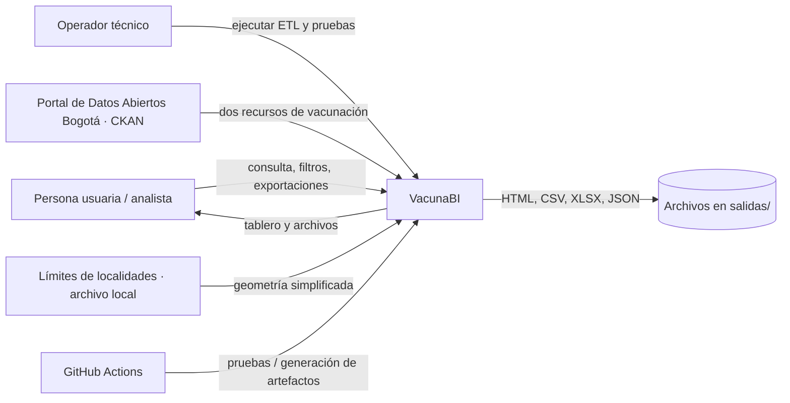
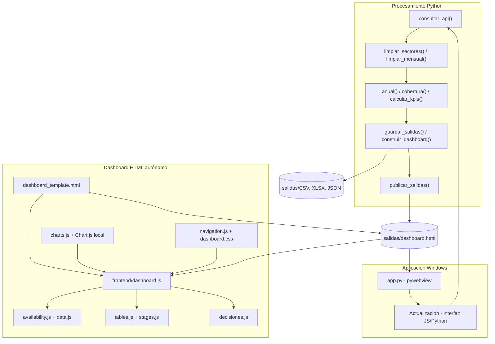
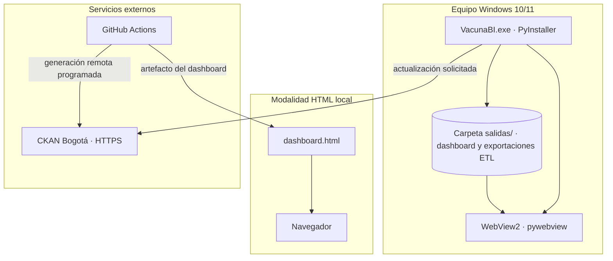
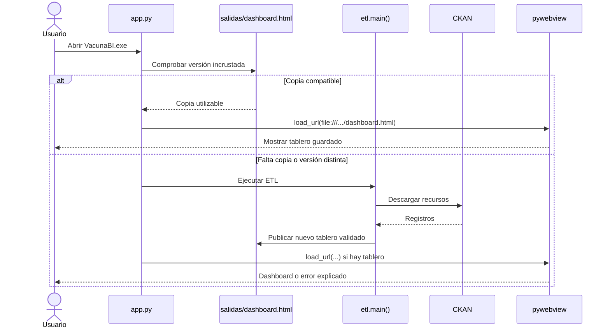
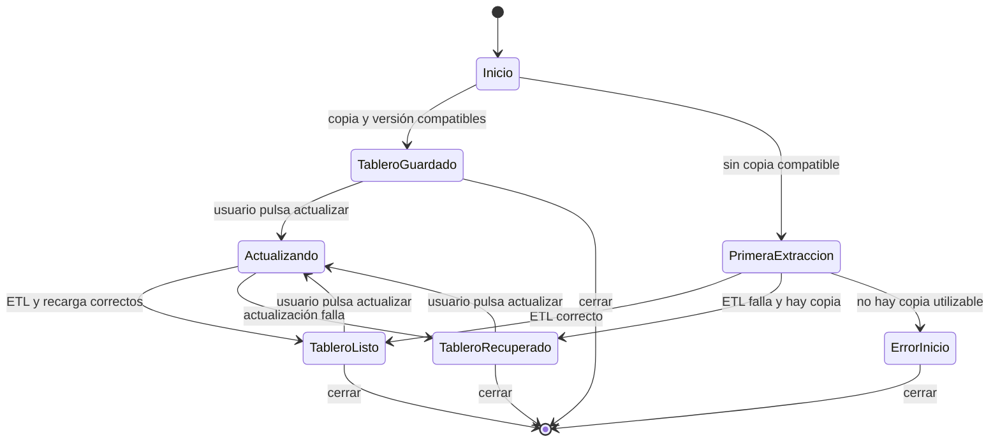

# Documentación técnica — VacunaBI V2.2.3

**Tipo:** manual técnico del sistema · **Ámbito:** código, arquitectura, componentes, interfaces, ejecución y mantenimiento  
**Proyecto:** Inteligencia de Negocios — Universidad Manuela Beltrán  
**Versión examinada:** V2.2.3 · **Fecha de revisión:** 16 de noviembre de 2026  
**Base de verificación:** archivos del repositorio `etl.py`, `app.py`, `dashboard_template.html`, `frontend/`, `decisiones.js` y workflows de GitHub Actions.

> Este manual describe **la implementación que existe**, no una arquitectura propuesta. Se acompaña de [Casos de uso y diagramas](CASOS_DE_USO_Y_DIAGRAMAS.md), [Diccionario y gestión de datos](DICCIONARIO_Y_GESTION_DATOS.md), [Proceso ETL](PROCESO_ETL.md) y [Documentación integral](DOCUMENTACION_INTEGRAL.md). La validación manual de Windows sigue documentada por separado.

## 1. Propósito y lectores

Este documento permite a un integrante del equipo o a otra persona desarrolladora entender cómo se construye VacunaBI, localizar el código responsable de cada función y reproducir su funcionamiento. También sirve como referencia durante la sustentación del proyecto: las decisiones de diseño se describen junto con sus consecuencias y límites.

VacunaBI es una aplicación de análisis de cobertura de vacunación **agregada para Bogotá D. C.** Descarga datos abiertos de dos recursos CKAN, los valida, los transforma y genera un dashboard HTML autónomo. El mismo HTML puede abrirse desde un navegador o dentro de la aplicación Windows compilada con PyInstaller.

No implementa servidor Express, base de datos relacional, autenticación, expedientes de pacientes ni API propia para terceros. No se debe incluir esos componentes en los diagramas como si ya estuvieran construidos.

## 2. Contexto y límites del sistema



En este contexto, «analista» y «operador técnico» son **roles de uso**, no perfiles de acceso. No existe inicio de sesión ni un esquema de permisos dentro de la aplicación. GitHub Actions actúa fuera del software local mediante procesos del repositorio.

## 3. Principios de diseño

Se aplicaron cinco decisiones que explican la implementación:

1. **Separar adquisición y presentación.** Python obtiene y transforma; JavaScript presenta y permite explorar el resultado.
2. **Mantener la procedencia.** La fuente distrital mensual y la fuente sectorial no se combinan como si tuvieran el mismo desglose.
3. **Priorizar integridad.** No se publica un conjunto incompleto, con totales inconsistentes o páginas duplicadas.
4. **Distribuir un HTML autónomo.** Se incluyen estilos, Chart.js, módulos y datos dentro del archivo generado.
5. **Evitar descargas innecesarias.** Desde V2.2.2 se utiliza un tablero local compatible al iniciar; la actualización completa es explícita.

La meta de referencia del análisis es `META = 95.0`, visible en `etl.py`. Los escenarios no son predicciones epidemiológicas.

## 4. Arquitectura por componentes



**Lectura:** el diagrama representa dependencias y responsabilidades. No representa una comunicación HTTP entre el HTML y un backend propio. El proceso Python construye el archivo que el navegador o WebView2 termina interpretando.

### 4.1. Responsabilidades y archivos

| Componente | Archivo | Responsabilidad principal |
| --- | --- | --- |
| Extracción y reglas ETL | `etl.py` | CKAN, validación, limpieza, cálculo, publicación y auditoría |
| Escritorio | `app.py` | Inicio, copia local, actualización, carga segura y diálogo de guardar |
| Plantilla | `dashboard_template.html` | Semántica, controles y contenedores de las seis vistas |
| Orquestación visual | `frontend/dashboard.js` | Filtros, mapa, tablas, escenarios, eventos y exportación |
| Gráficos | `frontend/charts.js` | Configuración de Chart.js, series y mapa de calor |
| Disponibilidad | `frontend/availability.js` | Compatibilidad real entre fuente, año y granularidad |
| Cálculos del cliente | `frontend/data.js` | Agregaciones y porcentajes ponderados |
| Tablas/CSV | `frontend/tables.js` | Tabla alternativa para gráficos y celdas CSV seguras |
| Navegación | `frontend/navigation.js` | Cambio de vista usando fragmentos y descripción activa |
| Etapas | `frontend/stages.js` | Progreso Selección → Priorización → Simulación → Resultados |
| Decisiones | `decisiones.js` | Coberturas, dosis faltantes, escenarios, ranking y alertas |
| Datos geográficos | `localidades.json` | Límites simplificados de las 20 localidades |
| Estilos | `frontend/dashboard.css` | Diseño responsive, temas, estados y foco |

### 4.2. Ensamblado del dashboard

El ETL lee `dashboard_template.html` e intercambia marcadores de texto por componentes reales:

| Marcador en plantilla | Sustitución |
| --- | --- |
| `/*__CHARTJS__*/` | Código de `chart.umd.min.js` |
| `/*__DECISIONES__*/` | Código de `decisiones.js` |
| `/*__ESTILOS__*/` | `frontend/dashboard.css` |
| `/*__COMPONENTES__*/` | `data.js`, `tables.js`, `stages.js` y `availability.js` |
| `/*__GRAFICOS__*/` | `frontend/charts.js` |
| `/*__DASHBOARD__*/` | `frontend/dashboard.js` |
| `/*__NAVEGACION__*/` | `frontend/navigation.js` |
| `/*__DATOS__*/null` | JSON con los datos preparados por el ETL |

El resultado final es un único `salidas/dashboard.html`. La salida se actualiza al ejecutar `etl.py` o solicitar una actualización desde el escritorio, no cada vez que se cambia un filtro.

## 5. Arquitectura de despliegue



**Entornos:**
- **Desarrollo:** Python 3.12 recomendado, pandas y openpyxl; Node.js para pruebas de JavaScript.
- **Ejecución web:** navegador capaz de interpretar el HTML generado; no requiere un backend propio.
- **Escritorio:** Windows 10/11 y WebView2; PyInstaller `--onefile --windowed` en el pipeline.
- **Integración continua:** GitHub Actions con un workflow de pruebas/datos y otro de Windows.

La ejecución desde el código produce `salidas/` en el directorio del proyecto; en el ejecutable, la ruta se construye junto a `sys.executable`. El usuario necesita permiso de escritura en esa ubicación.

## 6. Interfaces e integraciones reales

### 6.1. API externa de datos

La dependencia remota es el endpoint CKAN:

```text
GET https://datosabiertos.bogota.gov.co/api/3/action/datastore_search
?resource_id=<uuid>&limit=<entero>&offset=<entero>
```

Recursos: seguimiento sectorial `e519cce2-9951-41de-afbc-005d1e1d24dd` y cobertura mensual `1910589c-2836-41d3-aba4-00488bb5e5f3`.

La aplicación comprueba `success`, `result.total`, `result.records`, identificadores `_id` y columnas mínimas. El timeout HTTP es de 60 segundos **por petición**, no de la actualización completa.

### 6.2. Contrato JavaScript–Python para Windows

| Método del objeto `Actualizacion` | Entradas / respuesta | Uso |
| --- | --- | --- |
| `refresh_data()` | Sin parámetros; `{ok: boolean, message?: string}` | Ejecutar ETL manual |
| `recargar_dashboard()` | Sin parámetros; `{ok, message?}` | Reabrir HTML local tras actualizar |
| `consumir_aviso_recarga()` | Sin parámetros; booleano | Mostrar un único aviso de actualización |
| `inicio_con_copia_guardada()` | Sin parámetros; booleano | Explicar inicio desde copia compatible |
| `usa_copia_local()` | Sin parámetros; booleano | Informar recuperación de copia |
| `get_audit()` | Sin parámetros; lista de ejecuciones | Mostrar auditoría |
| `guardar_exportacion(nombre, contenido)` | Nombre limitado y contenido Base64; estado | Mostrar diálogo de guardado |

Estos son **métodos expuestos a la interfaz de la aplicación**, no endpoints HTTP ni servicios públicos.

### 6.3. Eventos del frontend

Los filtros `fSource`, `fYear`, `fLocal`, `fBio`, `fSector`, `fMode`, `fCompare`, `fMonthFrom` y `fMonthTo` activan la función de renderizado. La tabla también tiene búsqueda, orden y paginación, y el módulo Decisiones actualiza los resultados cuando se cambian pesos y escenarios.

Los datos de la interfaz proceden del JSON incrustado en la última generación del dashboard. Una combinación no soportada no dispara una consulta nueva a CKAN: muestra las limitaciones o permite seleccionar otra combinación.

## 7. Diagramas de secuencia de componentes

### 7.1. Inicio de escritorio



### 7.2. Actualización solicitada

```mermaid
sequenceDiagram
    actor Usuario
    participant JS as dashboard.js
    participant Bridge as app.py / Actualizacion
    participant ETL as etl.main()
    participant CKAN as API CKAN
    participant Files as salidas/
    Usuario->>JS: Pulsar Actualizar datos
    JS->>Bridge: refresh_data()
    Bridge->>ETL: main()
    par Fuente sectorial
        ETL->>CKAN: Paginación sectorial
    and Fuente mensual
        ETL->>CKAN: Paginación mensual
    end
    CKAN-->>ETL: Filas de ambos recursos
    alt Descargas y validaciones correctas
        ETL->>Files: Guardar / publicar con respaldo
        Bridge-->>JS: ok = true
        JS->>Bridge: recargar_dashboard()
        Bridge->>JS: Cargar file URI sin query string
    else Error en alguna etapa
        ETL->>Files: Conservar publicación anterior y auditar
        Bridge-->>JS: ok = false
        JS-->>Usuario: Aviso de fallo; conserva copia
    end
```

**Nota:** las dos fuentes se solicitan de forma concurrente. El diagrama resume el intercambio; no indica que cada consulta termine en el mismo instante.

## 8. Estados de la aplicación de escritorio



Las etiquetas «Tablero guardado», «Recuperado» y «Listo» sirven para explicar el flujo. No representan nombres de clases ni estados persistidos como una tabla de base de datos.

## 9. Requisitos y trazabilidad técnica

| ID | Comportamiento | Implementación | Validación relevante |
| --- | --- | --- | --- |
| RF-01 | Extraer ambas fuentes | `consultar_api()`, `main()` | `test_etl_regression.py` |
| RF-02 | Rechazar descargas incompletas | validadores de páginas y esquema | pruebas de páginas vacías, duplicadas y totales cambiantes |
| RF-03 | Limpiar y normalizar | `limpiar_sectores()` y `limpiar_mensual()` | `test_etl.py`, regresiones |
| RF-04 | Calcular KPIs | `calcular_kpis()`, `cobertura()` | pruebas numéricas del ETL |
| RF-05 | Construir HTML | `construir_dashboard()` | `test_release_integrity.py` |
| RF-06 | Filtrar por fuente y año | `availability.js` y `dashboard.js` | `test_frontend.cjs` |
| RF-07 | Navegar seis vistas | `navigation.js` | `test_dashboard_template.py` |
| RF-08 | Consultar mapa y territorios | `dashboard.js`, `localidades.json` | pruebas estructurales y aceptación manual |
| RF-09 | Simular y priorizar | `decisiones.js` | `test_decisiones.cjs` |
| RF-10 | Exportar tablas y fichas | `tables.js`, `dashboard.js`, `app.py` | `test_frontend.cjs` y `test_app_export.py` |
| RF-11 | Reabrir copia local | `hay_tablero_compatible()`, `cargar()` | `test_app_export.py` |
| RF-12 | Actualizar manualmente | `Actualizacion.refresh_data()` | prueba de escritorio simulada y aceptación pendiente |
| RF-13 | Auditar ejecución | `auditoria.json` y vista Calidad | regresiones de ETL |
| RF-14 | Importar vista previa CSV | `parsePreview()` y eventos | revisión de código y aceptación funcional pendiente |

Los identificadores de esta tabla se usan para **trazabilidad documental**; no reemplazan las funciones ni corresponden a nombres de rutas HTTP. Los diagramas de casos de uso están ampliados en [CASOS_DE_USO_Y_DIAGRAMAS.md](CASOS_DE_USO_Y_DIAGRAMAS.md).

## 10. Calidad, errores y recuperación

La aplicación protege la publicación por dos vías:

**A nivel de descarga:** comprueba respuesta CKAN, total, coherencia de páginas, IDs y columnas. Si falla, no continúa con una fuente parcial.

**A nivel de archivos:** genera resultados en un directorio temporal y realiza copia de respaldo antes de reemplazar archivos. Si el reemplazo falla, restaura los ya sustituidos.

Un fallo de actualización se informa en la interfaz y deja disponible el tablero anterior cuando existe. El historial de auditoría conserva los registros de ejecuciones recientes y el detalle del error.

### 10.1. Fallos que no deben ocultarse

| Situación | Respuesta documentada |
| --- | --- |
| Fuente responde sin filas o con total inválido | La extracción falla |
| IDs repetidos entre páginas | La extracción falla |
| Columna requerida ausente | La extracción falla |
| Datos sin registros utilizables tras limpiar | No se publica tablero nuevo |
| Carpeta de destino bloqueada | Se intenta restaurar el respaldo |
| No existe archivo previo | No hay copia con la que recuperarse |
| Selección de filtros sin filas | Mensaje de ausencia, no cobertura cero |
| Sin desglose distrital por localidad | Mensaje de granularidad incompatible |
| Error de guardado | Mensaje de error y no se afirma éxito |

## 11. Consideraciones de seguridad y privacidad

Se utilizan datos públicos agregados. No existe módulo de pacientes, credenciales, roles ni inicio de sesión. El HTML incorpora una política CSP, distribuye Chart.js localmente, escapa contenido al preparar salidas HTML y contempla protección frente a fórmulas de hoja de cálculo en exportaciones CSV.

El puente de exportación nativo acepta únicamente nombres con el formato permitido y archivos CSV/XLSX; su contenido se entrega por Base64 y se escribe mediante diálogo de usuario. Esto no debe presentarse como una auditoría de ciberseguridad completa.

Los archivos de salida y la carpeta de instalación requieren tratamiento responsable: no almacenar allí datos personales de pacientes, porque ese escenario no hace parte del proyecto ni de sus pruebas.

## 12. Rendimiento y restricciones

`etl.py` utiliza `API_PAGE_SIZE = 1000` y `API_PAGE_WORKERS = 2`; ambos recursos CKAN se descargan simultáneamente. La descarga usa un timeout por petición de 60 segundos. Se registra `duracion_descarga_segundos` en la auditoría cuando ambas fuentes se obtienen correctamente.

Esta concurrencia busca evitar esperas secuenciales innecesarias. No hay benchmark comprobado que demuestre una aceleración porcentual fija en un equipo de usuario: los tiempos dependen de red y servidor.

El inicio desde una copia compatible evita repetir consultas remotas automáticamente. La actualización explícita sigue trayendo los recursos completos.

## 13. Instalación y ejecución para desarrolladores

```bash
git clone https://github.com/Codeforgeettttt/VacunaBI.git
cd VacunaBI
python -m venv .venv
python -m pip install -r requirements.txt
python etl.py
```

Para ejecutar el escritorio desde el código:

```bash
python -m pip install pywebview==5.3.2
python app.py
```

Para generar el ejecutable en Windows se utiliza PyInstaller 6.22.3 y se empaquetan la plantilla, el frontend, Chart.js, los datos geográficos y `decisiones.js`. El comando exacto se encuentra en [windows.yml](../.github/workflows/windows.yml) y en el [README](../README.md).

## 14. Pruebas automatizadas y aceptación

```bash
python test_etl.py
python -m unittest -v test_etl_regression test_dashboard_template test_app_export test_release_integrity
node --test test_decisiones.cjs test_frontend.cjs
```

Los workflows verifican estas suites. La release V2.2.3 dispone de ejecutable compilado, pero las **pruebas manuales de Windows**, accesibilidad con lector de pantalla y rendimiento real de CKAN continúan separadas en [VALIDACION_WINDOWS.md](VALIDACION_WINDOWS.md). No se deben marcar aprobadas sin evidencia.

## 15. Mantenimiento y reglas para evolucionar el sistema

Para una corrección técnica: identificar el módulo, reproducir con un conjunto controlado, ejecutar pruebas, hacer el cambio mínimo, comprobar que el cálculo de indicadores no se alteró, actualizar la documentación y repetir la validación. Un cambio que altere el contrato del HTML requiere revisar también `VERSION_TABLERO` y su marcador en la plantilla.

Cuando se publique un ejecutable, el artefacto, el tag y el commit de release deben corresponder. No modificar retrospectivamente los resultados clínicos o las fuentes para que el tablero «se vea completo».

**Referencias técnicas internas:** [ETL](PROCESO_ETL.md) · [Diccionario](DICCIONARIO_Y_GESTION_DATOS.md) · [Casos de uso](CASOS_DE_USO_Y_DIAGRAMAS.md) · [Calidad](CALIDAD_DATOS.md) · [Filtros](FILTROS_FUENTES.md).
