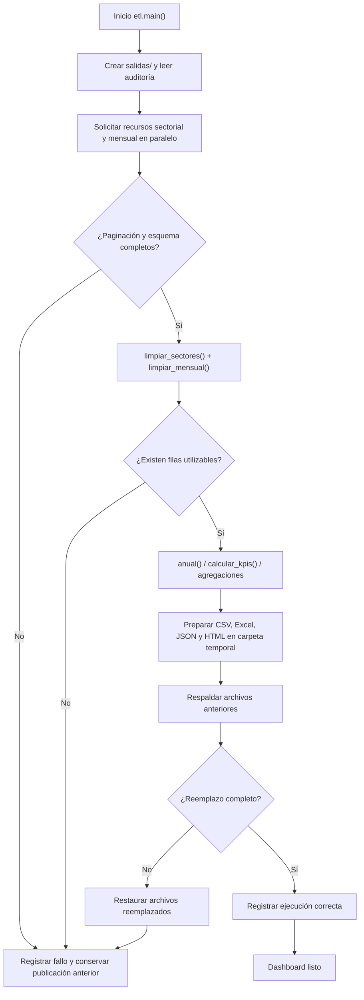
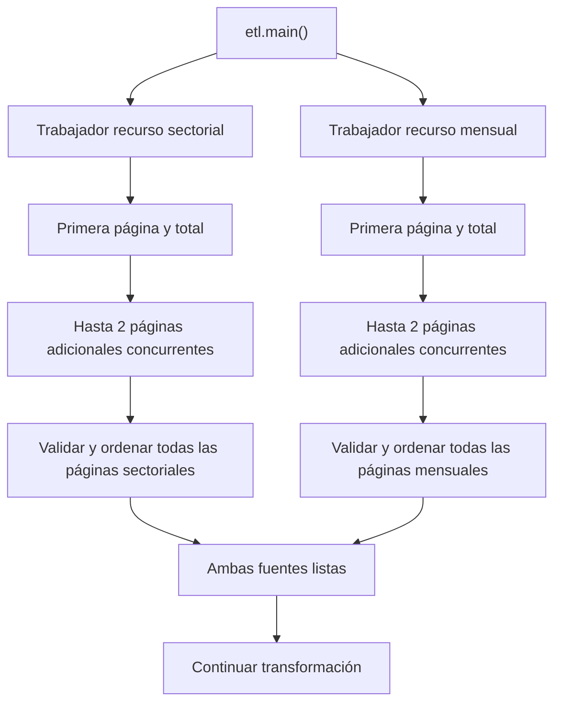
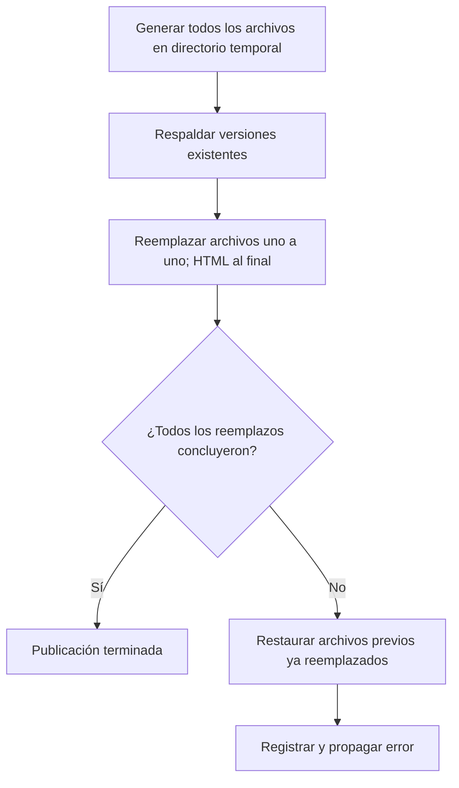

# Proceso ETL de VacunaBI — Diseño, ejecución, control y trazabilidad

**Versión:** 2.2.3 · **Responsable en código:** `etl.py`  
**Tipo de documento:** especificación de extracción, transformación, carga y operación  
**Fuentes:** API CKAN de Datos Abiertos Bogotá · **Salida:** archivos analíticos locales y dashboard HTML.

Este documento explica cómo se procesan los datos **desde la solicitud a CKAN hasta la publicación del tablero**, incluidos validadores, fórmulas, concurrencia, auditoría y recuperación. Forma parte de la documentación técnica de VacunaBI; no es un procedimiento hipotético.

## 1. Objetivo del proceso

El ETL toma dos recursos abiertos de vacunación, comprueba que las respuestas estén completas, prepara tablas de análisis y publica una nueva versión de los archivos que utiliza el dashboard. El propósito es que las gráficas y los indicadores provengan de registros verificables.

El ETL no modifica los recursos oficiales. Tampoco es un flujo incremental ni un servicio que consulte permanentemente la API: cada ejecución completa descarga las fuentes requeridas.

## 2. Vista general y diagrama de actividad



La función `main()` coordina todas las etapas. El detalle de las reglas está en `consultar_api()`, `limpiar_sectores()`, `limpiar_mensual()`, `anual()`, `calcular_kpis()` y `publicar_salidas()`.

## 3. Parámetros y recursos de entrada

| Parámetro | Valor en V2.2.3 | Efecto |
| --- | --- | --- |
| `API` | `https://datosabiertos.bogota.gov.co/api/3/action/datastore_search` | Endpoint CKAN |
| `RES_SECTORES` | `e519cce2-9951-41de-afbc-005d1e1d24dd` | Recurso de seguimiento sectorial |
| `RES_MENSUAL` | `1910589c-2836-41d3-aba4-00488bb5e5f3` | Recurso de cobertura mensual |
| `API_PAGE_SIZE` | 1000 | Límite de filas solicitado en la primera página |
| `API_PAGE_WORKERS` | 2 | Páginas adicionales simultáneas por recurso |
| Concurrencia de recursos | 2 trabajadores | Consulta simultánea de F-01 y F-02 |
| Timeout HTTP | 60 segundos por solicitud | No es un timeout global |
| `META` | 95.0 % | Referencia de cálculos de brecha |
| `VERSION_TABLERO` | 2.2.3 | Compatibilidad del HTML con la aplicación Windows |
| `OUT` | Carpeta `salidas/` | Destino de los archivos |

La estructura de respuesta esperada contiene `success` y `result`, con `total` y `records`. El código consulta mediante GET agregando `resource_id`, `limit` y `offset`.

## 4. Extracción (E): paginación CKAN

### 4.1. Primera petición

La extracción de cada recurso comienza con:

```text
GET /api/3/action/datastore_search
    ?resource_id=<id_del_recurso>
    &limit=1000
    &offset=0
```

La primera respuesta permite conocer el total declarado por CKAN. Se espera una lista de registros no vacía, de tamaño permitido, y un entero positivo para `total`.

### 4.2. Cálculo de las páginas restantes

El código obtiene el tamaño real de la primera página. Si el servidor devuelve menos filas de las solicitadas, utiliza ese tamaño como paso para el resto de páginas, en lugar de asumir que siempre entrega 1.000.

Ejemplo **ficticio**: el servidor anuncia 2.500 registros y devuelve 1.000 en la primera página. Se solicitan después los offsets 1.000 y 2.000. Si en la primera página solo entregara 500 filas, la lógica usaría offsets de 500 en 500 para no saltarse registros.

### 4.3. Descarga concurrente



La versión 2.2.3 usa `ThreadPoolExecutor` para consultar los dos recursos en paralelo y otro ejecutor con `max_workers=2` para las páginas adicionales de cada uno.

El iterador `executor.map()` entrega los resultados en el mismo orden de offsets solicitados, aunque las peticiones de red terminen en un orden diferente. El proceso verifica y agrega las filas según ese orden.

**Precaución:** descargar en paralelo reduce esperas secuenciales cuando el servidor lo permite. No puede garantizar que el servicio CKAN responda más rápido ni que cada actualización complete en un número fijo de segundos.

### 4.4. Controles de integridad de extracción

Antes de construir un DataFrame se comprueba:

1. Que CKAN informe éxito.
2. Que el total declarado sea un entero positivo.
3. Que no falten páginas o filas necesarias para completar el total.
4. Que las páginas posteriores informen el mismo total.
5. Que los registros tengan identificador `_id`.
6. Que no haya identificadores duplicados dentro ni entre páginas.
7. Que el total de filas acumuladas coincida con el total anunciado.
8. Que el resultado incluya las columnas mínimas del esquema del recurso.

Si falla cualquiera de estas comprobaciones, la actualización se interrumpe con un error; **no se publican solo las páginas que sí respondieron**.

### 4.5. Riesgos de una fuente dinámica

CKAN puede cambiar el contenido de un recurso mientras está paginándose. La comparación de totales y las comprobaciones de IDs detectan inconsistencias concretas, pero **no proporcionan una transacción snapshot garantizada por la API**. Si la fuente cambia sus filas sin alterar totales ni generar duplicados, algunos cambios podrían no detectarse con estas reglas. Esto debe considerarse al exigir reproducibilidad estricta.

El ETL no implementa actualmente retrocesos exponenciales (backoff), reintentos automáticos ni cancelación global después de un límite total de tiempo. Esas son posibles mejoras, no características existentes.

## 5. Transformación (T): seguimiento sectorial

### 5.1. Reglas paso a paso

`limpiar_sectores(df)` aplica:

| Paso | Transformación | Motivo |
| --- | --- | --- |
| T-S01 | Pasar columnas a minúsculas, limpiar espacios | Normalizar etiquetas |
| T-S02 | Parsear `fecha_reporte` con `%d/%m/%Y` | Homogeneizar periodos |
| T-S03 | Convertir dosis, denominador y cobertura | Permitir cálculo fiable |
| T-S04 | Interpretar `cobertura` publicada dividiendo por 10 | Adaptarse al formato del recurso |
| T-S05 | Recalcular `100 × dosis / denominador` | Comprobar porcentaje |
| T-S06 | Marcar diferencias mayores a 0,1 pp | Detectar inconsistencia |
| T-S07 | Marcar valores superiores a 100 % | Mantener observación visible |
| T-S08 | Extraer código y nombre de localidad | Identificar territorio |
| T-S09 | Excluir localidades fuera de las reconocidas | Respetar alcance Bogotá |
| T-S10 | Descartar fechas/cantidades/dimensiones inválidas | Evitar porcentajes imposibles |
| T-S11 | Normalizar instituciones y asignar grupo biológico | Facilitar comparaciones |
| T-S12 | Calcular cumplimiento y brecha | Preparar KPIs |
| T-S13 | Eliminar duplicados por fecha, localidad, biológico e institución | Evitar doble conteo |
| T-S14 | Ordenar y conservar columnas definidas | Consistencia de salida |

### 5.2. Cálculo de la cobertura sectorial

```text
cobertura_recalculada = round(dosis_aplicada / denominador × 100, 1)
brecha_meta = max(0, 95 − cobertura_recalculada)
cumple_meta = cobertura_recalculada >= 95
flag_inconsistencia = abs(cobertura_reportada − cobertura_recalculada) > 0,1
flag_sobre_100 = cobertura_recalculada > 100
```

**Ejemplo ficticio:** 17 dosis y un denominador de 24 generan una cobertura de 70,8 %. Si la fuente publica `708` y el código lo interpreta como 70,8 %, ambas medidas coinciden dentro de la tolerancia.

Una cobertura de 120 % no se sustituye por 100 %. La cifra se conserva y se señala para revisar el numerador, denominador y definición del recurso.

### 5.3. Validación territorial

El ETL solo acepta localidades de la lista configurada para Bogotá y les asigna una zona. La geometría del mapa procede de un archivo separado, no de una operación espacial durante la limpieza.

La clasificación por grupo de biológico depende de `grupo_biologico()`. No es un proceso de homologación clínica formal de todas las vacunas del país.

## 6. Transformación (T): fuente mensual distrital

### 6.1. Normalización

`limpiar_mensual(df)` renombra campos originales y convierte año, mes, población meta y vacunados. El parser de cantidades utiliza convenciones de formato colombiano: punto de miles y coma decimal cuando se encuentran en valores de texto.

La fuente contiene filas con `Orden mes = 13` que representan totales y se retiran antes de recalcular. Se aceptan meses válidos **sin cantidad reportada** y se conserva su ausencia como tal.

### 6.2. Reglas principales

| Paso | Operación |
| --- | --- |
| T-M01 | Renombrar las columnas del recurso |
| T-M02 | Limpiar descripción del biológico |
| T-M03 | Convertir año y mes a enteros válidos |
| T-M04 | Excluir fila total (mes 13) |
| T-M05 | Leer cantidades con formato colombiano |
| T-M06 | Exigir meta positiva y vacunados no negativos cuando existan |
| T-M07 | Eliminar duplicados por biológico/año/mes |
| T-M08 | Marcar `reportado` según presencia de cantidad |
| T-M09 | Acumular por biológico y año |
| T-M10 | Calcular cobertura acumulada |

### 6.3. Agregación anual

`anual(mensual)` trabaja con meses reportados y genera una fila por biológico y año:

```text
poblacion_meta = máximo de la meta entre meses reportados
vacunados = suma de vacunados_mes reportados
meses_reportados = conteo de meses con dato
cobertura = round(vacunados / poblacion_meta × 100, 1)
anio_completo = (meses_reportados == 12)
cobertura_proyectada = round(cobertura × 12 / meses_reportados, 1)
```

**Advertencia:** la extrapolación de cobertura a doce meses es aritmética, no un modelo de pronóstico evaluado estadísticamente. Los años con menos de doce meses deben mantenerse identificados como parciales.

## 7. Indicadores y agregaciones

### 7.1. Cobertura ponderada

La función `cobertura(df, por)` agrupa registros por dimensiones (por ejemplo, localidad o institución) y calcula:

```text
cobertura_agregada =
  suma(dosis_aplicada) / suma(denominador) × 100
```

No realiza una media aritmética de coberturas individuales. Esta regla protege las comparaciones cuando cada grupo representa poblaciones objetivo diferentes.

### 7.2. KPI del último corte sectorial

`calcular_kpis(sec, anu)` restringe las filas sectoriales al corte más reciente antes de calcular indicadores como cobertura general sectorial, cobertura de primera infancia, localidades bajo meta, localidad con menor cobertura, dosis faltantes y porcentajes de cumplimiento.

También utiliza años completos de la fuente distrital para referencias de triple viral y conteos por biológico. Se debe revisar [DICCIONARIO_Y_GESTION_DATOS.md](DICCIONARIO_Y_GESTION_DATOS.md) para conocer todas las claves del JSON.

### 7.3. Dosis adicionales

```text
dosis_faltantes =
  max(0, ceil(meta_porcentaje × denominador / 100) − dosis_aplicadas)
```

Se exige dosis no negativas, denominador positivo y meta válida. Un dato inválido no se corrige inventando un denominador.

## 8. Carga (L): producción de archivos

### 8.1. Archivos escritos

`guardar_salidas()` prepara:

| Archivo | Contenido |
| --- | --- |
| `crudo_sectores.csv` | Registros originales del recurso sectorial |
| `crudo_mensual.csv` | Registros originales del recurso mensual |
| `hechos_sectores.csv` | Filas sectoriales tratadas |
| `cobertura_anual.csv` | Serie anual |
| `base_consolidada.xlsx` | Hechos, dimensiones, indicadores y logs |
| `kpis.json` | KPIs y contadores de limpieza |
| `dashboard.html` | HTML autónomo con datos y módulos locales |
| `auditoria.json` | Historial de ejecuciones |

Las hojas del Excel son `HECHOS_SECTORES`, `HECHOS_MENSUAL`, `COBERTURA_ANUAL`, `DIM_LOCALIDAD`, `DIM_BIOLOGICO`, `KPI` y `LOG_LIMPIEZA`.

### 8.2. Construcción del HTML

`construir_dashboard()` serializa indicadores, límites de localidades, series anual y mensual, datos sectoriales, logs y auditoría en un objeto JavaScript. A partir de la plantilla HTML reemplaza los marcadores de Chart.js, CSS, componentes y datos.

El HTML generado es un **artefacto estático con información del corte**, no una vista que consulte directamente CKAN cada vez que se mueve un filtro.

### 8.3. Publicación con respaldo



La publicación utiliza una carpeta temporal y respaldos locales. Si ocurre un error al reemplazar un archivo, restaura los sustituidos en la misma operación y **no marca el ETL como éxito**.

La copia válida del dashboard es especialmente útil en Windows si una ejecución posterior falla.

## 9. Auditoría y control de ejecuciones

### 9.1. Estructura funcional de una entrada

El registro de auditoría contempla, según la fase alcanzada:

| Campo | Descripción |
| --- | --- |
| `inicio` | Momento de inicio en formato ISO UTC |
| `fin` | Momento de cierre, cuando se finaliza |
| `estado` | En curso, Correcta o Fallida según el registro |
| `fase` | Descarga sectorial, Descarga mensual, Validación y transformación, Publicación o Completa |
| `fuentes` | Por recurso: identificador, originales, aceptados, descartados, observados y corte si se obtuvieron |
| `duracion_descarga_segundos` | Tiempo desde inicio de solicitudes hasta disponer de ambas fuentes, si llegaron a completarse |
| `detalle` | Error de fallo cuando aplica |

Las fases de auditoría describen el avance del orquestador. Aunque las dos fuentes se consulten simultáneamente desde V2.2.3, la fase puede mostrar «Descarga mensual» al esperar su resultado, porque el proceso coordina los resultados secuencialmente después de iniciar ambas tareas.

### 9.2. Retención del historial

`historial_auditoria()` lee hasta **29 entradas previas**, y una ejecución nueva añade su registro, de modo que el historial ordinario conserva alrededor de 30 ejecuciones recientes.

No se implementa una retención indefinida de cada descarga histórica ni una base de logs centralizada.

## 10. Excepciones y recuperación

| Fallo | Punto de detección | Consecuencia |
| --- | --- | --- |
| CKAN devuelve `success: false` | Extracción | Error, no publicación |
| Timeout de petición | Red | Error, no publicación |
| Página vacía/incompleta | Extracción | Error, no publicación |
| Cambio de total entre páginas | Extracción | Error, no publicación |
| IDs repetidos | Extracción | Error, no publicación |
| Columna necesaria ausente | Esquema | Error, no publicación |
| Filas sin denominador válido | Limpieza | Se excluyen con registro de conteo |
| Todas las filas útiles desaparecen | Validación | Error, se conserva salida anterior |
| Archivo bloqueado | Publicación | Restauración de archivos reemplazados |
| Primera ejecución sin Internet ni copia | Escritorio | No hay tablero nuevo; se informa fallo |
| Actualización sin Internet con copia válida | Escritorio | Se conserva tablero anterior, sin afirmar éxito |

### 10.1. Diferencia entre descartado, observado y ausente

**Descartado**: fila que no cumple una regla y se excluye.  
**Observado**: fila que permanece, pero lleva una bandera de inconsistencia o cobertura elevada.  
**Ausente**: dato que no fue reportado, sin valor para calcular.  
**Cero**: valor numérico disponible y válido igual a cero.

La aplicación no debe intercambiar estas condiciones.

## 11. Rendimiento: alcance de la V2.2.3

La mejora principal consiste en descargar simultáneamente dos recursos y hasta dos páginas adicionales de cada recurso en paralelo. Su objetivo es disminuir los periodos de espera innecesaria de consultas secuenciales.

**Se verifica con pruebas unitarias** que una paginación simulada mantenga orden, rechace duplicados y detecte cambios de total. Eso no es una medición del rendimiento del servidor público.

Para medir en el equipo del usuario se recomienda registrar:

| Dato de ensayo | Registro necesario |
| --- | --- |
| Versión | V2.2.3 |
| Equipo/sistema | Windows, red, condiciones |
| Hora de ejecución | Inicio y fin |
| Acción | Actualizar datos |
| Tiempo de descarga | Campo de auditoría `duracion_descarga_segundos` |
| Tiempo total visible | Desde clic hasta carga y confirmación |
| Resultado | Correcto, incompleto o error |
| Cortes | Fecha sectorial y mes distrital |
| Comparación | Misma conexión y condiciones frente a versión anterior |

No se afirma una reducción porcentual sin datos de mediciones comparables.

## 12. Reproducción local y CI

### 12.1. Ejecutar el ETL desde Python

```bash
git clone https://github.com/Codeforgeettttt/VacunaBI.git
cd VacunaBI
python -m venv .venv
python -m pip install -r requirements.txt
python etl.py
```

La primera ejecución requiere acceso a CKAN. Los resultados aparecerán en `salidas/`.

### 12.2. Pruebas de regresión sin acceso a la API

```bash
python test_etl.py
python -m unittest -v test_etl_regression test_dashboard_template test_app_export test_release_integrity
node --test test_decisiones.cjs test_frontend.cjs
```

Casos cubiertos por las regresiones: paginación incompleta, concurrencia y orden, IDs repetidos, cambios de total, fechas y cantidades inválidas, duplicados de negocio, coberturas superiores al 100 %, periodos parciales y fallo de publicación por bloqueo de archivo.

### 12.3. Automatización

El workflow [actualizar.yml](../.github/workflows/actualizar.yml) ejecuta pruebas en cada `push` a `main` y dispone de una ejecución programada diaria declarada a las 11:00 UTC (06:00 de Colombia), además del disparador manual. La fase de descarga remota se ejecuta cuando el evento no es `push` y pasa las pruebas.

El artefacto se llama `VacunaBI-Dashboard`. La publicación web mediante GitHub Pages es opcional y depende de la variable `ENABLE_PAGES`. No debe asumirse que Pages está activo.

## 13. Mantenimiento operativo y mejoras futuras

1. Si CKAN cambia su esquema, modificar `ESCHEMAS` y las transformaciones **junto con** las pruebas.
2. Si se agrega una nueva fuente, documentar primero sus dimensiones y periodos; no forzar una unión con la serie existente.
3. Si cambia una fórmula de indicador, registrar la justificación y una prueba que proteja el resultado esperado.
4. Si se modifica la estructura del HTML, revisar la compatibilidad con el ejecutable mediante `VERSION_TABLERO`.
5. Si fallan extracciones repetidas, revisar el historial local antes de alterar el tamaño de páginas o la concurrencia.

Mejoras posibles —**aún no implementadas**—: reintentos con backoff, métricas separadas por recurso, límite global de tiempo de consulta, disponibilidad de una extracción histórica por fecha, monitoreo del esquema y benchmarks sistemáticos.

## 14. Matriz de trazabilidad ETL

| Regla/operación | Función | Prueba o evidencia |
| --- | --- | --- |
| Paginación y esquema | `consultar_api()` | `test_etl_regression.py` |
| Concurrencia y orden | `consultar_api()` | Prueba de páginas concurrentes |
| Duplicados entre páginas | `consultar_api()` | Prueba de IDs repetidos |
| Transformación sectorial | `limpiar_sectores()` | `test_etl.py` y regresiones |
| Transformación mensual | `limpiar_mensual()` | Regresiones y periodos parciales |
| Cobertura ponderada | `cobertura()` | Prueba de agregación |
| Dosis adicionales | `dosis_adicionales()` | Prueba de redondeo |
| Indicadores | `calcular_kpis()` | Regresiones de datos y contrato HTML |
| Construcción del dashboard | `construir_dashboard()` | `test_release_integrity.py` |
| Publicación con respaldo | `publicar_salidas()` | Prueba de archivo bloqueado |
| Auditoría de fallo | `main()` | Prueba de fallo de segunda fuente |

**Lectura adicional:** [Diccionario y gestión de datos](DICCIONARIO_Y_GESTION_DATOS.md) · [Manual técnico](DOCUMENTACION_TECNICA.md) · [Calidad y trazabilidad](CALIDAD_DATOS.md) · [Validación Windows](VALIDACION_WINDOWS.md).
