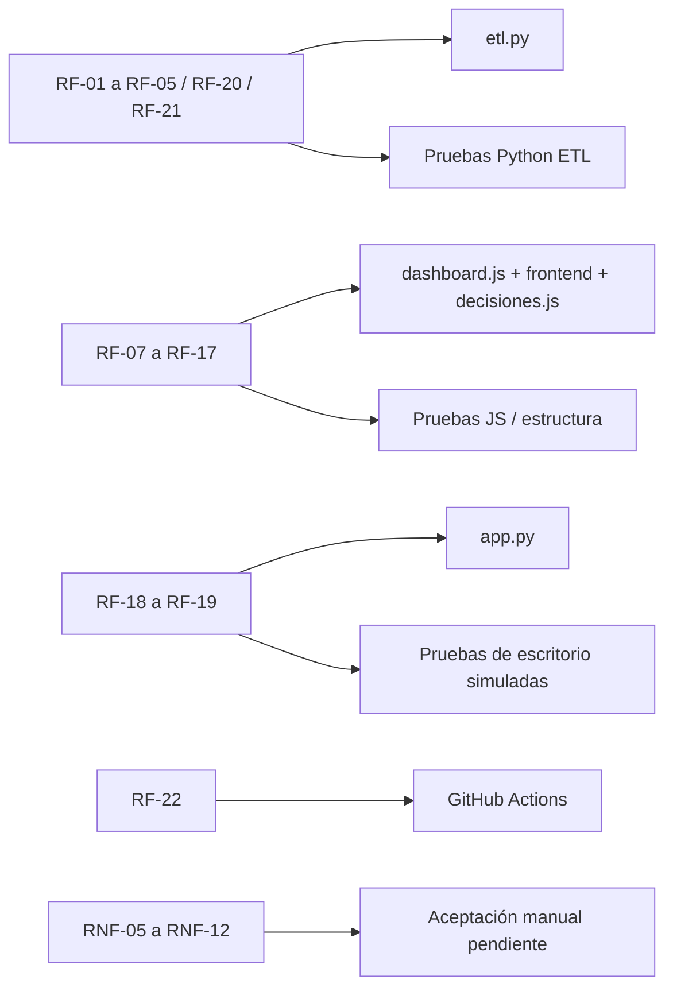

# Especificación de requisitos y plan de pruebas — VacunaBI

**Proyecto:** VacunaBI · **Versión:** V2.2.3  
**Enfoque:** requisitos verificables, trazabilidad, criterios de aceptación y evidencia.  
**Documentos relacionados:** [Casos de uso](CASOS_DE_USO_Y_DIAGRAMAS.md), [Manual técnico](DOCUMENTACION_TECNICA.md), [Diccionario](DICCIONARIO_Y_GESTION_DATOS.md), [ETL](PROCESO_ETL.md) y [Validación Windows](VALIDACION_WINDOWS.md).

Este documento explica qué debería hacer el sistema según las funcionalidades implementadas y cómo comprobarlo. **No equivale a un reporte de pruebas manuales completadas**. Los casos manuales se dejan con estado inicial «Pendiente» hasta que exista una ejecución y evidencia comprobable.

## 1. Alcance de los requisitos

Se consideran la generación del dashboard, la consulta de indicadores, el procesamiento ETL, la interfaz web local, el ejecutable Windows, las exportaciones y el mantenimiento por GitHub Actions.

El sistema no incluye datos de pacientes, autenticación, roles administrativos, una base de datos SQL ni modelos predictivos de comportamiento futuro.

### 1.1. Convenciones

- **RF:** requisito funcional.
- **RNF:** requisito no funcional.
- **CU:** caso de uso documentado (identificadores UC-01 a UC-19).
- **PA:** prueba de aceptación funcional.
- **CI:** ejecución automatizada en GitHub Actions.
- **Pendiente:** no hay evidencia manual que permita marcar éxito o fallo.

## 2. Requisitos funcionales y aceptación

| ID | Requisito | Criterio observable de aceptación | Caso de uso |
| --- | --- | --- | --- |
| RF-01 | Descargar los dos recursos de CKAN | No continuar si falta una fuente o hay páginas inválidas | UC-12/13 |
| RF-02 | Validar esquema, totales e identificadores | Rechazar total cambiante, duplicados, columnas ausentes o descarga parcial | UC-13 |
| RF-03 | Limpiar datos sectoriales | Convertir fecha y cantidades, validar localidad y retirar duplicados lógicos | UC-12/13 |
| RF-04 | Limpiar datos mensuales | Excluir fila mes 13, conservar meses sin reporte e identificar años parciales | UC-12/13 |
| RF-05 | Calcular indicadores de cobertura | Usar sumas de dosis/denominador y meta de 95 % | UC-01/12 |
| RF-06 | Generar salida autónoma | Construir `dashboard.html` con recursos incluidos y sin CDN externa obligatoria | UC-12 |
| RF-07 | Navegar seis vistas | Abrir Resumen, Localidades, Sectores, Calidad, Decisiones y Metodología | UC-01/03/05/06/07/15 |
| RF-08 | Filtrar por dimensiones disponibles | Ajustar tablas/gráficos compatibles sin pedir campos que la fuente no publica | UC-02 |
| RF-09 | Explicar selecciones sin registros | Distinguir ausencia, incompatibilidad y cero observado | UC-02 |
| RF-10 | Mostrar mapa y ranking | Utilizar mismo corte sectorial para mapa, ranking y ficha | UC-03 |
| RF-11 | Comparar localidades | Mostrar datos comparables y diferencia en puntos porcentuales | UC-04 |
| RF-12 | Explorar sectores y biológicos | Mostrar instituciones y grupos presentes, sin confundir las dos fuentes | UC-05 |
| RF-13 | Mostrar trazabilidad y calidad | Exponer fuentes, cortes, aceptados, descartados y observados | UC-06 |
| RF-14 | Generar prioridades y escenarios | Aplicar pesos visibles y denominador fijo; rechazar entradas inválidas | UC-07 |
| RF-15 | Mostrar alertas y reporte | Señalar periodos parciales, brechas y anomalías de calidad | UC-19 |
| RF-16 | Buscar, ordenar, paginar y exportar | Exportar la misma selección compatible de la tabla | UC-08/16 |
| RF-17 | Importar CSV temporal | Validar columnas, corte y cantidades; permitir quitar vista previa | UC-09 |
| RF-18 | Abrir escritorio con copia compatible | Segunda apertura de la misma versión no repite ETL automáticamente | UC-11 |
| RF-19 | Actualizar manualmente desde Windows | Ejecutar ETL completo y reabrir HTML local al finalizar bien | UC-10 |
| RF-20 | Conservar último tablero ante error | No sustituir archivos válidos por resultados incompletos | UC-10/11/12 |
| RF-21 | Mantener registro de auditoría | Registrar resultado, fase y detalle de fallos disponibles | UC-06/12 |
| RF-22 | Ejecutar pruebas y generar ejecutable | Workflow construye artefacto solo después de superar los pasos definidos | UC-14 |

Estos códigos permiten asignar y comprobar responsabilidades. No implican que exista una herramienta de gestión de requisitos desplegada dentro del programa.

## 3. Requisitos no funcionales

| ID | Aspecto | Criterio comprobable | Estado de evidencia |
| --- | --- | --- | --- |
| RNF-01 | Integridad | Sin publicación si cambian totales o IDs de páginas CKAN | Protegido por regresiones |
| RNF-02 | Reproducibilidad | Código, dependencias declaradas y pruebas accesibles | Disponible en GitHub; dependencias transitivas no bloqueadas |
| RNF-03 | Portabilidad de resultados | HTML autónomo con módulos, estilos y gráficos locales | Verificado estructuralmente |
| RNF-04 | Trazabilidad | Datos de fuente, corte y ejecución identificables | Implementado en auditoría y HTML |
| RNF-05 | Usabilidad | Estado vacío útil y controles de compatibilidad | Implementado; prueba de usuarios pendiente |
| RNF-06 | Accesibilidad | Foco, navegación y tablas alternativas | Pruebas estructurales; revisión manual pendiente |
| RNF-07 | Rendimiento | Consultas concurrentes con máximo dos páginas adicionales por recurso | Implementado; benchmark real pendiente |
| RNF-08 | Resiliencia | Conservar publicación anterior cuando falla ETL | Probado con simulaciones |
| RNF-09 | Seguridad de exportaciones | Guardado solicitado, error visible y tratamiento seguro de CSV | Cobertura unitaria, revisión real pendiente |
| RNF-10 | Mantenibilidad | Separación de archivos por responsabilidad y regresiones | Estructura del repo y CI |
| RNF-11 | Compatibilidad Windows | Ejecutable con pywebview/WebView2 y ruta local segura | CI correcto; aceptación manual pendiente |
| RNF-12 | Claridad analítica | No presentar dato ausente como cobertura cero | Reglas de disponibilidad y pruebas |

No se establece un «máximo de cinco segundos» ni porcentaje garantizado de aceleración para el ETL: **el servidor CKAN es externo y la medición real aún no se ha documentado**.

## 4. Plan de pruebas automatizadas

| Prueba | Archivo | Resultado que debe validar |
| --- | --- | --- |
| Limpieza y normalización básica | `test_etl.py` | Números colombianos, grupo biológico, localidades inválidas |
| Descargas parciales | `test_etl_regression.py` | No se aceptan páginas incompletas |
| Paginación concurrente | `test_etl_regression.py` | Orden correcto y conjunto completo |
| IDs duplicados | `test_etl_regression.py` | Rechazo de repetidos entre páginas |
| Cambios de total | `test_etl_regression.py` | Rechazo de instantánea inconsistente |
| Transformaciones mensuales | `test_etl_regression.py` | Mes 13 excluido, meses reportados y parciales |
| Agregación ponderada | `test_etl_regression.py` | Sumas de numerador/denominador |
| Respaldo y reversión | `test_etl_regression.py` | Conservación de archivos ante publicación fallida |
| Contrato de HTML | `test_dashboard_template.py` | Vistas, controles y marcadores |
| Integridad de ensamblado | `test_release_integrity.py` | Recursos y versión compatibles |
| Inicio y recarga Windows (simulados) | `test_app_export.py` | Copia local, rutas y manejo de errores |
| Exportación nativa (simulada) | `test_app_export.py` | Guardado, cancelación y errores |
| Filtros y disponibilidad | `test_frontend.cjs` | Año, fuente, granularidad y ausencia |
| Decisiones | `test_decisiones.cjs` | Fórmulas, ranking, escenarios y alertas |

**Comandos para reproducir:**

```bash
python test_etl.py
python -m unittest -v test_etl_regression test_dashboard_template test_app_export test_release_integrity
node --test test_decisiones.cjs test_frontend.cjs
```

La ejecución de CI documentada no equivale a una sesión de prueba manual con el ejecutable real.

## 5. Pruebas de aceptación funcional sugeridas

Estas pruebas deben ejecutarse sobre un artefacto de V2.2.3 identificado por tag y SHA. Las entradas que exigen año/corte se eligen según los registros presentes ese día; **no se deben inventar datos de fuente para que la prueba parezca aprobada**.

| ID | Acción | Resultado esperado | Estado |
| --- | --- | --- | --- |
| PA-01 | Abrir el ejecutable sin copia compatible | Genera datos o informa fallo si la API no responde | Pendiente |
| PA-02 | Reabrir la misma versión con copia | Abre HTML sin consultar CKAN automáticamente | Pendiente |
| PA-03 | Entrar a las seis vistas | Todas se presentan y la navegación señala la activa | Pendiente |
| PA-04 | Elegir un año con solo serie distrital | No inventa cobertura sectorial territorial | Pendiente |
| PA-05 | Elegir localidad + biológico distrital | Explica granularidad incompatible y permite recuperar consulta | Pendiente |
| PA-06 | Seleccionar localidad y comparar otra | Muestra mismo corte y diferencias coherentes | Pendiente |
| PA-07 | Cambiar pesos de priorización | Recalcula ranking sin modificar los datos oficiales | Pendiente |
| PA-08 | Introducir dosis negativas o decimales | Rechaza entradas inválidas de escenarios | Pendiente |
| PA-09 | Exportar CSV y XLSX | Archivos válidos con datos y columnas de la selección | Pendiente |
| PA-10 | Cancelar el diálogo de guardado | Informa cancelación, sin afirmar que guardó | Pendiente |
| PA-11 | Importar CSV con columnas incorrectas | Explica el fallo y conserva estado previo | Pendiente |
| PA-12 | Quitar vista previa manual | Regresa a registros oficiales | Pendiente |
| PA-13 | Pulsar Actualizar datos con conexión | Ejecución completa, nuevo corte cuando exista, recarga segura | Pendiente |
| PA-14 | Fallar la actualización con copia previa | Mantiene tablero anterior e informa el error | Pendiente |
| PA-15 | Abrir sin Internet tras generar copia | Muestra última copia disponible sin decir que es nueva | Pendiente |
| PA-16 | Usar teclado y lector de pantalla | Navegación y mensajes comprensibles | Pendiente |
| PA-17 | Medir actualización CKAN en condiciones comparables | Registrar duración real; sin afirmar un porcentaje de mejora no medido | Pendiente |

Estas pruebas complementan la lista oficial **WIN-01 a WIN-11** de [VALIDACION_WINDOWS.md](VALIDACION_WINDOWS.md). No deben duplicarse como éxitos por el hecho de aparecer en un documento.

## 6. Registro recomendado de evidencias

| Campo | Qué registrar |
| --- | --- |
| ID de prueba | PA-xx, WIN-xx o nombre de test |
| Versión y commit | Por ejemplo, tag v2.2.3 y SHA del ejecutable |
| Fecha y entorno | Windows, WebView2, conexión y carpeta |
| Datos utilizados | Fuente, corte, año y filtros |
| Pasos | Secuencia reproducible |
| Resultado esperado | Comportamiento definido |
| Resultado observado | Lo que realmente sucedió |
| Estado | Aprobada, Fallida, Bloqueada o No ejecutada |
| Evidencia | Captura, video, log o archivo |
| Responsable | Persona que ejecutó y verificó |

No se debe escribir «Aprobada» sin ejecutar el caso. Si el dato de prueba no existe en CKAN, corresponde marcar «Bloqueada» o utilizar un caso compatible que pruebe la misma regla, registrando ese cambio.

## 7. Defectos y criterios de cierre

La severidad se propone para organizar revisiones; **no es un módulo de seguimiento de incidencias implementado**:

- **Crítica:** se publican datos incompletos, se pierden archivos anteriores o se muestran indicadores inventados.
- **Alta:** no se puede abrir el tablero o completar una consulta central.
- **Media:** un filtro, mapa, gráfico o exportación falla sin comprometer la base.
- **Baja:** detalle de presentación que no impide completar la tarea.

Antes de cerrar una versión conviene verificar ausencia de defectos críticos abiertos, coherencia entre release y commit, aprobación del CI y ejecución documentada de los recorridos manuales pertinentes.

## 8. Matriz resumida de trazabilidad



El vínculo entre requisitos, casos de uso y pruebas facilita identificar qué volver a ejecutar después de un cambio. Por ejemplo, una modificación de `consultar_api()` requiere pruebas de integridad y concurrencia; un cambio de `availability.js` requiere pruebas de combinaciones sin datos.

## 9. Mantenimiento de la especificación

Cuando se agregue una funcionalidad deben revisarse conjuntamente: requisito, caso de uso, prueba, documentación técnica y registro de cambios. Cuando el cambio solo es visual, no hace falta redefinir los cálculos ni inventar un requisito de una nueva fuente.

**Criterio editorial:** describir lo que existe, diferenciar lo propuesto de lo implementado y usar evidencia observable para justificar estados.

**Referencias:** [Índice documental](INDICE_DOCUMENTACION.md) · [Casos de uso](CASOS_DE_USO_Y_DIAGRAMAS.md) · [Validación Windows](VALIDACION_WINDOWS.md) · [Manual técnico](DOCUMENTACION_TECNICA.md).
